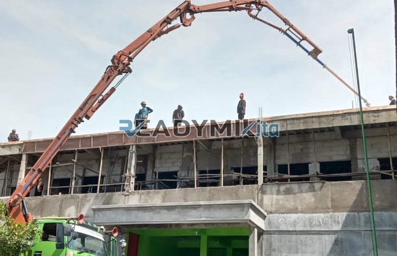

**Tempat Sewa Belalai Cor di Johar Baru Jakarta Harian** - Hai Mitra Readymix Kita! Gimana kabarnya? Punya proyek konstruksi di Johar Baru Jakarta yang butuh percepatan? Kami mengerti betul, efisiensi waktu dan biaya itu krusial banget. Nah, ReadymixKita hadir sebagai solusi tepat untuk kelancaran pengecoran beton Anda. Kami menyediakan layanan sewa belalai cor harian dengan operator berpengalaman, siap mendukung kesuksesan proyek Anda di Johar Baru Jakarta dan sekitarnya.



## Kenalan Dekat dengan Belalai Cor: Apa Itu dan Apa Saja Keunggulannya?

Concrete pump, atau yang lebih dikenal dengan sebutan belalai cor, adalah alat modern yang dirancang untuk memindahkan beton segar dari truk mixer langsung ke area pengecoran melalui sistem perpipaan. Alat ini sangat ideal untuk proyek-proyek dengan akses terbatas atau ketinggian tertentu yang sulit dijangkau secara manual. Mengapa belalai cor jadi pilihan cerdas? Yuk, simak keunggulannya:

1. **Pengecoran Lebih Cepat dan Efisien**

   Dibandingkan cara manual, belalai cor mempercepat proses pengecoran secara signifikan. Beton dipompa langsung ke titik yang dibutuhkan, mengurangi tenaga kerja dan waktu pengerjaan.

2. **Presisi Tanpa Tanding**

   Belalai cor memastikan aliran beton yang akurat dan terkontrol, ideal untuk struktur horizontal maupun vertikal seperti lantai, kolom, dan dinding. Hasilnya? Pengecoran lebih rapi dan presisi.

3. **Menaklukkan Lokasi yang Sulit**

   Dengan selang yang fleksibel, belalai cor mampu menjangkau area yang menantang, seperti lorong sempit, belakang bangunan, atau lantai atas gedung bertingkat.

4. **Kapasitas Besar untuk Proyek Skala Apa Pun**

   Belalai cor mampu menangani volume beton yang besar dalam waktu singkat, cocok untuk proyek kecil maupun besar.

## Kenapa Harus Sewa Belalai Cor di ReadymixKita?

Di tengah banyaknya penyedia jasa sewa pompa beton, **ReadymixKita** hadir dengan keunggulan yang membedakan kami:

1. **Pengalaman dan Kredibilitas Teruji**

   Kami telah berpengalaman menangani beragam proyek konstruksi di Johar Baru Jakarta dan sekitarnya, serta memiliki reputasi baik di mata klien. Tim kami terdiri dari operator terlatih dan profesional yang menjamin kelancaran proses pengecoran.

2. **Pilihan Concrete Pump yang Beragam**

   Kami menyediakan berbagai jenis concrete pump yang dapat disesuaikan dengan kebutuhan proyek Anda, antara lain:
   - **Mini Pump**: Ideal untuk proyek rumah tinggal dan area terbatas.
   - **Standard Pump**: Cocok untuk proyek menengah hingga besar.
   - **Long Boom Pump**: Dirancang khusus untuk proyek yang membutuhkan jangkauan tinggi dan jarak jauh.

3. **Perawatan Rutin untuk Kinerja Optimal**

   Kami melakukan perawatan berkala terhadap seluruh unit pompa beton untuk memastikan kinerjanya selalu optimal. Hal ini memberikan Anda jaminan dan ketenangan pikiran selama proses pengecoran.

4. **Layanan Profesional dan Responsif**

   Kami tidak hanya menyediakan peralatan, tetapi juga operator berpengalaman yang mendampingi Anda dari awal hingga akhir proses pengecoran. Kami siap memberikan solusi dan dukungan teknis kapan saja Anda membutuhkannya.

## Layanan Sewa Belalai Cor yang Terpercaya di Johar Baru Jakarta

Sebagai penyedia lokal, kami memahami seluk-beluk proyek konstruksi di Johar Baru Jakarta. Berikut keunggulan kami:

1. **Akses Cepat dan Mudah**

   Lokasi strategis kami memungkinkan kami memberikan layanan cepat ke seluruh wilayah Johar Baru Jakarta, baik pusat kota maupun area permukiman.

2. **Memahami Kontur dan Karakteristik Lokal**

   Dengan pengalaman bekerja di Johar Baru Jakarta, kami memahami tantangan unik seperti kondisi tanah yang berbeda atau kepadatan lalu lintas. Kami siap memberikan solusi yang paling sesuai dengan kebutuhan Anda.

3. **Harga Kompetitif untuk Proyek Anda**

   Kami menawarkan harga sewa yang bersaing tanpa mengorbankan kualitas layanan, menjadikan kami pilihan yang tepat untuk anggaran proyek Anda.

## Penawaran Harga Terbaik dan Promo Spesial di Johar Baru Jakarta

Kami memahami bahwa anggaran adalah pertimbangan penting dalam setiap proyek. Karena itu, kami menawarkan:

1. **Harga Transparan dan Jelas**

   Kami memberikan rincian harga sewa pompa beton secara transparan, termasuk biaya operator dan bahan bakar. Tidak ada biaya tersembunyi yang akan membuat Anda terkejut.

2. **Diskon dan Program Loyalitas**

   Nikmati diskon menarik untuk penyewaan jangka panjang atau pemesanan volume besar. Kami juga memiliki program loyalitas khusus untuk pelanggan setia di wilayah Johar Baru Jakarta.

3. **Konsultasi Gratis untuk Penentuan Alat yang Tepat**

   Bingung memilih jenis pompa beton yang sesuai? Tim ahli kami siap memberikan konsultasi gratis untuk membantu Anda menentukan solusi terbaik untuk proyek Anda.

## Daftar Harga Sewa Belalai Cor di Johar Baru Jakarta



Jangan biarkan kesulitan pengecoran menghambat kelancaran proyek Anda. Hubungi ReadymixKita sekarang juga untuk mendapatkan penawaran harga terbaik dan layanan sewa belalai cor unggulan di Johar Baru Jakarta!

Kami juga menyediakan layanan survei lokasi dan konsultasi gratis untuk memastikan kebutuhan Anda terpenuhi sepenuhnya. Segera pesan dan rasakan efisiensi, kecepatan, dan presisi dalam setiap pengecoran beton Anda. Percayakan pada ReadymixKita – solusi cerdas untuk hasil konstruksi yang sempurna! [Tempat Sewa Belalai Cor di Ancol Jakarta Harian](/pompa/tempat-sewa-belalai-cor-di-ancol-jakarta-harian/) — pastikan Anda mendapatkan solusi pengecoran yang tepat untuk setiap proyek, dengan dukungan dari tim profesional kami.