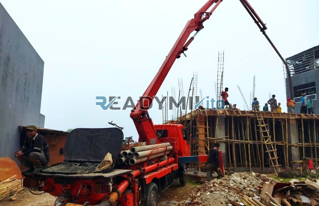

**Tempat Sewa Belalai Cor di Kalibaru Jakarta Harian** - Hai Mitra Readymix Kita! Punya proyek konstruksi di Kalibaru Jakarta yang butuh solusi pengecoran cepat dan tepat? Nah, Anda berada di tempat yang tepat! Kami dari ReadymixKita hadir sebagai penyedia jasa sewa concrete pump terpercaya, siap mendukung kelancaran proyek Anda.



## Kenali Lebih Dekat: Apa Itu Belalai Cor dan Manfaatnya?

Concrete pump, atau yang lebih dikenal dengan sebutan “belalai cor”, adalah alat vital dalam dunia konstruksi modern. Fungsinya sederhana: memindahkan beton cair dari *batching plant* atau *mixer truck* langsung ke titik pengecoran melalui jaringan pipa. Tapi manfaatnya luar biasa! Terutama untuk proyek di Kalibaru Jakarta yang seringkali memiliki tantangan aksesibilitas. Mari kita lihat apa saja keunggulannya:

1. **Hemat Waktu & Tenaga**

   Dengan concrete pump, proses pengecoran jadi jauh lebih cepat dibandingkan metode manual. Kurangi jam kerja dan biaya operasional proyek Anda!

2. **Presisi Tak Tertandingi**

   Alat ini memastikan beton dituangkan dengan akurat, ideal untuk membentuk struktur yang kompleks seperti kolom, balok, atau lantai.

3. **Solusi Cerdas untuk Lokasi Sulit**

   Punya proyek dengan akses terbatas? Belalai cor dengan pipa fleksibelnya mampu menjangkau area sempit, belakang bangunan, atau bahkan lantai tinggi.

4. **Tangani Volume Besar dengan Mudah**

   Baik proyek kecil maupun besar, concrete pump mampu memompa volume beton yang dibutuhkan dalam waktu singkat.

## Mengapa Memilih ReadymixKita untuk Sewa Concrete Pump di Kalibaru Jakarta?

Banyak penyedia jasa serupa, tapi ReadymixKita menawarkan lebih dari sekadar penyewaan alat. Kami hadir sebagai mitra terpercaya yang memahami kebutuhan spesifik proyek Anda di Kalibaru Jakarta:

1. **Reputasi Solid & Pengalaman Teruji**

   Kami telah berhasil menyelesaikan banyak proyek konstruksi di Kalibaru Jakarta dengan rekam jejak yang memuaskan. Operator kami berpengalaman dan terlatih.

2. **Pilihan Concrete Pump yang Lengkap**

   Kami menyediakan beragam tipe concrete pump untuk menyesuaikan kebutuhan proyek Anda:
   - **Mini Pump**: Cocok untuk proyek skala kecil di area perumahan, akses terbatas.
   - **Standard Pump**: Ideal untuk proyek sedang dan besar.
   - **Long Boom Pump**: Sempurna untuk jangkauan vertikal tinggi atau area yang sulit dijangkau.

3. **Perawatan Berkala, Performa Optimal**

   Semua unit concrete pump kami menjalani perawatan rutin. Jaminan performa maksimal sehingga Anda tidak perlu khawatir dengan kendala teknis.

4. **Layanan Profesional & Responsif**

   Kami tidak hanya menyediakan alat, tetapi juga operator berpengalaman yang siap membantu kelancaran proses pengecoran Anda.

## Keunggulan Layanan Kami di Kalibaru Jakarta: Memahami Kebutuhan Lokal

Sebagai penyedia lokal di Kalibaru Jakarta, kami punya keunggulan yang tidak dimiliki kompetitor lain:

1. **Akses Cepat & Mudah**

   Lokasi strategis kami memungkinkan kami memberikan layanan cepat ke seluruh wilayah Kalibaru Jakarta, dari pusat kota hingga daerah pinggiran.

2. **Pengetahuan Mendalam Tentang Kondisi Lokal**

   Pengalaman kami melayani proyek di Kalibaru Jakarta membuat kami memahami tantangan unik di area ini. Kami siap memberikan solusi yang tepat.

3. **Harga Kompetitif**

   Kami menawarkan harga sewa yang bersaing, tanpa mengorbankan kualitas layanan. Solusi hemat biaya untuk proyek Anda.

## Harga Terjangkau & Penawaran Spesial untuk Proyek di Kalibaru Jakarta

Kami memahami bahwa pengelolaan anggaran adalah prioritas utama. Oleh karena itu, kami menawarkan:

1. **Harga Transparan & Jelas**

   Dapatkan rincian harga lengkap, termasuk biaya sewa, operator, dan bahan bakar. Tanpa biaya tambahan tersembunyi.

2. **Diskon & Promo Menarik**

   Nikmati diskon khusus untuk sewa jangka panjang atau pemesanan volume besar. Penawaran spesial juga tersedia untuk proyek di wilayah Kalibaru Jakarta.

3. **Konsultasi Gratis**

   Bingung memilih jenis concrete pump yang tepat? Tim kami siap memberikan konsultasi gratis untuk membantu Anda menemukan solusi terbaik.

## Daftar Harga Sewa Belalai Cor di Kalibaru Jakarta



Jangan biarkan proses pengecoran menjadi kendala dalam proyek Anda. Percayakan pada ReadymixKita, penyedia jasa sewa concrete pump terpercaya di Kalibaru Jakarta!

Kami juga menawarkan layanan survei lokasi dan konsultasi gratis. Segera hubungi kami untuk mendapatkan penawaran terbaik dan wujudkan proyek impian Anda dengan cepat dan efisien.

Dengan pengalaman, dedikasi terhadap kualitas, dan komitmen terhadap kepuasan pelanggan, ReadymixKita adalah partner ideal untuk proyek konstruksi Anda di Kalibaru Jakarta. Hubungi kami sekarang juga! [anchor text](URL) — mempelajari lebih lanjut tentang solusi beton readymix kami dapat membantu proyek Anda lebih sukses. Segera hubungi kami dan buktikan keunggulan layanan kami! [anchor text](URL) — artikel tentang sewa pompa beton di Ancol Jakarta juga bisa memberikan Anda wawasan tambahan.