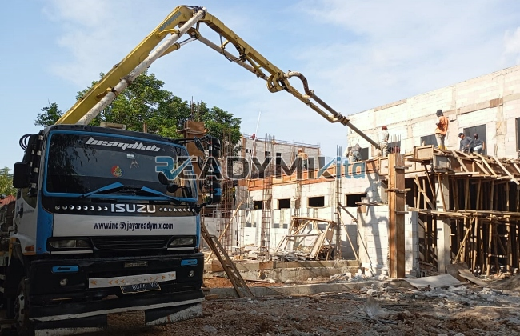

**Tempat Sewa Belalai Cor di Kalimulya Depok Harian** - Hai Mitra Readymix Kita! Pembangunan di Kalimulya Depok semakin menggeliat, ya? Proyek-proyek baru bermunculan, dan efisiensi menjadi kunci keberhasilan. Nah, kami dari ReadymixKita hadir dengan solusi tepat: layanan penyewaan concrete pump yang akan memperlancar pekerjaan pengecoran Anda.

Mengapa memilih penyewaan concrete pump? Karena kami paham betul, waktu dan tenaga adalah aset berharga dalam setiap proyek konstruksi di Kalimulya Depok. Mari kita bahas lebih lanjut bagaimana ReadymixKita dapat membantu Anda.



## Mengenal Concrete Pump: Alat Penting untuk Pengecoran Modern

Concrete pump, atau yang sering disebut belalai cor, adalah mesin canggih yang digunakan untuk memompa beton cair langsung ke lokasi pengecoran. Alat ini sangat ideal untuk proyek-proyek di Kalimulya Depok yang membutuhkan efisiensi tinggi, terutama ketika akses ke lokasi pengecoran terbatas atau memerlukan ketinggian tertentu. Berikut beberapa keunggulan utama dari concrete pump:

1. **Kecepatan dan Efisiensi Pengecoran**

   Lupakan metode manual yang lambat! Concrete pump mempercepat proses pengecoran secara signifikan, memangkas waktu kerja dan biaya operasional.

2. **Presisi dalam Penempatan Beton**

   Dengan operator terlatih, belalai cor memastikan beton dituangkan secara akurat ke area yang ditargetkan – baik itu struktur horizontal maupun vertikal seperti lantai, kolom, dan dinding.

3. **Mengatasi Tantangan Akses**

   Sulit menjangkau area sempit, belakang gedung, atau lantai tinggi? Concrete pump dengan selang yang fleksibel dapat mengatasi tantangan tersebut dengan mudah.

4. **Kapasitas Pengecoran Tinggi**

   Baik untuk proyek kecil maupun besar, concrete pump mampu memompa volume beton yang signifikan dalam waktu singkat.

## Mengapa ReadymixKita adalah Pilihan Terbaik Anda?

Di tengah banyaknya penyedia jasa sewa concrete pump, **ReadymixKita** menawarkan keunggulan yang membedakan kami dari yang lain:

1. **Pengalaman Terpercaya di Kalimulya Depok**

   Kami telah berhasil menangani berbagai proyek konstruksi di Kalimulya Depok, membangun reputasi sebagai mitra yang andal dan profesional.

2. **Pilihan Concrete Pump yang Lengkap**

   Kami menyediakan beragam tipe concrete pump untuk menyesuaikan dengan kebutuhan spesifik proyek Anda, termasuk:
   - **Mini Pump**: Ideal untuk proyek rumah tangga dan area terbatas.
   - **Standard Pump**: Solusi serbaguna untuk proyek menengah dan besar.
   - **Long Boom Pump**: Pilihan tepat untuk proyek dengan jangkauan tinggi dan horizontal yang luas.

3. **Perawatan Berkala untuk Kinerja Optimal**

   Setiap unit concrete pump kami menjalani perawatan berkala yang ketat untuk menjamin kinerja optimal di lapangan, sehingga Anda dapat fokus pada penyelesaian proyek tanpa khawatir gangguan teknis.

4. **Layanan Profesional dan Operator Terlatih**

   Kami tidak hanya menyediakan mesin, tetapi juga operator berpengalaman yang akan memastikan proses pengecoran berjalan lancar dan efisien.

## Keunggulan Lokal: Memahami Kebutuhan Kalimulya Depok

Sebagai penyedia lokal, ReadymixKita memiliki pemahaman mendalam tentang karakteristik proyek konstruksi di Kalimulya Depok. Ini memberikan kami keunggulan dalam:

1. **Respon Cepat dan Akses Mudah**

   Lokasi strategis kami memungkinkan kami memberikan layanan cepat ke seluruh wilayah Kalimulya Depok, baik di pusat kota maupun area pinggiran.

2. **Pengetahuan tentang Kondisi Lokal**

   Kami memahami tantangan unik di Kalimulya Depok, seperti medan berbukit atau akses jalan yang terbatas, dan siap memberikan solusi yang tepat.

3. **Harga Bersaing dengan Kualitas Terbaik**

   Kami menawarkan harga sewa concrete pump yang kompetitif tanpa mengorbankan kualitas layanan, menjadikan kami pilihan ekonomis untuk proyek Anda.

## Harga Terjangkau dan Penawaran Menarik di Kalimulya Depok

Kami menyadari bahwa anggaran adalah pertimbangan penting dalam setiap proyek. Karena itu, kami menawarkan:

1. **Transparansi Harga**

   Kami memberikan rincian harga sewa yang jelas, termasuk biaya operator dan bahan bakar – tanpa biaya tersembunyi.

2. **Diskon dan Promo Spesial**

   Manfaatkan diskon menarik untuk penyewaan jangka panjang atau pesanan dalam jumlah besar. Kami juga menyediakan penawaran khusus untuk proyek di Kalimulya Depok.

3. **Konsultasi Gratis**

   Bingung memilih tipe concrete pump yang tepat? Tim ahli kami siap memberikan konsultasi gratis untuk membantu Anda menemukan solusi terbaik.

## Daftar Harga Sewa Belalai Cor di Kalimulya Depok



Jangan biarkan kendala pengecoran menghambat kemajuan proyek Anda! Hubungi kami sekarang juga untuk mendapatkan layanan penyewaan concrete pump berkualitas di Kalimulya Depok.

Kami menyediakan layanan survei lokasi gratis dan konsultasi ahli untuk memastikan kebutuhan Anda terpenuhi secara optimal. Pesan sekarang dan rasakan efisiensi pengecoran yang tak tertandingi.

ReadymixKita adalah mitra terpercaya untuk kesuksesan proyek konstruksi Anda di Kalimulya Depok. Dengan pengalaman, kualitas layanan, dan komitmen terhadap kepuasan pelanggan, kami siap mewujudkan proyek impian Anda menjadi kenyataan. Jangan ragu untuk menghubungi kami dan buktikan sendiri keunggulan layanan kami! [Tempat Sewa Belalai Cor di Abadijaya Depok Harian](/pompa/tempat-sewa-belalai-cor-di-abadijaya-depok-harian/) mungkin bisa jadi alternatif kalau Anda juga mengerjakan proyek di sana.