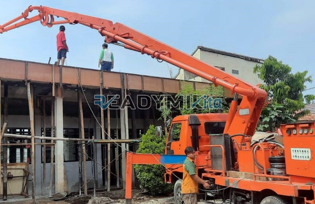

**Tempat Sewa Belalai Cor di Kampung Rawa Jakarta Harian** - Hai Mitra Readymix Kita! Sedang merencanakan proyek konstruksi di Kampung Rawa Jakarta? Butuh solusi pengecoran beton yang cepat, efisien, dan bisa diandalkan? Nah, Anda berada di tempat yang tepat! ReadymixKita hadir sebagai penyedia jasa sewa concrete pump (belalai cor) yang siap mendukung kelancaran pembangunan Anda. Dari proyek kecil hingga besar, kami punya solusinya.



## Apa Itu Belalai Cor dan Mengapa Penting?

Concrete pump – atau yang sering disebut belalai cor – adalah alat modern yang dirancang khusus untuk memindahkan beton cair dari truk mixer langsung ke lokasi pengecoran menggunakan jaringan pipa. Alat ini menjadi semakin vital di tengah pembangunan pesat di Kampung Rawa Jakarta, terutama untuk proyek-proyek dengan akses terbatas atau kebutuhan ketinggian tertentu. Apa saja keunggulannya? Simak daftarnya:

1. **Hemat Waktu dan Tenaga Kerja**

   Dibandingkan metode manual, concrete pump mempercepat proses pengecoran secara signifikan. Pemindahan beton cair jadi lebih cepat dan membutuhkan lebih sedikit pekerja.

2. **Presisi Tingkat Tinggi**

   Alat ini memastikan penempatan material yang akurat, baik untuk struktur horizontal maupun vertikal seperti lantai, kolom, dan dinding.

3. **Solusi untuk Lokasi Sulit**

   Dengan pipa yang fleksibel, concrete pump dapat menjangkau area-area sulit, seperti gang sempit, belakang gedung, atau bahkan lantai bangunan bertingkat.

4. **Kapasitas Besar untuk Berbagai Skala Proyek**

   Mampu menangani volume material yang besar, concrete pump ideal untuk proyek kecil, menengah, maupun besar.

## Mengapa ReadymixKita adalah Pilihan Terbaik di Kampung Rawa Jakarta?

Banyak penyedia sewa concrete pump di luar sana, lho. Tapi, apa yang membedakan ReadymixKita? Ini dia beberapa alasannya:

1. **Pengalaman dan Kepercayaan Pelanggan**

   Kami punya rekam jejak yang solid dalam melayani berbagai proyek konstruksi di Kampung Rawa Jakarta. Kepuasan pelanggan adalah prioritas utama kami. Operator kami juga sudah berpengalaman untuk memastikan alat bekerja secara optimal.

2. **Pilihan Concrete Pump yang Lengkap**

   Kami menyediakan berbagai tipe concrete pump yang bisa disesuaikan dengan kebutuhan spesifik proyek Anda:
   - **Mini Pump**: Ideal untuk pekerjaan perumahan atau area dengan akses terbatas.
   - **Standard Pump**: Cocok untuk proyek skala menengah hingga besar.
   - **Long Boom Pump**: Dirancang untuk proyek yang membutuhkan jangkauan horizontal atau vertikal yang lebih jauh.

3. **Perawatan Berkala untuk Performa Optimal**

   Semua unit concrete pump kami menjalani perawatan rutin untuk menjamin performa dan keandalannya. Anda tidak perlu khawatir tentang gangguan teknis saat pengecoran.

4. **Layanan Profesional dan Responsif**

   Kami tidak hanya menawarkan perangkat, tapi juga menyediakan operator berpengalaman yang siap membantu kelancaran proses pengecoran dari awal hingga akhir.

## Keunggulan Memilih Jasa Kami di Kampung Rawa Jakarta

Sebagai penyedia lokal, kami memahami betul tantangan dan kebutuhan konstruksi di Kampung Rawa Jakarta. Berikut beberapa keunggulan yang bisa Anda rasakan:

1. **Respon Cepat dan Akses Mudah**

   Dengan lokasi strategis, kami dapat memberikan layanan cepat ke seluruh area Kampung Rawa Jakarta, baik di pusat kota maupun daerah pinggiran.

2. **Pengetahuan Mendalam tentang Kondisi Lokal**

   Pengalaman kami bekerja di Kampung Rawa Jakarta memungkinkan kami memahami tantangan spesifik seperti kondisi tanah, medan yang berbukit, dan kepadatan lalu lintas. Kami siap memberikan solusi terbaik yang disesuaikan dengan kebutuhan Anda.

3. **Harga Kompetitif dan Terjangkau**

   Kami menawarkan harga yang bersaing tanpa mengorbankan kualitas layanan. Kami adalah pilihan cerdas untuk memaksimalkan anggaran proyek Anda.

## Harga Terjangkau dan Penawaran Menarik di Kampung Rawa Jakarta

Kami sadar bahwa anggaran adalah pertimbangan penting dalam setiap proyek. Karena itu, kami menawarkan:

1. **Harga Transparan dan Jelas**

   Anda akan mendapatkan rincian harga sewa yang lengkap, termasuk biaya operator dan bahan bakar. Tidak ada biaya tersembunyi yang akan mengejutkan Anda.

2. **Diskon dan Promo Spesial**

   Nikmati diskon menarik untuk sewa jangka panjang atau pesanan dalam jumlah besar. Kami juga menawarkan promo khusus untuk proyek-proyek di Kampung Rawa Jakarta.

3. **Konsultasi Gratis untuk Solusi Terbaik**

   Bingung memilih jenis concrete pump yang tepat? Jangan ragu untuk berkonsultasi dengan tim kami secara gratis! Kami akan membantu Anda menemukan solusi terbaik sesuai dengan kebutuhan proyek Anda.

## Daftar Harga Sewa Belalai Cor di Kampung Rawa Jakarta



Jangan biarkan kendala pengecoran menghambat kelancaran proyek Anda. Segera hubungi kami untuk layanan sewa belalai cor berkualitas di Kampung Rawa Jakarta!

Kami juga menawarkan layanan survei lokasi dan konsultasi gratis untuk memastikan semua kebutuhan Anda terpenuhi dengan baik. Pesan sekarang dan rasakan kemudahan konstruksi yang cepat, efisien, dan memuaskan.

Proyek yang sukses membutuhkan alat yang tepat. Dengan layanan sewa belalai cor dari ReadymixKita, Anda bisa mencapai target proyek dengan lebih efektif, efisien, dan akurat. Hubungi kami sekarang juga untuk layanan sewa alat cor unggulan di Kampung Rawa Jakarta. Pilihan terbaik untuk hasil yang sempurna! [Tempat Sewa Belalai Cor di Ancol Jakarta Harian](/pompa/tempat-sewa-belalai-cor-di-ancol-jakarta-harian/) — Cek juga layanan kami untuk proyek di Ancol Jakarta.