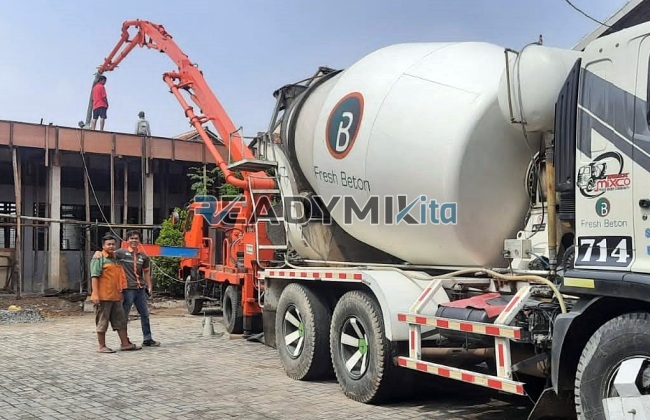

**Tempat Sewa Belalai Cor di Kebon Kosong Jakarta Harian** - Hai Mitra Readymix Kita! Punya proyek konstruksi di Kebon Kosong Jakarta yang butuh solusi pengecoran cepat dan efisien? Nah, Anda datang ke tempat yang tepat! Kami dari ReadymixKita hadir sebagai solusi terpercaya untuk kelancaran proyek Anda.

Proses konstruksi seringkali dihadapkan pada tantangan waktu dan akses lokasi. Pengecoran yang lambat atau sulit dijangkau bisa jadi batu sandungan. Tapi tenang, dengan memanfaatkan teknologi Belalai Cor, semua kendala itu bisa diatasi! Proses pengecoran jadi lebih cepat, hemat tenaga, dan hasilnya pun lebih presisi.



## Memahami Belalai Cor: Apa Itu dan Apa Saja Manfaatnya?

Concrete pump, atau yang lebih dikenal dengan Belalai Cor, adalah alat modern yang memindahkan beton cair langsung dari *mixer truck* ke lokasi pengecoran menggunakan pipa. Alat ini adalah solusi ideal untuk proyek dengan akses terbatas, ketinggian tertentu, atau kebutuhan efisiensi yang tinggi. Berikut manfaat utama yang ditawarkan:

1. **Efisiensi Waktu dan Tenaga**

   Bayangkan, proses penuangan beton yang biasanya memakan waktu dan tenaga, kini bisa dilakukan jauh lebih cepat! Belalai Cor mempermudah pemindahan beton cair langsung ke area pengecoran, mengurangi kebutuhan tenaga kerja manual.

2. **Akurasi Hasil Pengecoran**

   Alat ini memastikan beton ditempatkan dengan presisi, baik untuk struktur horizontal maupun vertikal seperti lantai, kolom, atau dinding.

3. **Mengatasi Kendala Akses Lokasi**

   Pipa fleksibel Belalai Cor memungkinkan pengecoran di lokasi yang sulit dijangkau, misalnya gang sempit, belakang bangunan, atau bahkan area bertingkat.

4. **Kapasitas Besar untuk Proyek Skala Apa Pun**

   Dengan kemampuannya mengelola volume beton yang besar, Belalai Cor cocok untuk proyek mulai dari skala kecil hingga yang sangat besar.

## Mengapa Memilih ReadymixKita untuk Penyewaan Concrete Pump?

Di antara banyaknya pilihan penyewaan concrete pump, **ReadymixKita** menawarkan keunggulan yang membedakan kami:

1. **Pengalaman dan Reputasi Teruji**

   Kami telah sukses melayani berbagai proyek konstruksi di Kebon Kosong Jakarta dengan reputasi yang baik. Tim kami yang terlatih dan berpengalaman menjamin alat beroperasi optimal.

2. **Pilihan Concrete Pump yang Beragam**

   Kami menyediakan beragam tipe concrete pump yang bisa disesuaikan dengan kebutuhan proyek Anda:
   - **Mini Pump**: Ideal untuk proyek perumahan atau area dengan ruang terbatas.
   - **Standard Pump**: Cocok untuk proyek dengan skala menengah hingga besar.
   - **Long Boom Pump**: Dirancang untuk proyek yang membutuhkan jangkauan tinggi.

3. **Perawatan Alat yang Rutin dan Terjamin**

   Semua unit Belalai Cor kami dirawat secara berkala untuk memastikan kinerja yang prima di lapangan. Anda bisa tenang tanpa khawatir gangguan teknis mengganggu proses pengecoran.

4. **Layanan Profesional dan Berorientasi Pelanggan**

   Kami tidak hanya menyediakan alat, tapi juga operator berpengalaman untuk menjamin kelancaran proses penuangan dari awal hingga akhir.

## Keunggulan Kami sebagai Penyedia Jasa Lokal di Kebon Kosong Jakarta

Sebagai penyedia lokal, kami memahami betul karakter proyek konstruksi di Kebon Kosong Jakarta. Ini menjadi keunggulan utama yang kami miliki:

1. **Aksesibilitas dan Respon Cepat**

   Lokasi strategis pabrik dan gudang kami memungkinkan kami memberikan layanan cepat ke seluruh wilayah Kebon Kosong Jakarta, baik di area pusat maupun pinggiran.

2. **Pemahaman Kondisi Lapangan**

   Pengalaman bekerja di Kebon Kosong Jakarta membuat kami memahami tantangan spesifik di sini, seperti kontur tanah berbukit atau area padat penduduk. Kami bisa menawarkan solusi terbaik yang sesuai dengan kebutuhan Anda.

3. **Harga yang Kompetitif**

   Kami menawarkan harga sewa yang kompetitif tanpa mengorbankan kualitas layanan, menjadikan kami mitra terbaik untuk proyek konstruksi Anda.

## Penawaran Harga Kompetitif dan Promo Spesial di Kebon Kosong Jakarta

Kami mengerti bahwa anggaran adalah pertimbangan penting dalam setiap proyek. Oleh karena itu, kami menawarkan:

1. **Transparansi Harga**

   Kami akan memberikan rincian harga penyewaan yang jelas, termasuk biaya operator dan bahan bakar. Tidak ada biaya tersembunyi yang mengejutkan.

2. **Diskon dan Promo Menarik**

   Nikmati diskon khusus untuk penyewaan jangka panjang atau pesanan dalam jumlah besar. Kami juga menawarkan promo khusus untuk proyek di Kebon Kosong Jakarta.

3. **Konsultasi Gratis dari Ahlinya**

   Masih bingung memilih tipe Belalai Cor yang tepat? Tim kami siap memberikan konsultasi gratis untuk membantu Anda menemukan solusi terbaik.

## Daftar Harga Sewa Belalai Cor di Kebon Kosong Jakarta



Jangan biarkan kendala pengecoran menghambat kelancaran proyek Anda! Segera hubungi kami untuk layanan penyewaan Belalai Cor terbaik di Kebon Kosong Jakarta.

Kami juga memberikan layanan survei lokasi dan konsultasi gratis untuk memastikan semua kebutuhan Anda terpenuhi. Pesan sekarang dan rasakan efisiensi, ketepatan, dan kepuasan dalam proyek konstruksi Anda.

ReadymixKita adalah partner ideal untuk proyek konstruksi Anda di Kebon Kosong Jakarta berkat pengalaman, kualitas layanan, dan komitmen kami terhadap kepuasan pelanggan. Percayakan kebutuhan penyewaan Belalai Cor Anda kepada kami, dan wujudkan proyek impian Anda dengan hasil yang optimal. Hubungi kami sekarang juga untuk merasakan keunggulan layanan kami! [Tempat Sewa Belalai Cor di Babakan Bogor Harian](/pompa/tempat-sewa-belalai-cor-di-babakan-bogor-harian/) — Perlu solusi pengecoran yang lebih spesifik? Cek artikel kami tentang penyewaan Belalai Cor di Babakan Bogor.