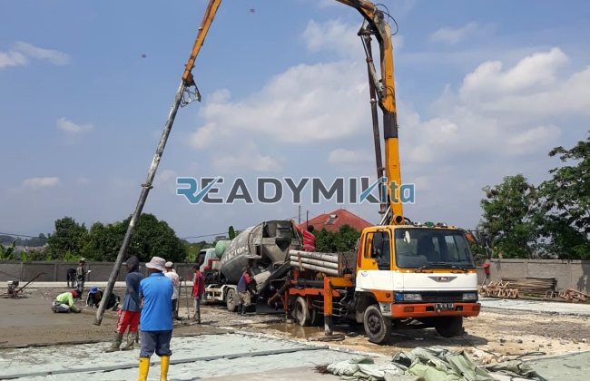

**Tempat Sewa Belalai Cor di Klender Jakarta Harian** - Hai Mitra Readymix Kita! Punya proyek pembangunan di Klender Jakarta yang butuh efisiensi tinggi? Pengecoran yang cepat dan tepat itu kunci utama, kan? Nah, ReadymixKita hadir sebagai solusi cerdas untuk kelancaran proyek Anda. Kami adalah penyedia jasa sewa concrete pump terpercaya di Klender Jakarta dan sekitarnya.

Bagi Anda yang beraktivitas di area Klender Jakarta, ReadymixKita menghadirkan layanan penyewaan belalai cor (concrete pump) untuk berbagai kebutuhan konstruksi. Kami tidak sekadar menyediakan alat, tapi solusi komprehensif yang memastikan proyek Anda berjalan lancar, efisien, dan sesuai target. Gimana, tertarik untuk mempercepat pekerjaan Anda?



## Apa Itu Belalai Cor dan Mengapa Ia Penting?

Concrete pump, atau yang sering disebut belalai cor, adalah mesin modern yang berfungsi memindahkan beton dari *batching plant* atau *mixer truck* langsung ke area pengecoran melalui sistem perpipaan. Alat ini memberikan banyak keuntungan, terutama di proyek dengan akses terbatas atau membutuhkan pengecoran di ketinggian. Ini dia beberapa keunggulannya:

1. **Hemat Waktu dan Tenaga Kerja**

   Dibandingkan metode manual, penggunaan concrete pump mempercepat proses pengecoran secara signifikan. Pindahkan beton cair ke lokasi yang diperlukan tanpa perlu banyak tenaga.

2. **Presisi dalam Pengecoran**

   Alat ini menjamin penempatan material yang akurat, baik untuk struktur horizontal maupun vertikal seperti lantai, kolom, dan dinding. Hasilnya? Pengecoran yang lebih rapi dan kuat.

3. **Solusi untuk Lokasi Sulit**

   Dengan pipa fleksibel, concrete pump dapat menjangkau area yang sulit diakses, seperti gang sempit, area belakang bangunan, atau lantai tinggi.

4. **Kapasitas Besar untuk Skala Apa Pun**

   Concrete pump mampu menangani volume beton yang besar dalam waktu singkat, menjadikannya pilihan ideal untuk proyek kecil maupun besar.

## Mengapa Harus Sewa Belalai Cor dari ReadymixKita?

Di tengah banyaknya penyedia jasa, **ReadymixKita** menawarkan keunggulan yang membedakan kami:

1. **Reputasi Terpercaya dan Berpengalaman**

   Kami telah sukses menangani berbagai proyek konstruksi di Klender Jakarta dan sekitarnya, dengan tingkat kepuasan pelanggan yang tinggi. Operator kami terlatih dan berpengalaman, menjamin pekerjaan yang profesional dan optimal.

2. **Pilihan Concrete Pump yang Lengkap**

   Kami menyediakan beragam jenis concrete pump yang bisa disesuaikan dengan kebutuhan proyek Anda, antara lain:
   - **Mini Pump**: Cocok untuk proyek perumahan atau area terbatas.
   - **Standard Pump**: Ideal untuk proyek skala menengah hingga besar.
   - **Long Boom Pump**:  Dirancang untuk proyek yang membutuhkan jangkauan tinggi atau jarak jauh.

3. **Perawatan Rutin untuk Performa Optimal**

   Semua unit concrete pump kami menjalani perawatan berkala untuk memastikan performa yang handal. Anda pun bisa tenang, tanpa khawatir terjadi kendala teknis selama pengecoran.

4. **Layanan Profesional dan Responsif**

   Kami tidak hanya menyediakan alat, tetapi juga operator berpengalaman yang siap membantu kelancaran proses penuangan, mulai dari persiapan hingga penyelesaian.

## Keunggulan Menyewa Belalai Cor di Klender Jakarta Bersama Kami

Sebagai penyedia jasa lokal, kami memahami betul dinamika proyek di Klender Jakarta:

1. **Akses Cepat dan Mudah**

   Lokasi strategis pabrik dan gudang kami memungkinkan kami memberikan layanan cepat ke seluruh wilayah Klender Jakarta, baik pusat kota maupun daerah pinggiran.

2. **Pemahaman Kondisi Lapangan**

   Kami berpengalaman bekerja di Klender Jakarta dan memahami berbagai tantangan lapangan, seperti kondisi tanah atau akses jalan yang terbatas.  Dengan begitu, kami dapat memberikan solusi yang paling tepat.

3. **Harga yang Bersaing**

   Kami menawarkan harga sewa yang kompetitif tanpa mengorbankan kualitas layanan, menjadikannya pilihan cerdas untuk anggaran proyek Anda. Yuk, bandingkan sendiri!

## Harga Sewa Belalai Cor yang Transparan di Klender Jakarta

Kami percaya transparansi harga itu penting.  Oleh karena itu, kami memberikan:

1. **Rincian Biaya yang Jelas**

   Anda akan menerima rincian harga sewa lengkap, termasuk biaya operator (jika diperlukan) dan bahan bakar. Tidak ada biaya tambahan yang tidak terduga.

2. **Promo dan Diskon*

   Dapatkan diskon menarik untuk sewa jangka panjang atau pemesanan dalam jumlah besar. Kami juga memberikan penawaran khusus untuk proyek di wilayah Klender Jakarta.

3. **Konsultasi Gratis – Cari Tahu Solusi Terbaik!**

   Bingung memilih jenis concrete pump yang tepat? Jangan ragu untuk menghubungi kami dan dapatkan konsultasi gratis dari tim ahli kami.

## Informasi Harga Sewa Belalai Cor di Klender Jakarta



Jangan biarkan kesulitan pengecoran menghambat kemajuan proyek Anda. Hubungi ReadymixKita sekarang dan rasakan kemudahan menyewa belalai cor terbaik di Klender Jakarta!

Kami juga menyediakan layanan survei lokasi gratis untuk memberikan solusi yang paling sesuai dengan kebutuhan Anda. Pesan segera dan nikmati pengecoran yang lebih cepat, efisien, dan berkualitas.

Dengan pengalaman, komitmen terhadap kualitas, dan layanan pelanggan yang unggul, ReadymixKita adalah partner terpercaya Anda untuk proyek konstruksi di Klender Jakarta. Percayakan kebutuhan penyewaan belalai cor Anda kepada kami, dan wujudkan proyek impian Anda dengan hasil yang maksimal. [Tempat Sewa Belalai Cor di Ancol Jakarta Harian](/pompa/tempat-sewa-belalai-cor-di-ancol-jakarta-harian/) Segera hubungi kami untuk informasi lebih lanjut dan penawaran terbaik!