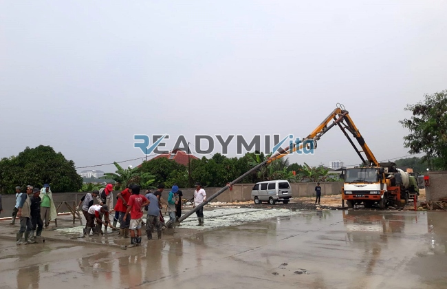

**Tempat Sewa Belalai Cor di Kramat Jakarta Harian** - Hai Mitra Readymix Kita! Punya proyek konstruksi di Kramat Jakarta yang butuh solusi pengecoran cepat dan tepat? Nah, Anda sudah tepat berada di sini! Kami dari ReadymixKita hadir sebagai penyedia layanan sewa concrete pump terpercaya, siap mendukung kelancaran proyek Anda.

Waktu adalah aset berharga dalam setiap proyek konstruksi. Menggunakan concrete pump memungkinkan efisiensi yang signifikan, mengurangi waktu dan tenaga tanpa mengorbankan kualitas pengecoran. Di Kramat Jakarta, ReadymixKita hadir sebagai solusi terbaik untuk memastikan setiap rencana penuangan berjalan sukses dan sesuai harapan.



## Mengenal Belalai Cor: Apa Itu dan Apa Saja Keunggulannya?

Concrete pump, atau yang sering disebut "belalai cor", adalah alat modern yang digunakan untuk memindahkan beton cair dari truk mixer langsung ke lokasi pengecoran melalui sistem pipa. Alat ini sangat ideal untuk berbagai situasi proyek, terutama ketika akses lokasi terbatas atau memerlukan pengecoran pada ketinggian tertentu. Berikut beberapa keunggulan utama dari penggunaan concrete pump:

1. **Efisiensi Waktu dan Tenaga Kerja**

   Dibandingkan metode pengecoran manual, concrete pump mempercepat proses penuangan secara dramatis. Beton cair dipindahkan langsung ke area yang dituju, sehingga mengurangi kebutuhan tenaga kerja dan waktu pengerjaan.

2. **Hasil Pengecoran yang Presisi dan Rata**

   Alat ini memastikan material dituangkan dengan tepat ke area yang diinginkan, baik untuk konstruksi horizontal maupun vertikal seperti lantai, kolom, dan dinding.

3. **Kemampuan Akses ke Lokasi Sulit**

   Dengan bantuan pipa fleksibel, concrete pump mampu mencapai area yang sulit dijangkau secara manual, seperti gang sempit, area belakang bangunan, atau lantai atas.

4. **Kapasitas Pengecoran yang Besar**

   Mampu mengelola volume material yang besar dalam waktu singkat, concrete pump menjadi pilihan tepat untuk proyek konstruksi berskala kecil maupun besar.

## Mengapa Memilih ReadymixKita untuk Sewa Concrete Pump di Kramat Jakarta?

Di antara banyaknya penyedia layanan sewa concrete pump, **ReadymixKita** menawarkan keunggulan yang membedakan kami:

1. **Pengalaman dan Reputasi Terpercaya**

   Kami telah berpengalaman menangani berbagai proyek konstruksi di Kramat Jakarta dan sekitarnya, dengan rekam jejak kepuasan pelanggan yang tinggi. Tim operator kami yang terampil memastikan pengoperasian alat yang efisien dan aman.

2. **Pilihan Concrete Pump yang Beragam**

   Kami menyediakan berbagai jenis concrete pump yang dapat disesuaikan dengan kebutuhan spesifik proyek Anda, termasuk:
   - **Mini Pump**: Ideal untuk proyek perumahan dan area dengan akses terbatas.
   - **Standard Pump**: Cocok untuk proyek skala menengah hingga besar.
   - **Long Boom Pump**: Dirancang untuk proyek yang membutuhkan jangkauan pengecoran yang lebih jauh.

3. **Perawatan Alat yang Berkala dan Terjamin**

   Seluruh unit concrete pump kami menjalani perawatan berkala yang ketat untuk memastikan performa optimal saat digunakan di lapangan. Ini memberikan Anda jaminan dan ketenangan pikiran selama proses pengecoran.

4. **Layanan Profesional dan Responsif**

   Kami tidak hanya menyewakan alat, tetapi juga menyediakan operator berpengalaman yang siap membantu kelancaran proses pengecoran dari awal hingga akhir.

## Keunggulan Memilih Layanan Kami di Kramat Jakarta

Sebagai penyedia layanan lokal, kami memahami betul karakteristik dan tantangan konstruksi di Kramat Jakarta. Berikut beberapa keunggulan utama kami:

1. **Akses Mudah dan Respons Cepat**

   Lokasi strategis gudang dan armada kami memungkinkan kami memberikan layanan cepat dan efisien ke seluruh wilayah Kramat Jakarta, baik pusat kota maupun daerah pinggiran.

2. **Pemahaman Mendalam tentang Kondisi Lokal**

   Dengan pengalaman bekerja di Kramat Jakarta, kami memahami tantangan spesifik seperti kondisi medan yang bervariasi dan kepadatan lalu lintas. Ini memungkinkan kami memberikan solusi yang paling sesuai dengan kebutuhan Anda.

3. **Harga Kompetitif dan Terjangkau**

   Kami menawarkan harga sewa yang kompetitif tanpa mengorbankan kualitas layanan, menjadikan kami solusi yang tepat untuk anggaran proyek Anda.

## Harga Sewa Concrete Pump yang Bersaing dan Penawaran Spesial di Kramat Jakarta

Kami memahami bahwa anggaran merupakan pertimbangan penting dalam setiap proyek. Oleh karena itu, kami menawarkan:

1. **Rincian Harga yang Transparan**

   Kami memberikan rincian harga sewa yang jelas dan transparan, termasuk biaya operator, bahan bakar, dan biaya tambahan lainnya. Tidak ada biaya tersembunyi yang akan Anda temui.

2. **Promo dan Diskon Menarik**

   Nikmati diskon khusus untuk penyewaan jangka panjang atau pemesanan dalam jumlah besar. Kami juga menawarkan promo-promo menarik khusus untuk proyek di wilayah Kramat Jakarta.

3. **Konsultasi Gratis untuk Penentuan Unit yang Tepat**

   Bingung memilih jenis concrete pump yang paling sesuai untuk proyek Anda? Tim ahli kami siap memberikan konsultasi gratis untuk membantu Anda menentukan solusi terbaik.

## Cek Daftar Harga Sewa Belalai Cor Terbaru di Kramat Jakarta



Jangan biarkan kendala pengecoran menghambat kelancaran proyek Anda. Hubungi ReadymixKita sekarang juga untuk mendapatkan layanan sewa concrete pump terbaik di Kramat Jakarta!

Kami juga menyediakan layanan survei lokasi gratis dan konsultasi untuk memastikan semua kebutuhan Anda terpenuhi. Pesan sekarang dan rasakan efisiensi, kecepatan, serta hasil konstruksi yang memuaskan.

Dengan pengalaman, komitmen terhadap kepuasan pelanggan, dan kualitas layanan yang terjamin, ReadymixKita adalah mitra terpercaya untuk proyek konstruksi Anda di Kramat Jakarta. Percayakan kebutuhan penyewaan Belalai Cor Anda kepada kami, dan wujudkan proyek impian Anda dengan hasil yang optimal. Segera hubungi kami untuk penawaran terbaik! [Tempat Sewa Belalai Cor di Ancol Jakarta Harian](/pompa/tempat-sewa-belalai-cor-di-ancol-jakarta-harian/)