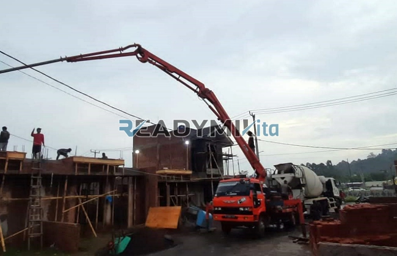

**Tempat Sewa Belalai Cor di Kresek Tangerang Harian** - Hai Mitra Readymix Kita! Pembangunan di Kresek Tangerang semakin pesat, kan? Nah, kami dari ReadymixKita hadir sebagai solusi untuk memperlancar proyek konstruksi Anda. Kami menyediakan jasa penyewaan concrete pump yang handal dan efisien, membantu Anda menyelesaikan pengecoran dengan cepat dan mutu terjamin.

Lalu, apa yang membuat ReadymixKita menjadi pilihan utama di Kresek Tangerang? Yuk, simak penjelasannya!



## Concrete Pump: Solusi Cerdas untuk Pengecoran Modern

Concrete pump, atau yang sering disebut belalai cor, adalah alat mutakhir yang digunakan untuk memompa beton cair langsung ke lokasi pengecoran melalui jaringan pipa. Teknologi ini sungguh bermanfaat, lho, terutama untuk proyek-proyek dengan akses terbatas atau yang membutuhkan ketinggian tertentu. Apa saja keunggulannya?

1. **Hemat Waktu dan Biaya Tenaga**

   Dibandingkan cara manual, concrete pump mempercepat proses pengecoran secara signifikan. Pengurangan kebutuhan tenaga kerja membuat biaya operasional proyek lebih efisien.

2. **Presisi Tingkat Tinggi**

   Alat ini memastikan beton dituangkan dengan akurat ke titik yang diinginkan, baik untuk struktur horizontal maupun vertikal seperti lantai, kolom, atau dinding.

3. **Jangkauan Luas Bahkan di Lokasi Sulit**

   Berkat pipa yang fleksibel, concrete pump bisa menjangkau area yang sulit diakses, seperti gang sempit, belakang bangunan, atau lantai tinggi.

4. **Kapasitas Cairan yang Besar**

   Mampu menangani volume beton yang besar dalam waktu singkat, menjadikannya ideal untuk proyek berskala kecil maupun besar.

## Kenapa Harus Menyewa Concrete Pump dari ReadymixKita?

Di antara banyaknya penyedia jasa penyewaan concrete pump di Kresek Tangerang, ReadymixKita punya beberapa keunggulan yang membedakannya:

1. **Pengalaman dan Kepercayaan Pelanggan**

   Kami telah sukses menangani berbagai proyek konstruksi di Kresek Tangerang, membangun reputasi yang solid akan kualitas dan keandalan. Tim kami terdiri dari operator berpengalaman yang siap memberikan hasil terbaik.

2. **Pilihan Concrete Pump yang Lengkap**

   Kami menyediakan berbagai jenis concrete pump untuk menyesuaikan dengan kebutuhan proyek Anda:
   - **Mini Pump**: Sangat cocok untuk proyek rumah tinggal atau lokasi dengan akses terbatas.
   - **Standard Pump**: Ideal untuk proyek skala menengah hingga besar.
   - **Long Boom Pump**: Dirancang untuk proyek yang membutuhkan jangkauan horizontal atau vertikal yang tinggi.

3. **Perawatan Alat yang Rutin dan Terjamin**

   Setiap unit concrete pump kami menjalani pemeriksaan berkala untuk memastikan performa optimal di lapangan. Ini berarti Anda tak perlu khawatir dengan masalah teknis saat pengecoran.

4. **Layanan Profesional dan Ramah**

   Kami tidak hanya menyediakan perangkat, tetapi juga operator yang berpengalaman untuk memastikan proses penuangan berjalan lancar dari awal hingga selesai.

## Keunggulan ReadymixKita untuk Proyek di Kresek Tangerang

Sebagai penyedia lokal, kami memahami betul karakteristik proyek di Kresek Tangerang. Berikut kelebihan utama yang kami tawarkan:

1. **Akses Cepat dan Mudah**

   Lokasi strategis kami memungkinkan kami memberikan layanan cepat ke seluruh wilayah Kresek Tangerang, mulai dari pusat kota hingga area pinggiran.

2. **Pemahaman Mendalam tentang Kondisi Lokal**

   Dengan pengalaman bekerja di Kresek Tangerang, kami memahami tantangan spesifik seperti kontur tanah yang bervariasi dan kondisi lingkungan yang padat. Ini memungkinkan kami memberikan solusi terbaik sesuai kebutuhan Anda.

3. **Harga yang Bersaing**

   Kami menawarkan harga yang terjangkau tanpa mengorbankan kualitas layanan, menjadikannya pilihan yang cerdas untuk proyek konstruksi Anda.

## Penawaran Harga Terbaik dan Promo Menarik di Kresek Tangerang

Kami mengerti bahwa harga adalah pertimbangan penting dalam setiap proyek. Oleh karena itu, kami menawarkan:

1. **Harga yang Jelas dan Transparan**

   Kami akan memberikan rincian biaya sewa alat secara detail, termasuk biaya operator (jika diperlukan) dan bahan bakar. Tidak ada biaya tambahan yang tersembunyi.

2. **Diskon dan Penawaran Spesial**

   Dapatkan diskon menarik untuk penyewaan jangka panjang atau pemesanan dalam jumlah besar. Kami juga menawarkan promo khusus untuk proyek yang berlokasi di Kresek Tangerang.

3. **Konsultasi Gratis**

   Bingung memilih jenis concrete pump yang tepat? Jangan ragu untuk berkonsultasi dengan tim kami secara gratis! Kami akan membantu Anda menemukan solusi terbaik untuk proyek Anda.

## Daftar Harga Sewa Belalai Cor di Kresek Tangerang



Jangan tunda lagi! Segera hubungi kami untuk mendapatkan layanan penyewaan concrete pump terbaik di Kresek Tangerang.

Kami juga menyediakan layanan survei lokasi dan konsultasi gratis untuk memastikan semua kebutuhan pengecoran Anda terpenuhi dengan sempurna. Pesan sekarang dan nikmati proses konstruksi yang efisien, cepat, dan memuaskan. 

ReadymixKita adalah mitra terpercaya Anda untuk proyek konstruksi di Kresek Tangerang. Kami berdedikasi untuk memberikan kualitas layanan terbaik dan memastikan kepuasan pelanggan. Percayakan kebutuhan penyewaan Belalai Cor Anda kepada kami, dan wujudkan proyek impian Anda dengan hasil yang optimal! Hubungi kami sekarang dan rasakan perbedaannya.