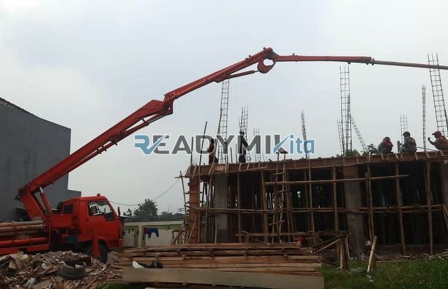

**Tempat Sewa Belalai Cor di Lebak Bulus Jakarta Harian** - Hai Mitra Readymix Kita! Melakukan konstruksi seringkali menghadirkan tantangan tersendiri, ya? Akses lokasi terbatas dan proses penuangan yang memakan waktu adalah masalah umum. Nah, di ReadymixKita, kami punya solusinya! Kami hadir di Lebak Bulus Jakarta untuk mendukung kelancaran proyek Anda dengan efisiensi dan ketepatan waktu yang lebih baik.

Untuk Anda yang berlokasi di Lebak Bulus Jakarta, kami menyediakan jasa penyewaan pompa beton (concrete pump) untuk berbagai kebutuhan konstruksi. Kami bukan sekadar penyedia alat, tapi juga mitra yang siap memastikan proyek Anda berjalan lancar dan sesuai rencana.



## Apa Sebenarnya Belalai Cor Itu, dan Apa Kelebihannya?

Pompa beton, atau yang lebih dikenal dengan istilah “belalai cor”, adalah sebuah alat modern yang dirancang untuk memindahkan beton cair dari truk mixer langsung ke area pengecoran menggunakan sistem pipa.  Alat ini menjadi solusi efektif untuk mengatasi berbagai kendala proyek, khususnya saat lokasi pengecoran sulit dijangkau atau membutuhkan ketinggian tertentu. Apa saja keunggulannya? Mari kita lihat lebih lanjut:

1. **Hemat Waktu dan Tenaga**

   Dibandingkan dengan metode manual, penggunaan pompa beton secara signifikan mempercepat proses pengecoran. Beton bisa ditransfer ke lokasi target tanpa memerlukan banyak tenaga kerja, sehingga efisiensi meningkat tajam.

2. **Akurasi Penuangan Terjamin**

   Belalai cor memastikan beton dituangkan dengan presisi ke area yang ditentukan, baik untuk struktur horizontal maupun vertikal seperti lantai, kolom, atau dinding.

3. **Jangkauan Lokasi Sulit**

   Dengan pipa yang fleksibel, pompa beton mampu menjangkau area-area yang sulit diakses, misalnya gang sempit, area belakang bangunan, atau lantai-lantai tinggi.

4. **Kapasitas Besar untuk Berbagai Skala Proyek**

   Pompa beton dirancang untuk menangani volume material yang besar dalam waktu singkat, menjadikannya ideal untuk proyek konstruksi kecil maupun besar.

## Mengapa Harus Memilih Jasa dari ReadymixKita?

Di antara banyaknya penyedia jasa penyewaan pompa beton, **ReadymixKita** menawarkan nilai tambah yang membuat kami berbeda:

1. **Pengalaman dan Reputasi yang Teruji**

   Kami telah berpengalaman melayani berbagai proyek konstruksi di Lebak Bulus Jakarta dan sekitarnya, serta mendapatkan kepercayaan dari banyak pelanggan. Tim kami terdiri dari operator yang terlatih dan berpengalaman, memastikan alat beroperasi dengan optimal.

2. **Pilihan Pompa Beton yang Lengkap**

   Kami menyediakan beragam jenis pompa beton yang dapat disesuaikan dengan kebutuhan spesifik proyek Anda, antara lain:
   - **Mini Pump**: Sangat cocok untuk proyek rumah tangga dan lokasi dengan ruang terbatas.
   - **Standard Pump**: Ideal untuk proyek kecil hingga menengah.
   - **Long Boom Pump**: Dirancang untuk proyek yang membutuhkan jangkauan tinggi dan jarak jauh.

3. **Perawatan Rutin untuk Kinerja Optimal**

   Semua unit pompa beton kami menjalani pemeriksaan dan perawatan berkala untuk menjamin kinerjanya tetap maksimal di lapangan. Dengan begitu, Anda bisa fokus pada proyek tanpa khawatir akan gangguan teknis.

4. **Layanan Profesional dan Responsif**

   Kami tidak hanya menyediakan peralatan, tetapi juga operator berpengalaman yang siap membantu kelancaran proses pengecoran dari awal hingga akhir.

## Keuntungan Menggunakan Jasa Sewa Pompa Beton di Lebak Bulus Jakarta

Sebagai penyedia layanan lokal, kami memahami betul karakteristik proyek konstruksi di Lebak Bulus Jakarta. Ini adalah keunggulan yang kami tawarkan:

1. **Akses Cepat dan Mudah**

   Lokasi strategis pabrik dan gudang kami memungkinkan kami memberikan layanan cepat ke seluruh wilayah Lebak Bulus Jakarta, termasuk area perkotaan dan pinggiran kota.

2. **Pengetahuan Mendalam tentang Kondisi Lokal**

   Pengalaman kami bekerja di Lebak Bulus Jakarta membuat kami memahami tantangan spesifik seperti kontur tanah yang bergelombang dan kepadatan lalu lintas.  Dengan demikian, kami dapat memberikan solusi yang tepat sasaran.

3. **Harga yang Bersaing**

   Kami menawarkan harga sewa yang kompetitif tanpa mengorbankan kualitas layanan, menjadikannya pilihan yang cerdas untuk anggaran proyek Anda.

## Penawaran Harga Terbaik dan Promo Spesial di Lebak Bulus Jakarta

Kami menyadari bahwa biaya adalah pertimbangan penting dalam setiap proyek. Oleh karena itu, kami hadir dengan penawaran menarik:

1. **Transparansi Harga**

   Anda akan menerima rincian biaya sewa pompa beton secara jelas, termasuk biaya operator dan bahan bakar.  Tidak ada biaya tambahan yang tersembunyi.

2. **Diskon dan Penawaran Khusus**

   Nikmati potongan harga untuk penyewaan jangka panjang atau pemesanan dalam jumlah besar.  Kami juga menawarkan promo khusus untuk proyek-proyek yang berlokasi di Lebak Bulus Jakarta.

3. **Konsultasi Gratis**

   Bingung memilih jenis pompa beton yang tepat? Jangan ragu untuk berkonsultasi dengan tim kami secara gratis. Kami akan membantu Anda menemukan solusi terbaik.

## Daftar Harga Sewa Pompa Beton di Lebak Bulus Jakarta



Jangan biarkan kendala pengecoran menghambat kemajuan proyek Anda.  Hubungi kami sekarang untuk mendapatkan layanan penyewaan pompa beton berkualitas di Lebak Bulus Jakarta!

Kami juga menawarkan layanan survei lokasi dan konsultasi gratis untuk memastikan semua kebutuhan Anda terpenuhi dengan sempurna.  Pesan sekarang dan rasakan kemudahan konstruksi yang cepat, efisien, dan memuaskan.

ReadymixKita adalah mitra terpercaya untuk proyek konstruksi Anda di Lebak Bulus Jakarta, berkat pengalaman, kualitas layanan, dan komitmen kami terhadap kepuasan pelanggan. Percayakan kebutuhan penyewaan pompa beton Anda kepada kami dan wujudkan proyek impian Anda dengan hasil yang maksimal.  Silakan hubungi kami untuk informasi lebih lanjut! [Tempat Sewa Belalai Cor di Ancol Jakarta Harian](/pompa/tempat-sewa-belalai-cor-di-ancol-jakarta-harian/) merupakan salah satu artikel yang dapat Anda baca untuk perbandingan layanan pompa beton di wilayah Jakarta lainnya.