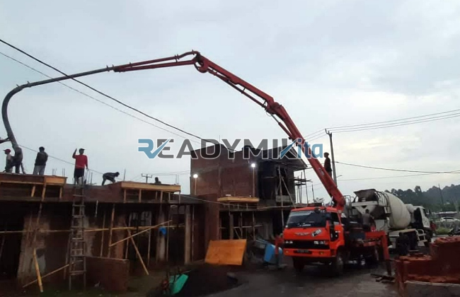

**Tempat Sewa Belalai Cor di Lenteng Agung Jakarta Harian** - Hai Mitra Readymix Kita! Punya proyek pembangunan di Lenteng Agung Jakarta yang butuh percepatan? Kami tahu betul, efisiensi adalah kunci utama. Nah, ReadymixKita hadir sebagai solusi terpercaya untuk memastikan proyek Anda berjalan lancar dan tepat waktu.

Dalam dunia konstruksi, waktu adalah aset paling berharga. Ingin mempercepat pengecoran tanpa mengurangi kualitas? Pemanfaatan concrete pump adalah jawabannya. Di Lenteng Agung Jakarta, ReadymixKita hadir sebagai mitra terbaik untuk menjamin kelancaran setiap tahapan penuangan beton Anda.



## Apa Itu Belalai Cor dan Mengapa Penting?

Concrete pump, atau yang sering disebut belalai cor, adalah alat modern yang digunakan untuk memompa beton cair langsung dari truk mixer ke area pengecoran melalui jaringan pipa. Alat ini sangat ideal untuk berbagai kondisi proyek, terutama ketika akses lokasi terbatas atau membutuhkan jangkauan vertikal tertentu. Apa saja keunggulannya? Simak poin-poin berikut:

1. **Efisiensi Waktu dan Tenaga**

   Pengecoran manual? Itu sudah ketinggalan zaman! Dengan concrete pump, proses pengecoran jadi jauh lebih cepat dan hemat tenaga kerja. Beton dipindahkan langsung ke titik lokasi yang diinginkan.

2. **Presisi dan Kualitas Terjamin**

   Alat ini memastikan beton dituangkan dengan akurat, baik untuk pengecoran lantai, kolom, maupun dinding, menjamin hasil yang lebih rapi dan berkualitas.

3. **Solusi untuk Lokasi Sulit**

   Gang sempit, area belakang gedung, atau bangunan bertingkat? Bukan masalah! Saluran fleksibel pada concrete pump mampu menjangkau area yang sulit diakses.

4. **Kapasitas Besar untuk Proyek Skala Apa Pun**

   Baik proyek kecil maupun besar, concrete pump mampu menangani volume beton yang signifikan dalam waktu singkat.

## Kenapa Harus Sewa Concrete Pump dari ReadymixKita?

Di antara banyaknya penyedia jasa sewa concrete pump di Lenteng Agung Jakarta, ReadymixKita menawarkan nilai lebih yang akan membuat Anda puas:

1. **Pengalaman dan Kepercayaan Pelanggan**

   Kami telah berpengalaman menangani beragam proyek konstruksi di Lenteng Agung Jakarta dan sekitarnya, dengan tingkat kepuasan pelanggan yang tinggi. Tim kami terdiri dari operator yang terlatih dan berpengalaman.

2. **Pilihan Concrete Pump yang Lengkap**

   Kami menyediakan berbagai tipe concrete pump yang bisa disesuaikan dengan kebutuhan spesifik proyek Anda:
   - **Mini Pump**: Ideal untuk proyek perumahan dan area sempit.
   - **Standard Pump**: Cocok untuk proyek skala menengah.
   - **Long Boom Pump**: Dikhususkan untuk pengecoran tinggi atau jangkauan horizontal yang jauh.

3. **Perawatan Rutin, Kinerja Optimal**

   Setiap unit concrete pump kami menjalani perawatan berkala untuk memastikan kinerja yang prima di lapangan. Anda tidak perlu khawatir masalah teknis akan menghambat pekerjaan.

4. **Layanan Profesional dan Ramah**

   Kami tidak hanya menyediakan alat, tetapi juga operator berpengalaman yang siap membantu kelancaran proses pengecoran dari awal hingga akhir.

## Keuntungan Menyewa Belalai Cor di Lenteng Agung Jakarta Bersama Kami

Sebagai penyedia jasa yang memahami seluk-beluk konstruksi di Lenteng Agung Jakarta, kami menawarkan keuntungan sebagai berikut:

1. **Akses Mudah dan Cepat**

   Lokasi strategis depot kami memungkinkan kami memberikan layanan cepat ke seluruh wilayah Lenteng Agung Jakarta, baik pusat kota maupun daerah pinggiran.

2. **Pemahaman Kondisi Lokal yang Mendalam**

   Pengalaman kami di Lenteng Agung Jakarta memungkinkan kami memahami tantangan spesifik seperti kontur tanah berbukit atau area padat penduduk. Dengan demikian, kami dapat memberikan solusi terbaik sesuai kebutuhan proyek Anda.

3. **Harga Bersaing, Kualitas Terjamin**

   Kami menawarkan harga yang kompetitif tanpa mengurangi kualitas layanan, menjadikannya pilihan tepat untuk anggaran konstruksi Anda.

## Harga Terjangkau dan Promo Menarik di Lenteng Agung Jakarta

Kami mengerti bahwa pengelolaan anggaran adalah prioritas utama dalam setiap proyek. Oleh karena itu, kami menawarkan:

1. **Transparansi Harga**

   Anda akan mendapatkan rincian harga sewa yang jelas, termasuk biaya operator dan bahan bakar. Tidak ada biaya tambahan tersembunyi.

2. **Diskon dan Penawaran Khusus**

   Nikmati diskon menarik untuk sewa jangka panjang atau pemesanan dalam jumlah besar. Kami juga memberikan promo khusus untuk proyek yang berlokasi di Lenteng Agung Jakarta.

3. **Konsultasi Gratis untuk Hasil Optimal**

   Bingung memilih jenis concrete pump yang tepat? Tim ahli kami siap memberikan konsultasi gratis untuk memastikan Anda mendapatkan solusi terbaik.

## Info Harga Sewa Belalai Cor di Lenteng Agung Jakarta



Jangan biarkan kendala pengecoran menghambat kelancaran proyek Anda. Hubungi kami sekarang juga dan rasakan kemudahan layanan sewa belalai cor terbaik di Lenteng Agung Jakarta! Kami juga menyediakan layanan survei lokasi gratis untuk memastikan kepuasan Anda. Pesan sekarang dan nikmati hasil konstruksi yang efisien, cepat, dan berkualitas!

Kebutuhan konstruksi yang efisien dimulai dari pemilihan alat yang tepat. Dengan layanan penyewaan Belalai Cor dari ReadymixKita, Anda dapat mencapai target proyek secara lebih cepat, efisien, dan akurat. Segera hubungi kami untuk mendapatkan layanan sewa concrete pump terpercaya di Lenteng Agung Jakarta. Pilihan yang tepat untuk hasil yang sempurna! [Tempat Sewa Belalai Cor di Ancol Jakarta Harian](/pompa/tempat-sewa-belalai-cor-di-ancol-jakarta-harian/) [Tempat Sewa Belalai Cor di Babakan Bogor Harian](/pompa/tempat-sewa-belalai-cor-di-babakan-bogor-harian/)