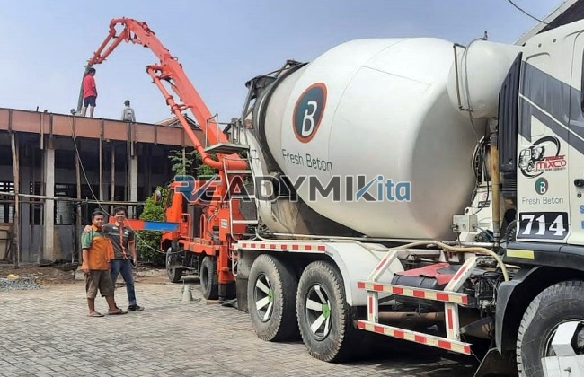

**Tempat Sewa Belalai Cor di Pakuan Bogor Harian** - Hai Mitra Readymix Kita! Punya proyek konstruksi di Pakuan Bogor dan butuh solusi pengecoran yang handal? Proses pengecoran yang lambat atau akses lokasi yang sulit sering jadi kendala, ya? Kini, ada solusi tepatnya! Dengan menyewa belalai cor (concrete pump), semua proses pengecoran bisa jadi lebih cepat, efisien, dan presisi.

Nah, di ReadymixKita, kami hadir sebagai penyedia layanan penyewaan perangkat cor pompa beton terpercaya di Pakuan Bogor. Kami siap mendukung berbagai kebutuhan konstruksi Anda, memastikan proyek berjalan lancar dan tepat waktu.



## Apa Itu Belalai Cor dan Apa Saja Keunggulannya?

Concrete pump, atau yang sering disebut belalai cor, adalah alat modern yang digunakan untuk memindahkan beton cair dari *mixer truck* langsung ke area pengecoran menggunakan sistem perpipaan. Alat ini jadi solusi ideal untuk beragam situasi proyek, khususnya ketika akses ke lokasi terbatas atau memerlukan ketinggian tertentu. Kira-kira, apa saja kelebihan concrete pump ini? Simak daftarnya:

1. **Efisiensi Waktu dan Tenaga Kerja**

   Pengecoran jadi lebih cepat! Concrete pump dapat mempercepat proses penuangan beton secara signifikan dibandingkan cara manual. Beton cair bisa dipindahkan langsung ke lokasi yang tepat, tanpa perlu banyak tenaga kerja manual.

2. **Hasil Pengecoran yang Lebih Presisi**

   Alat ini memastikan beton dituangkan secara akurat ke area yang dituju, baik struktur horizontal maupun vertikal seperti lantai, kolom, dan dinding.

3. **Mengatasi Akses Lokasi yang Sulit**

   Dengan menggunakan saluran yang fleksibel, concrete pump bisa menjangkau area yang sulit diakses, misalnya gang sempit, lokasi di belakang bangunan, atau struktur bertingkat.

4. **Kapasitas Pengecoran yang Besar**

   Concrete pump mampu menangani volume beton yang besar dalam waktu singkat, menjadikannya pilihan tepat untuk proyek kecil maupun besar.

## Kenapa Harus Memilih Jasa Penyewaan Concrete Pump dari ReadymixKita?

Di antara banyaknya penyedia jasa penyewaan concrete pump, **ReadymixKita** punya beberapa keunggulan yang membedakan kami:

1. **Pengalaman dan Reputasi yang Terpercaya**

   Kami sudah berpengalaman menangani berbagai proyek konstruksi di wilayah Pakuan Bogor dan sekitarnya. Kami bangga dengan tingkat kepuasan pelanggan yang tinggi. Tim kami yang terdiri dari profesional berpengalaman memastikan alat berfungsi optimal di lapangan.

2. **Pilihan Concrete Pump yang Beragam**

   Kami menyediakan berbagai jenis concrete pump yang bisa disesuaikan dengan kebutuhan proyek Anda, antara lain:
   - **Mini Pump**: Ideal untuk proyek perumahan atau area dengan akses terbatas.
   - **Standard Pump**: Cocok untuk proyek menengah.
   - **Long Boom Pump**: Direkomendasikan untuk proyek yang memerlukan jangkauan jauh.

3. **Perawatan Alat yang Terjamin**

   Semua perangkat concrete pump kami dirawat secara berkala untuk memastikan kinerja yang optimal. Anda bisa tenang bekerja tanpa khawatir ada masalah teknis selama proses pengecoran.

4. **Layanan Profesional dan Ramah**

   Kami tidak hanya menyediakan perangkat, tapi juga operator yang berpengalaman, memastikan proses penuangan berjalan lancar dari awal hingga akhir.

## Keunggulan Jasa Penyewaan Belalai Cor di Pakuan Bogor

Sebagai penyedia jasa lokal, kami memahami karakteristik proyek-proyek di wilayah Pakuan Bogor. Berikut adalah keunggulan utama kami:

1. **Akses Mudah dan Pengiriman Cepat**

   Lokasi pabrik dan gudang kami yang strategis memungkinkan kami memberikan layanan cepat ke seluruh wilayah Pakuan Bogor, termasuk area pusat kota dan pinggiran.

2. **Memahami Kondisi Lokal**

   Berkat pengalaman bekerja di Pakuan Bogor, kami memahami tantangan spesifik seperti kondisi medan yang bergelombang atau lingkungan yang padat penduduk. Hal ini memungkinkan kami memberikan solusi yang paling sesuai dengan kebutuhan Anda.

3. **Harga yang Kompetitif**

   Kami menawarkan harga sewa yang bersaing tanpa mengorbankan kualitas layanan, menjadikannya pilihan terbaik untuk proyek konstruksi Anda.

## Penawaran Harga dan Promo Spesial di Pakuan Bogor

Kami memahami bahwa anggaran adalah faktor penting dalam setiap proyek. Oleh karena itu, kami menawarkan:

1. **Harga yang Transparan**

   Anda akan mendapatkan rincian harga sewa alat yang jelas, termasuk biaya tambahan seperti operator dan bahan bakar. Tidak ada biaya tersembunyi yang akan membuat Anda terkejut!

2. **Diskon dan Promo Menarik**

   Nikmati potongan harga menarik untuk penyewaan jangka panjang atau pemesanan dalam jumlah besar. Kami juga menawarkan promo khusus untuk proyek yang berlokasi di Pakuan Bogor.

3. **Konsultasi Gratis**

   Bingung memilih jenis concrete pump yang tepat untuk proyek Anda? Jangan khawatir! Kami siap membantu Anda dengan layanan konsultasi gratis untuk menentukan solusi terbaik.

## Daftar Harga Sewa Belalai Cor di Pakuan Bogor



Jangan biarkan kendala pengecoran menghambat kelancaran proyek Anda. Segera hubungi kami untuk layanan penyewaan belalai cor berkualitas di Pakuan Bogor!

Kami juga menawarkan layanan survei lokasi dan konsultasi gratis untuk memastikan kebutuhan Anda terpenuhi secara tepat. Pesan sekarang dan rasakan efisiensi, efektivitas, dan kepuasan dalam setiap pembangunan Anda. 

Dengan pengalaman, kualitas layanan, dan komitmen terhadap kepuasan pelanggan, ReadymixKita adalah mitra terbaik Anda untuk proyek konstruksi di Pakuan Bogor. Percayakan kebutuhan penyewaan belalai cor Anda kepada kami dan wujudkan proyek impian Anda dengan hasil yang maksimal. Hubungi kami sekarang juga untuk informasi lebih lanjut! [Tempat Sewa Belalai Cor di Babakan Bogor Harian](/pompa/tempat-sewa-belalai-cor-di-babakan-bogor-harian/) akan membantu Anda menemukan solusi pengecoran yang tepat.