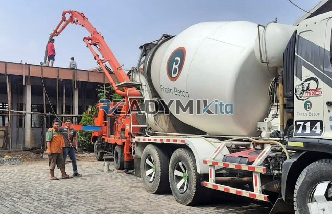

**Tempat Sewa Belalai Cor di Palmeriam Jakarta Harian** - Hai Mitra Readymix Kita! Pembangunan di Palmeriam Jakarta semakin pesat, kan? Nah, kami dari ReadymixKita hadir sebagai solusi praktis untuk kelancaran proyek Anda. Kami menyediakan layanan sewa concrete pump yang siap mendukung pengecoran cepat dan berkualitas di Palmeriam Jakarta dan sekitarnya.

Bagi Anda yang sedang mengerjakan proyek di Palmeriam Jakarta, ReadymixKita menawarkan solusi cerdas dengan layanan sewa concrete pump. Kami memahami betul dinamika pembangunan di wilayah ini dan siap menjadi mitra andalan Anda.



## Apa Itu Belalai Cor dan Mengapa Penting?

Concrete pump, atau yang lebih dikenal dengan istilah “belalai cor”, adalah alat modern yang berfungsi memindahkan beton siap pakai dari truk mixer langsung ke lokasi pengecoran melalui jaringan pipa. Alat ini sangat ideal untuk proyek-proyek di Palmeriam Jakarta, terutama jika menghadapi akses terbatas atau membutuhkan pengecoran di ketinggian. Manfaatnya antara lain:

1. **Efisiensi Waktu dan Tenaga**

   Dibandingkan pengecoran manual, concrete pump mempercepat proses penuangan drastis. Beton dapat dialirkan langsung ke titik yang diperlukan tanpa banyak tenaga manual.

2. **Presisi Lebih Tinggi**

   Concrete pump memastikan penempatan material tepat sasaran, baik untuk struktur horizontal maupun vertikal seperti lantai, kolom, dan dinding.

3. **Solusi Akses Sulit**

   Dengan pipa fleksibel, beton bisa dicapai juga untuk lokasi yang sulit dijangkau, seperti gang sempit, area belakang bangunan, atau lantai-lantai tinggi.

4. **Kapasitas Besar**

   Concrete pump mampu menangani volume beton yang besar dalam waktu singkat, sehingga cocok untuk proyek kecil maupun besar.

## Kenapa Harus Sewa Concrete Pump dari ReadymixKita?

Di Palmeriam Jakarta, ada banyak penyedia jasa sewa concrete pump. Tapi, apa yang membuat ReadymixKita berbeda?

1. **Reputasi Terpercaya & Pengalaman Luas**

   Kami telah melayani berbagai proyek konstruksi di Palmeriam Jakarta dan sekitarnya, dengan tingkat kepuasan pelanggan yang tinggi. Tim kami didukung operator berpengalaman yang menjamin pengoperasian alat yang optimal.

2. **Pilihan Concrete Pump Lengkap**

   Kami menyediakan beragam tipe concrete pump untuk menyesuaikan dengan kebutuhan proyek Anda:
   - **Mini Pump**: Sangat cocok untuk proyek perumahan atau area dengan akses terbatas.
   - **Standard Pump**: Pilihan ideal untuk proyek menengah.
   - **Long Boom Pump**: Dirancang khusus untuk proyek yang memerlukan jangkauan tinggi.

3. **Perawatan Berkala Terjamin**

   Seluruh alat concrete pump kami menjalani perawatan rutin untuk memastikan kinerja maksimal saat digunakan di lapangan. Ini mengurangi risiko gangguan teknis yang bisa memperlambat proyek Anda.

4. **Pelayanan Profesional dan Ramah**

   Kami tidak hanya menyediakan alat, tapi juga operator berpengalaman yang siap membantu kelancaran proses pengecoran dari awal hingga akhir.

## Keunggulan Layanan Kami di Palmeriam Jakarta

Sebagai penyedia lokal, kami benar-benar memahami karakteristik proyek di Palmeriam Jakarta. Keunggulan ini menjadi nilai tambah bagi Anda:

1. **Respons Cepat & Akses Mudah**

   Dengan lokasi strategis, kami dapat memberikan layanan yang cepat ke seluruh wilayah Palmeriam Jakarta, termasuk daerah perkotaan dan pinggiran.

2. **Pemahaman Kondisi Lokal**

   Pengalaman kami di Palmeriam Jakarta membuat kami memahami tantangan spesifik seperti kondisi tanah yang beragam dan kepadatan lalu lintas. Kami siap memberikan solusi yang tepat untuk kebutuhan Anda.

3. **Harga Bersaing**

   Kami menawarkan harga yang kompetitif tanpa mengorbankan kualitas layanan, menjadikannya solusi yang ideal untuk anggaran proyek Anda.

## Harga Terjangkau & Penawaran Spesial untuk Palmeriam Jakarta

Kami mengerti bahwa anggaran adalah hal penting dalam setiap proyek. Oleh karena itu, kami memberikan:

1. **Harga Transparan**

   Anda akan mendapatkan rincian harga sewa yang jelas, termasuk biaya operator dan bahan bakar. Tidak ada biaya tambahan tersembunyi.

2. **Diskon & Promo Menarik**

   Nikmati diskon untuk penyewaan jangka panjang atau pesanan dalam jumlah besar. Ada juga promo khusus untuk proyek-proyek di Palmeriam Jakarta!

3. **Konsultasi Gratis**

   Bingung memilih jenis concrete pump yang tepat? Tim kami siap memberikan konsultasi gratis untuk membantu Anda menentukan solusi terbaik.

## Daftar Harga Sewa Belalai Cor di Palmeriam Jakarta



Jangan biarkan kendala pengecoran menghambat kemajuan proyek Anda! Hubungi ReadymixKita sekarang juga untuk layanan sewa concrete pump terbaik di Palmeriam Jakarta.

Kami juga menyediakan layanan survei lokasi dan konsultasi gratis untuk memastikan kebutuhan Anda terpenuhi dengan tepat. Pesan sekarang dan rasakan kemudahan serta efisiensi konstruksi yang maksimal. 

Dengan pengalaman, kualitas layanan, dan komitmen terhadap kepuasan pelanggan, ReadymixKita adalah mitra ideal untuk proyek konstruksi Anda di Palmeriam Jakarta. Percayakan kebutuhan penyewaan concrete pump Anda kepada kami, dan wujudkan proyek impian Anda dengan hasil yang optimal! Hubungi kami untuk penawaran terbaik!

