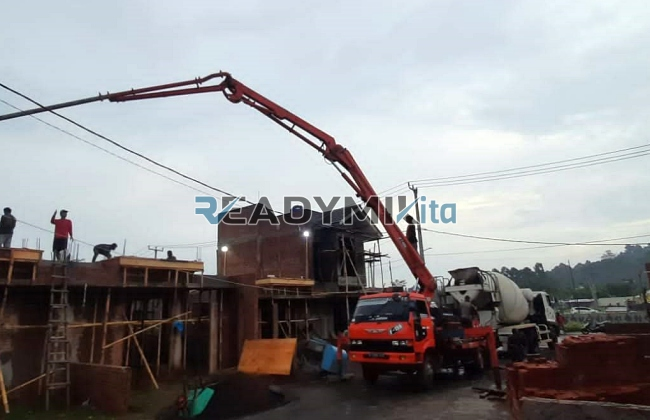

**Tempat Sewa Belalai Cor di Pamulang Tangerang Harian** - Hai Mitra Readymix Kita! Punya proyek konstruksi di Pamulang Tangerang yang butuh solusi pengecoran praktis? Atau mungkin kesulitan mengakses area pengecoran karena lokasinya kurang ideal? Kami mengerti betul tantangan-tantangan itu. Nah, ReadymixKita hadir sebagai jawaban atas kebutuhan Anda! Kami hadir untuk memastikan kelancaran pengerjaan proyek Anda.

Membangun properti atau infrastruktur di Pamulang Tangerang seringkali dihadapkan pada berbagai kendala, mulai dari keterbatasan akses lokasi hingga efisiensi waktu penuangan. Tapi jangan khawatir! ReadymixKita, penyedia solusi beton cor readymix dan pompa beton terpercaya, siap membantu Anda mengatasi semua itu. Dengan layanan sewa belalai cor (concrete pump) harian, kami memastikan proyek Anda berjalan efektif dan tepat waktu.



## Belalai Cor: Apa Itu dan Bagaimana Manfaatnya Bagi Proyek Anda?

Belalai cor, atau *concrete pump*, adalah alat canggih yang dirancang khusus untuk memindahkan beton cair dari truk mixer langsung ke lokasi pengecoran melalui jaringan pipa. Alat ini adalah solusi yang sangat efektif untuk berbagai jenis proyek, terutama ketika akses ke area pengecoran terbatas atau memerlukan penempatan beton pada ketinggian tertentu. Mari kita bedah lebih lanjut apa saja keuntungannya:

1. **Efisiensi Tak Tertandingi**

   Penuangan beton menjadi jauh lebih cepat dibandingkan metode manual. Dengan pompa beton, beton cair dialirkan langsung ke titik yang dibutuhkan, mengurangi waktu dan tenaga kerja yang diperlukan.

2. **Presisi Tinggi dalam Penempatan**

   Alat ini memungkinkan penempatan beton yang akurat, baik untuk struktur horizontal maupun vertikal seperti lantai, kolom, dan dinding. Tidak ada lagi beton yang tumpah atau penempatan yang tidak rata!

3. **Mengatasi Lokasi yang Sulit Dijangkau**

   Pipa fleksibel pada pompa beton memungkinkan beton mengalir ke area yang sulit dijangkau, seperti gang sempit, belakang bangunan, atau struktur bertingkat tinggi.

4. **Kapasitas Besar untuk Proyek Skala Apa Pun**

   Pompa beton mampu menangani volume beton yang besar dalam waktu singkat, menjadikannya pilihan yang ideal untuk proyek kecil maupun besar.

## Mengapa Memilih Layanan Kami di ReadymixKita?

Di antara banyaknya penyedia jasa sewa pompa beton di Pamulang Tangerang, ReadymixKita menawarkan keunggulan yang membedakan kami:

1. **Pengalaman dan Kepercayaan Pelanggan**

   Kami memiliki rekam jejak yang solid dalam melayani beragam proyek konstruksi di Pamulang Tangerang. Kepuasan pelanggan adalah prioritas utama kami, dan kami berkomitmen memberikan layanan terbaik. Tim kami terdiri dari operator berpengalaman yang menjamin kinerja optimal pompa beton.

2. **Pilihan Concrete Pump yang Beragam**

   Kami menyediakan berbagai jenis pompa beton yang bisa disesuaikan dengan kebutuhan spesifik proyek Anda:
   - **Mini Pump**: Ideal untuk proyek perumahan skala kecil dan area yang sempit.
   - **Standard Pump**: Cocok untuk proyek-proyek berukuran sedang hingga besar.
   - **Long Boom Pump**: Dirancang untuk proyek yang membutuhkan jangkauan vertikal atau horizontal yang lebih tinggi.

3. **Perawatan Preventif untuk Performa Optimal**

   Kami melakukan perawatan rutin dan inspeksi menyeluruh pada seluruh armada pompa beton untuk memastikan performa yang handal dan bebas masalah. Dengan begitu, Anda bisa fokus mengerjakan proyek tanpa khawatir gangguan teknis.

4. **Layanan Profesional dan Ramah**

   Kami tidak hanya menyediakan alat, tetapi juga operator berpengalaman yang akan memastikan proses pemompaan berjalan lancar dari awal hingga akhir. Kami selalu siap menjawab pertanyaan dan memberikan dukungan teknis yang Anda butuhkan.

## Keunggulan Lokal Kami di Pamulang Tangerang

Sebagai penyedia jasa lokal di Pamulang Tangerang, kami memiliki pemahaman mendalam tentang karakteristik proyek konstruksi di kawasan ini:

1. **Akses Mudah dan Respon Cepat**

   Dengan lokasi strategis, kami dapat memberikan layanan cepat dan efisien ke seluruh wilayah Pamulang Tangerang, baik pusat kota maupun area pinggiran.

2. **Pemahaman Kondisi Medan Lokal**

   Pengalaman kami bekerja di Pamulang Tangerang memungkinkan kami untuk memahami tantangan spesifik seperti kontur tanah yang berbukit dan kepadatan lalu lintas. Kami siap memberikan solusi yang paling sesuai dengan kebutuhan Anda.

3. **Harga yang Bersaing dan Terjangkau**

   Kami menawarkan harga sewa pompa beton yang kompetitif tanpa mengorbankan kualitas layanan. Kami berkomitmen untuk memberikan nilai terbaik bagi investasi Anda.

## Penawaran Harga dan Promo Spesial di Pamulang Tangerang

Kami memahami bahwa anggaran adalah pertimbangan penting dalam setiap proyek konstruksi. Oleh karena itu, kami menawarkan:

1. **Harga yang Transparan dan Jelas**

   Kami memberikan rincian harga sewa yang lengkap, termasuk biaya operator dan bahan bakar. Tidak ada biaya tersembunyi yang akan membuat Anda terkejut.

2. **Diskon dan Promo Menarik**

   Nikmati diskon khusus untuk penyewaan jangka panjang atau pemesanan dengan volume besar. Kami juga menawarkan promo-promo menarik untuk proyek konstruksi di wilayah Pamulang Tangerang.

3. **Konsultasi Gratis untuk Solusi Terbaik**

   Bingung memilih jenis pompa beton yang paling sesuai untuk proyek Anda? Jangan ragu untuk menghubungi kami dan mendapatkan konsultasi gratis dari tim ahli kami.

## Daftar Harga Sewa Belalai Cor di Pamulang Tangerang



Jangan biarkan tantangan pengecoran menghambat kemajuan proyek Anda. Segera hubungi kami untuk mendapatkan layanan sewa belalai cor terbaik di Pamulang Tangerang! Dapatkan penawaran khusus dan konsultasi gratis sekarang juga.

Kami juga menyediakan layanan survei lokasi untuk membantu Anda menentukan jenis pompa beton yang paling sesuai dengan kebutuhan proyek Anda. Percayakan proyek Anda kepada ReadymixKita dan nikmati pengalaman konstruksi yang efisien, cepat, dan memuaskan. Segera hubungi kami! [Tempat Sewa Belalai Cor di Ancol Jakarta Harian](/pompa/tempat-sewa-belalai-cor-di-ancol-jakarta-harian/) bisa menjadi referensi tambahan jika Anda juga beroperasi di area Jakarta.