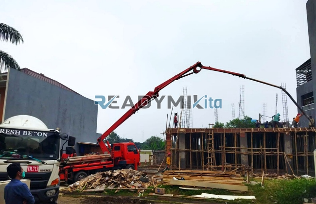

**Tempat Sewa Belalai Cor di Pangkalan Jati Depok Harian** - Hai Mitra Readymix Kita! Gimana kabar hari ini? Pembangunan di Pangkalan Jati Depok semakin pesat, ya? ReadymixKita hadir sebagai solusi modern untuk kebutuhan pengecoran beton Anda dengan layanan sewa pompa beton (belalai cor) yang handal dan efisien. Kami berkomitmen memastikan setiap proyek konstruksi di Pangkalan Jati Depok berjalan lancar dan menghasilkan kualitas terbaik.



## Apa Itu Belalai Cor dan Mengapa Pengecoran dengan Concrete Pump Lebih Baik?

Concrete pump, atau yang lebih dikenal dengan sebutan belalai cor, adalah teknologi modern yang merampingkan proses pengecoran. Alat ini memindahkan beton siap pakai langsung dari truk mixer ke titik pengecoran menggunakan pipa. Daripada berjam-jam dengan cara manual, bayangkan betapa efisiennya pengerjaan dengan sistem ini — terutama untuk proyek di Pangkalan Jati Depok yang mungkin memiliki akses terbatas. Berikut beberapa keuntungan utamanya:

1. **Hemat Waktu & Tenaga:**
   Pengecoran manual memang bisa dilakukan, tapi dengan concrete pump? Prosesnya jadi jauh lebih cepat dan tidak terlalu menguras tenaga kerja.

2. **Presisi Tingkat Tinggi:**
   Alat ini memastikan beton ditempatkan tepat pada posisinya, baik untuk fondasi, kolom, lantai, atau dinding. Minim pemborosan, hasil lebih rapi.

3. **Menaklukkan Lokasi Sulit:**
   Punya proyek di gang sempit atau area yang sulit dijangkau? Saluran pompa yang fleksibel memungkinkan beton diantarkan ke titik yang paling strategis.

4. **Kapasitas Besar untuk Proyek Apapun:**
   Baik proyek kecil maupun konstruksi besar, concrete pump mampu menangani volume beton yang signifikan dengan cepat dan berkesinambungan.

## Kenapa Harus Sewa Concrete Pump dari ReadymixKita?

Di Pangkalan Jati Depok dan sekitarnya, banyak penyedia jasa serupa. Lantas, apa yang membuat ReadymixKita jadi pilihan terbaik? Ini dia: 

1. **Rekam Jejak Terpercaya & Pengalaman Lokal:**
   Kami punya pengalaman bertahun-tahun menangani proyek konstruksi di Pangkalan Jati Depok. Kepuasan pelanggan adalah prioritas utama kami. Tim kami yang kompeten memastikan alat berfungsi optimal.

2. **Pilihan Concrete Pump yang Lengkap:**
   Kami menyediakan beragam tipe pompa beton yang bisa disesuaikan dengan kebutuhan proyek Anda:
   - **Mini Pump:** Ideal untuk proyek rumahan atau lokasi dengan ruang terbatas.
   - **Standard Pump:** Cocok untuk proyek skala sedang hingga besar.
   - **Long Boom Pump:** Didesain untuk proyek yang memerlukan jangkauan jauh dan presisi tinggi.

3. **Perawatan Rutin, Kinerja Andal:**
   Semua unit concrete pump kami menjalani perawatan berkala secara ketat. Jadi, Anda bisa fokus pada konstruksi tanpa khawatir masalah teknis.

4. **Layanan Profesional & Operator Berpengalaman:**
   Kami tidak hanya menyediakan alat, tapi juga operator terlatih yang memastikan proses pengecoran berjalan lancar dari awal hingga akhir.

## Keuntungan Menggunakan Jasa Sewa Concrete Pump di Pangkalan Jati Depok dari Kami

Sebagai penyedia solusi konstruksi yang berlokasi strategis di wilayah ini, kami memahami betul tantangan dan peluang di Pangkalan Jati Depok. Ini yang membedakan kami:

1. **Respon Cepat & Akses Mudah:**
   Dengan lokasi yang strategis, kami siap melayani Anda dengan cepat di seluruh wilayah Pangkalan Jati Depok, baik di pusat kota maupun area pinggiran.

2. **Memahami Kondisi Lokal:**
   Kami akrab dengan kondisi medan di Pangkalan Jati Depok, termasuk area berbukit dan kepadatan lalu lintas. Hal ini memungkinkan kami memberikan solusi terbaik yang sesuai dengan kebutuhan proyek Anda.

3. **Harga Kompetitif dengan Kualitas Terjamin:**
   Kami menawarkan harga sewa yang terjangkau tanpa mengorbankan kualitas layanan dan keandalan alat.

## Harga Terjangkau & Penawaran Khusus untuk Proyek Anda di Pangkalan Jati Depok

Kami percaya bahwa setiap proyek memiliki anggaran yang berbeda. Karena itu, kami menawarkan:

1. **Rincian Harga Transparan:**
   Anda akan mendapatkan rincian harga sewa yang jelas, termasuk biaya operator dan bahan bakar. Tanpa biaya tersembunyi yang mengejutkan.

2. **Diskon & Promo Menarik:**
   Nikmati diskon khusus untuk penyewaan jangka panjang dan pesanan dalam jumlah besar. Jangan lewatkan juga promo-promo spesial untuk proyek di Pangkalan Jati Depok!

3. **Konsultasi Gratis untuk Pilihan Terbaik:**
   Bingung pompa jenis mana yang paling cocok? Hubungi kami untuk konsultasi gratis. Kami siap membantu Anda menentukan solusi yang paling tepat.

## Berapa Biaya Sewa Belalai Cor di Pangkalan Jati Depok?



Jangan tunda lagi! Hubungi kami sekarang untuk mendapatkan penawaran terbaik untuk layanan sewa concrete pump di Pangkalan Jati Depok. 

Kami juga menyediakan layanan survei lokasi gratis untuk memastikan solusi yang kami tawarkan benar-benar sesuai dengan kebutuhan Anda. Segera pesan dan buktikan sendiri kemudahan serta efisiensi pengecoran beton bersama ReadymixKita! [Tempat Sewa Belalai Cor di Babakan Bogor Harian](/pompa/tempat-sewa-belalai-cor-di-babakan-bogor-harian/) — kunjungi artikel kami tentang solusi serupa di Babakan Bogor. Dengan pengalaman dan komitmen kami, ReadymixKita adalah mitra terpercaya untuk kesuksesan proyek konstruksi Anda di Pangkalan Jati Depok. Percayakan kebutuhan Belalai Cor Anda pada kami, dan wujudkan proyek impian Anda! Segera hubungi kami untuk informasi lebih lanjut dan penawaran khusus.