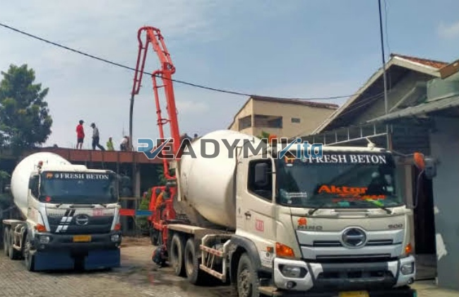

**Tempat Sewa Belalai Cor di Panongan Tangerang Harian** - Hai Mitra Readymix Kita! Punya proyek konstruksi di Panongan Tangerang dan butuh solusi pengecoran yang andal? Atau mungkin Anda menghadapi tantangan aksesibilitas lokasi yang sulit? Jangan khawatir! Kami dari ReadymixKita hadir untuk memberikan solusi praktis dan efisien untuk kelancaran proyek Anda.

Pengecoran beton yang efisien adalah kunci keberhasilan proyek konstruksi. Nah, di Panongan Tangerang, ReadymixKita hadir sebagai mitra terpercaya yang menyediakan jasa sewa belalai cor (concrete pump) untuk berbagai kebutuhan pembangunan. Kami memahami betul tantangan di lapangan, dan siap memberikan solusi yang tepat sasaran.



## Belalai Cor: Solusi Pengecoran Modern dan Keunggulannya

Concrete pump, atau yang lebih dikenal dengan istilah belalai cor, adalah sebuah perangkat canggih yang dirancang khusus untuk memindahkan beton cair dari truk mixer langsung ke lokasi pengecoran menggunakan sistem perpipaan. Di Panongan Tangerang, alat ini menjadi semakin populer karena kemampuannya mengatasi berbagai kendala, terutama di lokasi dengan akses terbatas. Berikut beberapa keunggulan yang bisa Anda rasakan:

1. **Efisiensi Waktu dan Biaya**

   Dengan belalai cor, proses penuangan beton jadi jauh lebih cepat dibandingkan metode manual. Artinya, Anda bisa menghemat waktu dan biaya tenaga kerja.

2. **Presisi dan Kualitas Terjamin**

   Alat ini memastikan beton ditempatkan dengan akurat di area yang Anda inginkan, bahkan pada struktur vertikal dan horizontal. Hasilnya, kualitas pengecoran lebih terjaga.

3. **Mengatasi Lokasi Sulit**

   Saluran fleksibel pada belalai cor memungkinkan beton mencapai area yang sulit dijangkau, seperti gang sempit, area belakang bangunan, atau lantai tinggi.

4. **Kapasitas Besar untuk Proyek Skala Apa Pun**

   Baik proyek kecil maupun besar, belalai cor mampu menangani volume beton yang signifikan dengan efisien.

## Mengapa Memilih ReadymixKita di Panongan Tangerang?

Di Panongan Tangerang, banyak penyedia jasa sewa belalai cor. Tapi, apa yang membedakan ReadymixKita? Ini dia:

1. **Pengalaman dan Kepercayaan Pelanggan**

   Kami telah lama berkecimpung dalam menyediakan layanan ini di Panongan Tangerang, dan telah membantu banyak klien menyelesaikan proyek mereka dengan sukses. 

2. **Pilihan Belalai Cor yang Beragam**

   Kami memiliki armada lengkap yang dapat disesuaikan dengan kebutuhan proyek Anda:
   - **Mini Pump**: Ideal untuk area sempit atau proyek perumahan.
   - **Standard Pump**: Solusi serbaguna untuk proyek menengah.
   - **Long Boom Pump**: Cocok untuk proyek tinggi atau area yang membutuhkan jangkauan jauh.

3. **Perawatan Rutin, Kinerja Optimal**

   Semua unit belalai cor kami dirawat secara berkala oleh teknisi ahli. Ini menjamin kinerja alat tetap prima selama masa penyewaan.

4. **Layanan Profesional dan Responsif**

   Kami tidak hanya menyediakan alat, tapi juga operator berpengalaman yang siap membantu Anda dalam proses pengecoran.

## Keunggulan Memilih Jasa Kami di Panongan Tangerang

Sebagai penyedia jasa lokal, kami memahami betul kondisi konstruksi di Panongan Tangerang. Inilah yang membuat kami unggul:

1. **Jangkauan Luas dan Respons Cepat**

   Lokasi strategis kami memungkinkan kami memberikan layanan cepat ke seluruh wilayah Panongan Tangerang, baik pusat kota maupun daerah pelosok.

2. **Pengetahuan Mendalam tentang Kondisi Lokal**

   Kami paham betul dengan tantangan seperti kondisi jalan yang beragam dan area proyek yang padat penduduk. Kami siap memberikan solusi yang tepat.

3. **Harga Kompetitif dan Bersaing**

   Kami menawarkan harga sewa belalai cor yang terjangkau tanpa mengorbankan kualitas layanan. 

## Penawaran Harga Spesial di Panongan Tangerang!

Kami percaya transparansi harga adalah kunci. Anda akan menerima rincian harga yang jelas, termasuk biaya operator (jika diperlukan) dan biaya bahan bakar. 

1. **Harga yang Jelas dan Terperinci**

   Anda akan mendapatkan penawaran harga yang transparan dan tidak ada biaya tersembunyi.

2. **Promo Menarik dan Diskon Khusus**

   Nikmati diskon menarik untuk penyewaan jangka panjang atau pemesanan dalam jumlah besar. Kami juga punya penawaran khusus untuk area Panongan Tangerang.

3. **Konsultasi Gratis untuk Kebutuhan Anda**

   Bingung memilih jenis belalai cor yang tepat? Tim kami siap membantu Anda melalui konsultasi gratis.

## Daftar Harga Sewa Belalai Cor di Panongan Tangerang



Yuk, jangan biarkan proses pengecoran menjadi hambatan dalam proyek Anda. Segera hubungi ReadymixKita untuk mendapatkan layanan sewa belalai cor terbaik di Panongan Tangerang! 

Kami juga menyediakan layanan survei lokasi gratis untuk memastikan solusi yang kami tawarkan sesuai dengan kebutuhan Anda. Pesan sekarang dan rasakan kemudahan konstruksi yang cepat, efisien, dan memuaskan. Dengan ReadymixKita, proyek Anda selesai tepat waktu dan sesuai anggaran. Jangan tunda lagi, hubungi kami sekarang untuk penawaran terbaik! [Tempat Sewa Belalai Cor di Ancol Jakarta Harian](/pompa/tempat-sewa-belalai-cor-di-ancol-jakarta-harian/) bisa menjadi pertimbangan jika proyek Anda ada di wilayah tersebut.