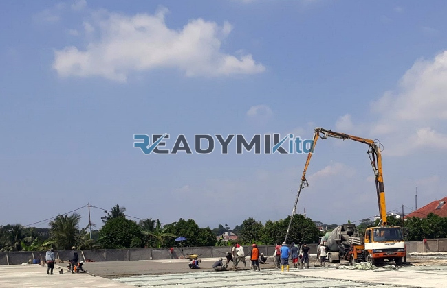

**Tempat Sewa Belalai Cor di Pasar Manggis Jakarta Harian** - Hai Mitra Readymix Kita! Punya proyek konstruksi di Pasar Manggis Jakarta yang butuh percepatan? Kami tahu betul, efisiensi adalah kunci sukses. Nah, ReadymixKita hadir sebagai solusi penyewaan concrete pump yang handal dan terpercaya untuk berbagai kebutuhan pembangunan Anda.



## Mengapa Concrete Pump Penting untuk Proyek Anda?

Concrete pump, atau yang sering disebut “belalai cor”, adalah alat modern yang merevolusi cara pengecoran beton dilakukan. Alat ini memindahkan beton cair langsung dari mixer ke lokasi pengecoran menggunakan pipa, sehingga menghemat waktu dan tenaga yang signifikan. Bayangkan kemudahan dan kecepatan yang ditawarkannya!

1. **Efisiensi Maksimal: Waktu & Tenaga**

   Dengan concrete pump, proses pengecoran jadi jauh lebih cepat dibanding cara manual.  Pekerja tidak perlu lagi memindahkan beton secara fisik, fokus mereka bisa dialihkan ke tugas-tugas penting lainnya.

2. **Presisi Tingkat Tinggi**

   Alat ini memastikan penempatan beton akurat, baik untuk bangunan vertikal seperti kolom dan dinding, maupun horizontal seperti lantai. Hasilnya? Konstruksi yang lebih kuat dan rapi. 

3. **Solusi Akses Lokasi Sulit**

   Pipa fleksibel concrete pump mampu menjangkau area yang sulit diakses, seperti gang sempit, belakang bangunan, atau area bertingkat. Problem akses bukan lagi kendala!

4. **Kapasitas Besar untuk Skala Proyek Apa Pun**

   Concrete pump sanggup menangani volume beton besar dalam waktu singkat, ideal untuk proyek kecil, menengah, maupun besar.

## Mengapa Memilih ReadymixKita untuk Sewa Concrete Pump?

Di Pasar Manggis Jakarta, banyak penyedia layanan serupa. Lalu, kenapa harus ReadymixKita? Ini dia keunggulan kami:

1. **Pengalaman & Kepercayaan Pelanggan**

   Kami telah lama berkecimpung di dunia penyewaan concrete pump di Pasar Manggis Jakarta dan sekitarnya, dengan rekam jejak kepuasan pelanggan yang tinggi. Operator kami terlatih dan berpengalaman, memastikan alat bekerja optimal.

2. **Pilihan Concrete Pump yang Lengkap**

   Kami menyediakan berbagai tipe concrete pump yang bisa disesuaikan dengan kebutuhan proyek Anda, di antaranya:
   - **Mini Pump**: Cocok untuk proyek kecil seperti rumah tinggal atau renovasi gang sempit.
   - **Standard Pump**: Ideal untuk proyek menengah dengan akses yang cukup luas.
   - **Long Boom Pump**:  Pilihan tepat untuk proyek bertingkat atau area dengan jangkauan tinggi.

3. **Perawatan Terjamin & Kondisi Prima**

   Setiap unit concrete pump kami menjalani perawatan rutin untuk menjaga performa terbaik. Anda bisa fokus pada proyek tanpa khawatir masalah teknis.

4. **Layanan Profesional & Responsif**

   Kami tidak hanya menyediakan alat, tetapi juga operator handal yang siap membantu kelancaran proses pengecoran dari awal hingga akhir.

## Keunggulan Layanan Kami di Pasar Manggis Jakarta

Sebagai penyedia lokal di Pasar Manggis Jakarta, kami memahami betul tantangan dan karakteristik proyek di area ini.

1. **Akses Cepat & Mudah**

   Lokasi strategis gudang kami memungkinkan kami memberikan layanan cepat ke seluruh wilayah Pasar Manggis Jakarta, baik pusat kota maupun pinggiran.

2. **Memahami Kondisi Lokal**

   Kami akrab dengan berbagai kondisi medan di Pasar Manggis Jakarta, mulai dari jalanan sempit hingga area yang padat penduduk. Ini memungkinkan kami memberikan solusi paling tepat untuk proyek Anda.

3. **Harga Kompetitif & Terjangkau**

   Kami menawarkan harga sewa yang kompetitif tanpa mengorbankan kualitas layanan, menjadikannya pilihan cerdas untuk anggaran proyek Anda.

## Penawaran Spesial & Harga Transparan di Pasar Manggis Jakarta

Kami mengerti bahwa anggaran adalah pertimbangan penting. Berikut adalah keuntungan yang bisa Anda dapatkan:

1. **Harga Sewa yang Jelas & Transparan**

   Anda akan menerima rincian harga lengkap, termasuk biaya operator dan bahan bakar. Tidak ada biaya tersembunyi yang akan mengejutkan Anda.

2. **Diskon & Promosi Menarik**

   Nikmati diskon khusus untuk penyewaan jangka panjang atau pesanan dalam jumlah besar. Kami juga sering menawarkan promo untuk proyek di wilayah Pasar Manggis Jakarta.

3. **Konsultasi Gratis dari Ahli Kami**

   Bingung memilih concrete pump yang tepat? Tim kami siap memberikan konsultasi gratis untuk membantu Anda menentukan solusi terbaik.

## Daftar Harga Sewa Belalai Cor di Pasar Manggis Jakarta



Jangan biarkan proses pengecoran menjadi hambatan dalam proyek Anda. Hubungi tim ReadymixKita sekarang juga untuk layanan penyewaan concrete pump berkualitas di Pasar Manggis Jakarta!

Kami juga menyediakan layanan survei lokasi gratis untuk memastikan semua kebutuhan Anda terpenuhi. Pesan sekarang dan nikmati pengecoran yang efisien, akurat, dan memuaskan.  Yuk, wujudkan proyek idaman Anda dengan solusi terbaik dari ReadymixKita!