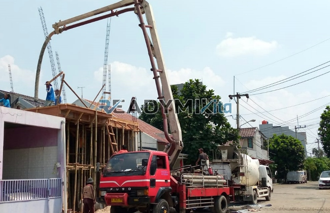

**Tempat Sewa Belalai Cor di Pekojan Jakarta Harian** - Hai Mitra Readymix Kita! Gimana kabarnya? Proyek konstruksi di Pekojan Jakarta semakin ramai, ya? Nah, kami dari ReadymixKita hadir sebagai solusi untuk kelancaran pengecoran beton Anda dengan layanan sewa belalai cor yang cepat dan handal.

Pengecoran beton membutuhkan presisi dan efisiensi. Kami mengerti betul tantangan di lapangan, khususnya di area seperti Pekojan Jakarta. Dengan layanan sewa belalai cor dari kami, Anda bisa fokus pada kualitas bangunan tanpa khawatir soal proses pengecoran yang lambat atau tidak merata.



## Mengenal Belalai Cor: Solusi Cerdas Pengecoran Beton Modern

Concrete pump, atau yang lebih dikenal dengan sebutan belalai cor, adalah alat mutakhir untuk memindahkan beton cair dari *batching plant* atau truk mixer langsung ke lokasi pengecoran melalui sistem perpipaan. Alat ini sangat ideal untuk berbagai kondisi proyek, terutama ketika akses lokasi sulit atau membutuhkan ketinggian tertentu. Inilah beberapa keunggulan utama belalai cor:

1. **Efisiensi Waktu dan Tenaga Kerja**

   Dibandingkan dengan metode manual, penggunaan belalai cor mempercepat proses pengecoran secara signifikan. Proses pemindahan beton menjadi lebih cepat dan tidak memerlukan banyak tenaga kerja manual.

2. **Hasil Pengecoran yang Lebih Presisi**

   Belalai cor memastikan material ditempatkan secara akurat ke area yang dituju, baik untuk struktur horizontal seperti lantai maupun vertikal seperti kolom dan dinding.

3. **Kemampuan Akses Lokasi yang Sulit**

   Dengan pipa yang fleksibel, belalai cor dapat menjangkau area-area yang sulit diakses, seperti gang sempit, belakang bangunan, atau area bertingkat tinggi.

4. **Kapasitas Pengecoran yang Besar**

   Belalai cor mampu menangani volume beton yang besar dalam waktu singkat, menjadikannya pilihan tepat untuk proyek konstruksi dengan skala kecil hingga besar.

## Mengapa Pilih ReadymixKita untuk Sewa Belalai Cor di Pekojan Jakarta?

Di antara banyaknya penyedia layanan sewa belalai cor, **ReadymixKita** menawarkan keunggulan yang membedakan kami:

1. **Pengalaman dan Reputasi yang Terpercaya**

   Kami telah berpengalaman menangani beragam proyek konstruksi di Pekojan Jakarta dengan tingkat kepuasan pelanggan yang tinggi. Tim kami terdiri dari operator yang terlatih dan berpengalaman.

2. **Pilihan Tipe Concrete Pump yang Lengkap**

   Kami menyediakan berbagai tipe concrete pump yang dapat disesuaikan dengan kebutuhan spesifik proyek Anda, antara lain:
   - **Mini Pump**: Cocok untuk proyek hunian dan area dengan akses terbatas.
   - **Standard Pump**: Ideal untuk proyek menengah hingga besar.
   - **Long Boom Pump**: Dirancang untuk proyek yang memerlukan jangkauan vertikal tinggi.

3. **Perawatan Alat yang Berkala**

   Seluruh unit concrete pump kami menjalani perawatan rutin untuk memastikan performa optimal. Hal ini memberikan Anda jaminan bahwa pengecoran akan berjalan lancar tanpa gangguan teknis.

4. **Layanan Profesional dan Responsif**

   Kami tidak hanya menyediakan peralatan, tetapi juga operator berpengalaman yang siap membantu memastikan proses pengecoran berjalan lancar dari awal hingga selesai.

## Keunggulan Layanan Kami di Pekojan Jakarta: Memahami Kebutuhan Lokal

Sebagai penyedia jasa lokal, kami memahami betul karakteristik proyek konstruksi di wilayah Pekojan Jakarta. Berikut beberapa keunggulan utama kami:

1. **Akses Mudah dan Cepat ke Lokasi Proyek**

   Lokasi strategis kantor dan gudang kami memungkinkan kami memberikan layanan cepat ke seluruh area Pekojan Jakarta, baik pusat kota maupun daerah pinggiran.

2. **Pemahaman Mendalam Terhadap Kondisi Lokal**

   Pengalaman kami dalam melayani proyek di Pekojan Jakarta membuat kami memahami tantangan unik seperti kondisi medan yang beragam dan aksesibilitas yang terbatas. Kami mampu memberikan solusi terbaik sesuai kebutuhan proyek Anda.

3. **Harga yang Kompetitif dan Transparan**

   Kami menawarkan harga sewa yang bersaing tanpa mengorbankan kualitas layanan.

## Penawaran Harga dan Promo Spesial di Pekojan Jakarta

Kami mengerti bahwa anggaran merupakan pertimbangan penting dalam setiap proyek. Oleh karena itu, kami menawarkan:

1. **Harga yang Jelas dan Transparan**

   Kami akan memberikan rincian biaya sewa yang lengkap, termasuk biaya operator dan bahan bakar. Tidak ada biaya tambahan yang tersembunyi.

2. **Diskon dan Promo Menarik**

   Dapatkan potongan harga untuk penyewaan jangka panjang atau pemesanan dalam jumlah besar. Kami juga memberikan penawaran khusus untuk proyek yang berlokasi di Pekojan Jakarta.

3. **Konsultasi Gratis**

   Bingung memilih tipe belalai cor yang tepat? Tim kami siap memberikan konsultasi gratis untuk membantu Anda menentukan solusi terbaik.

## Daftar Harga Sewa Belalai Cor di Pekojan Jakarta



Jangan tunda lagi! Hubungi kami sekarang untuk mendapatkan layanan sewa belalai cor terbaik di Pekojan Jakarta. Kami juga menyediakan layanan survei lokasi untuk memastikan solusi yang kami tawarkan sesuai dengan kebutuhan proyek Anda.

Dengan pengalaman, kualitas layanan, dan komitmen terhadap kepuasan pelanggan, ReadymixKita adalah mitra terpercaya Anda untuk proyek konstruksi di Pekojan Jakarta. Percayakan kebutuhan sewa belalai cor Anda kepada kami dan raih hasil konstruksi yang efisien, cepat, dan berkualitas! Hubungi kami segera dan rasakan sendiri keunggulan layanan kami. [Tempat Sewa Belalai Cor di Ancol Jakarta Harian](/pompa/tempat-sewa-belalai-cor-di-ancol-jakarta-harian/) — Kami juga melayani proyek di area Ancol Jakarta lho! [Tempat Sewa Belalai Cor di Babakan Pasar Bogor Harian](/pompa/tempat-sewa-belalai-cor-di-babakan-pasar-bogor-harian/) — Cek juga layanan kami di Babakan Pasar Bogor.