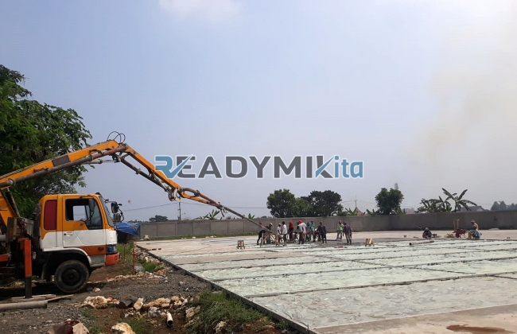

**Tempat Sewa Belalai Cor di Pengadegan Jakarta Harian** - Hai Mitra Readymix Kita! Punya proyek konstruksi di Pengadegan Jakarta dan mencari solusi pengecoran yang handal? Kami tahu betul, tantangan di lapangan bisa bermacam-macam. Nah, ReadymixKita hadir sebagai solusi modern untuk memastikan proyek Anda berjalan lancar dan efisien. Kami siap bantu wujudkan rencana Anda!

Banyak proyek menghadapi masalah akses lokasi yang terbatas atau proses penuangan yang lama. Untungnya, ada solusi inovatif: pompa beton! Di Pengadegan Jakarta, ReadymixKita hadir sebagai mitra terpercaya Anda untuk layanan penyewaan concrete pump yang efisien dan tepat kebutuhan.



## Apa Saja Keuntungan Menggunakan Belalai Cor?

Concrete pump, atau yang sering disebut belalai cor, adalah alat canggih untuk memindahkan beton cair langsung dari truk mixer ke titik pengecoran menggunakan pipa. Peralatan ini sangat ideal untuk berbagai kondisi proyek, terutama ketika akses lokasi sulit atau membutuhkan ketinggian tertentu. Berikut beberapa keunggulan utama yang ditawarkan:

1. **Hemat Waktu dan Tenaga Kerja**

   Penuangan beton jadi jauh lebih cepat dibandingkan cara manual. Concrete pump memindahkan beton cair secara langsung, mengurangi kebutuhan akan banyak tenaga kerja.

2. **Presisi Tinggi dalam Pengecoran**

   Alat ini memastikan penempatan material yang akurat, baik untuk struktur horizontal maupun vertikal seperti lantai, kolom, dan dinding.

3. **Solusi untuk Lokasi Sulit Dijangkau**

   Dengan pipa fleksibel, concrete pump bisa menjangkau area yang sulit diakses, misalnya gang sempit, bagian belakang bangunan, atau lantai bertingkat.

4. **Kapasitas Besar untuk Efisiensi Maksimal**

   Mampu menangani volume beton yang besar dalam waktu singkat, menjadikannya pilihan tepat untuk proyek besar maupun kecil.

## Kenapa Harus Memilih ReadymixKita?

Di tengah banyaknya penyedia layanan serupa, **ReadymixKita** menawarkan beberapa keunggulan yang membedakan kami:

1. **Pengalaman dan Reputasi Terbaik**

   Kami telah melayani berbagai proyek konstruksi di Pengadegan Jakarta dengan tingkat kepuasan pelanggan yang tinggi. Tim kami terdiri dari operator berpengalaman yang menjamin kinerja optimal alat.

2. **Pilihan Concrete Pump yang Lengkap**

   Kami menyediakan beragam tipe concrete pump yang bisa disesuaikan dengan kebutuhan proyek Anda:
   - **Mini Pump**: Ideal untuk proyek rumah tangga dan area sempit.
   - **Standard Pump**: Cocok untuk proyek skala menengah hingga besar.
   - **Long Boom Pump**: Dirancang khusus untuk proyek yang memerlukan jangkauan tinggi dan jarak jauh.

3. **Perawatan Berkala untuk Kinerja Terjamin**

   Semua unit pompa beton kami menjalani perawatan rutin untuk memastikan kinerja yang optimal di lokasi proyek. Anda bisa tenang tanpa khawatir masalah teknis.

4. **Pelayanan Profesional yang Ramah**

   Kami tidak hanya menyewakan alat, tapi juga menyediakan operator berpengalaman untuk memastikan proses penuangan berjalan lancar dari awal hingga akhir.

## Keunggulan Menyewa Belalai Cor di Pengadegan Jakarta Bersama Kami

Sebagai penyedia lokal, kami memahami betul karakteristik proyek di Pengadegan Jakarta. Inilah beberapa keunggulan utama kami:

1. **Akses Cepat dan Mudah**

   Lokasi strategis pabrik dan gudang kami memungkinkan kami memberikan layanan yang responsif ke seluruh wilayah Pengadegan Jakarta, termasuk area pusat dan pinggiran.

2. **Memahami Kondisi Lokal**

   Pengalaman kami di Pengadegan Jakarta memungkinkan kami memahami tantangan unik seperti kondisi medan yang beragam dan area padat penduduk. Kami siap memberikan solusi terbaik untuk kebutuhan proyek Anda.

3. **Harga yang Kompetitif**

   Kami menawarkan harga sewa yang bersaing tanpa mengorbankan kualitas layanan, menjadikannya pilihan hemat untuk anggaran proyek Anda.

## Harga Terjangkau dan Penawaran Menarik di Pengadegan Jakarta

Kami sadar bahwa anggaran adalah pertimbangan penting dalam setiap proyek. Oleh karena itu, kami memberikan:

1. **Harga Transparan dan Jelas**

   Kami akan memberikan rincian harga sewa yang lengkap, termasuk biaya operator dan bahan bakar. Tanpa biaya tambahan yang tersembunyi.

2. **Diskon dan Promo Spesial**

   Dapatkan potongan harga menarik untuk sewa jangka panjang atau pemesanan volume besar. Kami juga menawarkan promo khusus untuk proyek-proyek di Pengadegan Jakarta.

3. **Konsultasi Gratis**

   Bingung memilih tipe pompa beton yang tepat? Tim kami siap memberikan konsultasi gratis untuk membantu Anda menentukan solusi terbaik.

## Harga Sewa Belalai Cor di Pengadegan Jakarta



Jangan biarkan tantangan pengecoran menghambat kemajuan proyek Anda! Hubungi kami sekarang untuk layanan penyewaan belalai cor terbaik di Pengadegan Jakarta. Kami siap membantu!

Kami juga menyediakan layanan survei lokasi dan konsultasi gratis untuk memastikan kebutuhan Anda terpenuhi. Pesan sekarang dan rasakan efisiensi, kualitas, serta kepuasan dalam setiap proyek Anda. Dengan pengalaman, layanan profesional, dan komitmen terhadap kepuasan pelanggan, ReadymixKita adalah mitra konstruksi terpercaya Anda di Pengadegan Jakarta. Percayakan kebutuhan penyewaan Belalai Cor Anda kepada kami dan wujudkan proyek impian Anda! Segera hubungi kami dan buktikan sendiri! [Tempat Sewa Belalai Cor di Ancol Jakarta Harian](/pompa/tempat-sewa-belalai-cor-di-ancol-jakarta-harian/) — untuk referensi solusi pengecoran di area Jakarta lainnya.