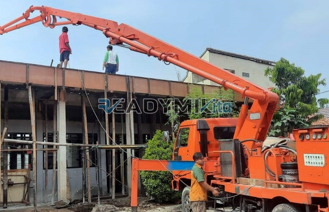

**Tempat Sewa Belalai Cor di Petamburan Jakarta Harian** - Hai Mitra Readymix Kita! Punya proyek konstruksi di Petamburan Jakarta yang butuh percepatan? Atau mungkin akses lokasi pengecoran yang cukup menantang? Nah, kami dari ReadymixKita hadir sebagai solusi tepat untuk mengatasi berbagai kendala tersebut. Kami siap mendukung kelancaran proyek Anda dengan layanan sewa belalai cor yang handal dan terpercaya.

Bagi Anda yang berlokasi di Petamburan Jakarta dan sekitarnya, ReadymixKita menyediakan layanan sewa alat cor pompa beton untuk beragam kebutuhan konstruksi. Kami hadir sebagai mitra modern untuk memastikan proyek Anda berjalan lancar, efisien, dan sesuai target. Yuk, simak bagaimana layanan kami bisa membantu Anda!



## Apa Saja Keunggulan Menggunakan Belalai Cor?

Concrete pump, atau yang lebih dikenal dengan belalai cor, adalah perangkat canggih yang dirancang untuk memindahkan beton cair dari truk mixer langsung ke titik pengecoran menggunakan jaringan pipa. Alat ini menjadi solusi ideal untuk berbagai kondisi proyek, terutama di lokasi dengan akses terbatas atau membutuhkan ketinggian khusus. Apa saja kelebihannya?

1. **Hemat Waktu dan Tenaga Kerja**

   Dibandingkan metode pengecoran manual, concrete pump mempercepat proses pengecoran secara signifikan. Proses pemindahan beton cair langsung ke lokasi pengecoran mengurangi kebutuhan tenaga kerja yang besar.

2. **Hasil Pengecoran yang Presisi**

   Alat ini memastikan beton terdistribusi secara merata dan tepat sasaran, baik untuk konstruksi horizontal maupun vertikal seperti lantai, kolom, dan dinding.

3. **Solusi untuk Lokasi yang Sulit Dijangkau**

   Dengan selang fleksibel, concrete pump mampu menjangkau area yang sulit diakses, misalnya gang sempit, bagian belakang bangunan, atau konstruksi bertingkat tinggi.

4. **Kapasitas Pengecoran yang Besar**

   Mampu menangani volume beton yang besar dalam waktu singkat, concrete pump ideal untuk proyek konstruksi skala kecil maupun besar.

## Kenapa Harus Memilih Layanan ReadymixKita?

Di antara banyaknya penyedia jasa sewa pompa beton, **ReadymixKita** menawarkan keunggulan yang membedakan kami:

1. **Reputasi Terpercaya dan Pengalaman Luas**

   Kami telah berpengalaman menangani berbagai proyek konstruksi di Petamburan Jakarta dengan tingkat kepuasan pelanggan yang tinggi. Tim kami terdiri dari operator berpengalaman yang memastikan alat beroperasi secara optimal.

2. **Pilihan Concrete Pump yang Lengkap**

   Kami menyediakan beragam jenis concrete pump yang dapat disesuaikan dengan kebutuhan proyek Anda, antara lain:
   - **Mini Pump**: Ideal untuk proyek rumah tinggal dan area sempit.
   - **Standard Pump**: Cocok untuk proyek skala menengah hingga besar.
   - **Long Boom Pump**: Dirancang untuk proyek yang membutuhkan jangkauan tinggi.

3. **Perawatan Teratur untuk Performa Maksimal**

   Semua unit concrete pump kami menjalani perawatan berkala untuk menjamin performa terbaik. Hal ini memberi Anda keyakinan bahwa proses pengecoran berjalan lancar tanpa gangguan teknis.

4. **Layanan Profesional dan Pelayanan Ramah**

   Kami tidak hanya menyediakan alat, tetapi juga operator berpengalaman untuk memastikan proses penuangan berjalan lancar dari awal hingga akhir.

## Spesialis Penyewaan Belalai Cor di Petamburan Jakarta: Keunggulan Lokal Kami

Sebagai penyedia jasa lokal, kami memahami seluk-beluk proyek konstruksi di Petamburan Jakarta. Ini menjadi keunggulan utama kami:

1. **Akses Cepat dan Mudah di Petamburan Jakarta**

   Lokasi kantor dan gudang kami yang strategis memungkinkan kami memberikan layanan cepat ke seluruh wilayah Petamburan Jakarta, baik di area pusat maupun pinggiran.

2. **Pemahaman Mendalam Kondisi Lokal**

   Kami berpengalaman bekerja di Petamburan Jakarta, sehingga memahami tantangan spesifik seperti kontur tanah yang bervariasi dan kepadatan penduduk. Ini memungkinkan kami memberikan solusi terbaik sesuai kebutuhan proyek Anda.

3. **Harga Kompetitif Tanpa Mengurangi Kualitas**

   Kami menawarkan harga yang bersaing tanpa mengorbankan kualitas layanan, menjadikannya pilihan yang tepat untuk proyek konstruksi Anda.

## Penawaran Spesial dan Harga Kompetitif di Petamburan Jakarta

Kami menyadari bahwa anggaran adalah pertimbangan penting dalam setiap proyek. Oleh karena itu, kami menawarkan:

1. **Harga yang Jelas dan Transparan**

   Anda akan mendapatkan rincian harga sewa yang lengkap, termasuk biaya operator dan bahan bakar. Tidak ada biaya tambahan yang tak terduga.

2. **Diskon dan Promo Menarik**

   Nikmati diskon menarik untuk penyewaan jangka panjang atau pesanan dalam jumlah besar. Kami juga memberikan penawaran khusus untuk proyek di wilayah Petamburan Jakarta.

3. **Konsultasi Gratis untuk Pemilihan Alat yang Tepat**

   Bingung memilih jenis concrete pump yang sesuai dengan proyek Anda? Kami siap membantu Anda dengan konsultasi gratis untuk menentukan solusi terbaik.

## Info Harga Sewa Belalai Cor di Petamburan Jakarta



Jangan biarkan kendala pengecoran menghambat kelancaran proyek Anda. Hubungi kami sekarang untuk layanan sewa belalai cor terpercaya di Petamburan Jakarta!

Kami juga menawarkan layanan survei lokasi dan konsultasi gratis untuk memastikan semua kebutuhan Anda terpenuhi dengan baik. Segera pesan dan rasakan manfaat pengecoran yang cepat, efisien, dan memuaskan.

Proyek konstruksi yang sukses dimulai dari peralatan yang tepat. Dengan layanan sewa belalai cor dari ReadymixKita, Anda dapat mencapai target proyek dengan lebih cepat, mudah, dan akurat. Jangan ragu untuk menghubungi kami untuk layanan sewa alat beton terbaik di Petamburan Jakarta! Solusi tepat untuk hasil yang sempurna! [Tempat Sewa Belalai Cor di Ancol Jakarta Harian](/pompa/tempat-sewa-belalai-cor-di-ancol-jakarta-harian/) untuk kebutuhan pompa di Jakarta Utara.