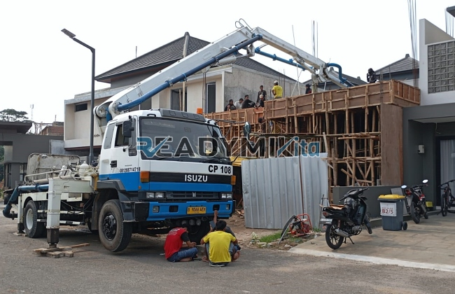

**Tempat Sewa Belalai Cor di Petojoselatan Jakarta Harian** - Hai Mitra Readymix Kita! Punya rencana membangun di Petojoselatan Jakarta? Pengecoran beton jadi salah satu tahapan krusial, ya? Nah, kami dari ReadymixKita hadir sebagai solusi praktis untuk kelancaran proyek Anda. Dengan layanan sewa belalai cor harian, pekerjaan pengecoran jadi lebih cepat, efisien, dan hemat tenaga.

Mau tahu bagaimana belalai cor bisa membantu proyek Anda? Yuk, simak penjelasannya!



## Apa Itu Belalai Cor dan Mengapa Penting?

Belalai cor, atau *concrete pump*, adalah alat modern yang dirancang khusus untuk memindahkan beton cair dari truk mixer langsung ke titik pengecoran menggunakan sistem perpipaan. Alat ini sangat krusial terutama saat akses lokasi terbatas atau membutuhkan pengecoran di ketinggian. Berikut beberapa keunggulan yang bisa Anda rasakan:

1. **Efisiensi Waktu dan Tenaga**

   Dibandingkan penuangan manual yang memakan waktu dan tenaga, pompa beton mempercepat proses pengecoran secara signifikan. Beton terkirim langsung ke area yang dibutuhkan tanpa perlu banyak tenaga kerja tambahan.

2. **Presisi Tingkat Tinggi**

   Pompa beton menjamin penempatan beton yang akurat, baik untuk struktur horizontal maupun vertikal seperti kolom, balok, dan dinding. Hasilnya lebih rapi dan kuat.

3. **Solusi untuk Lokasi Sulit**

   Dengan pipa yang fleksibel, pompa beton dapat menjangkau lokasi-lokasi yang sulit diakses, seperti gang sempit, area belakang bangunan, atau lantai-lantai tinggi.

4. **Kapasitas Pengecoran Besar**

   Alat ini mampu menangani volume beton besar dalam waktu singkat, menjadikannya ideal untuk proyek konstruksi skala kecil, menengah, hingga besar.

## Mengapa Memilih ReadymixKita untuk Sewa Pompa Beton di Petojoselatan Jakarta?

Di antara banyaknya penyedia layanan sewa pompa beton, **ReadymixKita** menawarkan keunggulan yang membedakan kami:

1. **Pengalaman dan Kepercayaan Pelanggan**

   Kami telah berpengalaman melayani berbagai proyek konstruksi di Petojoselatan Jakarta dan sekitarnya, dengan tingkat kepuasan pelanggan yang tinggi. Tim kami terdiri dari operator profesional yang terlatih.

2. **Pilihan Pompa Beton yang Lengkap**

   Kami menyediakan berbagai tipe pompa beton yang dapat disesuaikan dengan kebutuhan spesifik proyek Anda, antara lain:
   - **Mini Pump**: Cocok untuk proyek perumahan atau area dengan akses terbatas.
   - **Standard Pump**: Ideal untuk proyek skala menengah hingga besar.
   - **Long Boom Pump**: Dirancang untuk mencapai ketinggian tinggi pada bangunan bertingkat.

3. **Perawatan Terjadwal untuk Kinerja Optimal**

   Semua unit pompa beton kami menjalani perawatan berkala yang ketat untuk memastikan performa maksimal saat digunakan di lapangan. Anda tak perlu khawatir dengan risiko kerusakan alat.

4. **Layanan Profesional dan Suportif**

   Kami tidak hanya menyewakan alat, tetapi juga menyediakan operator berpengalaman yang siap membantu kelancaran proses pengecoran dari awal hingga akhir.

## Kelebihan Memilih Layanan Kami di Petojoselatan Jakarta

Sebagai penyedia layanan lokal, kami memahami betul karakteristik proyek konstruksi di wilayah Petojoselatan Jakarta, dan itu menjadi keuntungan bagi Anda:

1. **Respon Cepat dan Akses Mudah**

   Lokasi strategis kami memungkinkan kami merespons dengan cepat kebutuhan penyewaan pompa beton di seluruh wilayah Petojoselatan Jakarta, termasuk area perkotaan dan pinggiran.

2. **Pemahaman Kondisi Lokal**

   Dengan pengalaman bekerja di Petojoselatan Jakarta, kami memahami tantangan unik di wilayah ini, seperti kondisi tanah dan akses yang terbatas. Kami dapat menawarkan solusi terbaik sesuai kebutuhan Anda.

3. **Harga Bersaing**

   Kami berkomitmen memberikan harga sewa pompa beton yang terjangkau namun tetap menjamin kualitas layanan terbaik untuk proyek konstruksi Anda.

## Harga Sewa Pompa Beton yang Bersahabat di Petojoselatan Jakarta

Kami menyadari bahwa anggaran adalah hal penting dalam setiap proyek. Oleh karena itu, kami menawarkan:

1. **Harga Transparan dan Jelas**

   Kami akan memberikan rincian harga sewa pompa beton secara detail, termasuk biaya operator dan bahan bakar. Tanpa biaya tersembunyi yang mengejutkan!

2. **Promo dan Diskon Menarik**

   Dapatkan potongan harga untuk penyewaan jangka panjang atau pemesanan dalam jumlah besar. Ada pula promo spesial khusus untuk proyek di Petojoselatan Jakarta.

3. **Konsultasi Gratis untuk Penentuan Alat yang Tepat**

   Bingung memilih pompa beton yang sesuai? Jangan ragu untuk berkonsultasi dengan tim kami. Kami akan bantu Anda menentukan solusi terbaik secara cuma-cuma.

## Daftar Harga Sewa Belalai Cor di Petojoselatan Jakarta



Jangan biarkan kendala pengecoran menghambat proyek Anda! Segera hubungi kami untuk layanan sewa pompa beton berkualitas di Petojoselatan Jakarta.

Kami juga menyediakan layanan survei lokasi dan konsultasi gratis untuk memastikan semua kebutuhan Anda terpenuhi. Pesan sekarang dan rasakan kemudahan, efisiensi, serta hasil konstruksi yang memuaskan!

Membangun impian dimulai dengan alat yang tepat. Manfaatkan jasa sewa belalai cor dari ReadymixKita dan capai target proyek Anda dengan lebih cepat, efisien, dan akurat. Hubungi kami sekarang untuk mendapatkan penawaran terbaik di Petojoselatan Jakarta. Pilihan cerdas untuk hasil yang sempurna!