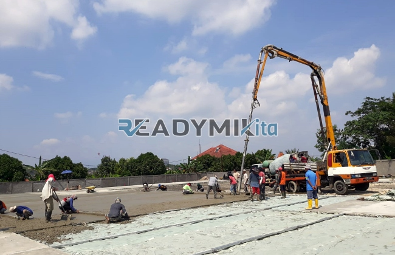

**Tempat Sewa Belalai Cor di Pondok Pinang Jakarta Harian** - Hai Mitra Readymix Kita! Punya proyek konstruksi di Pondok Pinang Jakarta dan butuh solusi pengecoran yang cepat serta efisien? Nah, Anda sudah berada di tempat yang tepat! Kami dari ReadymixKita hadir sebagai solusi penyewaan concrete pump harian yang terpercaya dan profesional di wilayah Pondok Pinang Jakarta dan sekitarnya. Yuk, simak lebih lanjut bagaimana kami bisa membantu kelancaran proyek Anda!



## Apa Itu Belalai Cor dan Mengapa Penting?

Concrete pump, atau yang lebih dikenal dengan istilah "belalai cor", adalah alat vital dalam dunia konstruksi modern. Alat ini berfungsi untuk memindahkan beton cair secara presisi dari truk mixer langsung ke lokasi pengecoran menggunakan sistem perpipaan. Lebih dari sekadar alat, concrete pump adalah kunci efisiensi, terutama saat menghadapi tantangan aksesibilitas atau ketinggian tertentu. Apa saja keuntungannya? Mari kita lihat:

1. **Hemat Waktu & Tenaga:** Penuangan beton jadi jauh lebih cepat dibandingkan metode manual. Prosesnya minim tenaga kerja, mengoptimalkan sumber daya Anda.
2. **Presisi Tingkat Tinggi:** Belalai cor memastikan beton dituangkan tepat sasaran, baik untuk struktur horizontal maupun vertikal, seperti lantai, kolom, dan dinding.
3. **Solusi Lokasi Sulit:** Dengan fleksibilitas pipa-pipanya, belalai cor mampu menjangkau area yang sulit diakses, seperti gang sempit, area belakang bangunan, atau lantai tinggi.
4. **Kapasitas Besar:** Alat ini cocok untuk proyek dengan volume pengecoran besar, menawarkan efisiensi maksimal dalam waktu singkat.

## Mengapa Memilih ReadymixKita untuk Sewa Belalai Cor di Pondok Pinang Jakarta?

Di antara banyaknya penyedia jasa, **ReadymixKita** menawarkan keunggulan yang benar-benar membedakan kami. Kami tidak sekadar menyewakan alat, tetapi memberikan pengalaman layanan yang komprehensif dan terpercaya:

1. **Pengalaman & Reputasi Solid:** Kami telah sukses menangani beragam proyek konstruksi di Pondok Pinang Jakarta, membangun reputasi yang kuat dan kepercayaan pelanggan yang tinggi. Tim kami terdiri dari operator profesional yang memastikan alat beroperasi dengan optimal.
2. **Pilihan Concrete Pump yang Lengkap:** Kami menyediakan berbagai tipe concrete pump yang dapat disesuaikan dengan kebutuhan proyek Anda, termasuk:
   - **Mini Pump:** Ideal untuk proyek rumah tinggal atau area dengan akses terbatas.
   - **Standard Pump:** Solusi optimal untuk proyek skala menengah.
   - **Long Boom Pump:** Dikhususkan untuk proyek yang membutuhkan jangkauan vertikal dan horizontal yang jauh.

3. **Perawatan Terjadwal & Terjamin:** Kami melakukan perawatan berkala pada setiap unit concrete pump untuk memastikan performa maksimal dan mencegah gangguan selama pekerjaan berlangsung.
4. **Layanan Profesional & Responsif:** Kami tidak hanya menyediakan alat, tetapi juga operator berpengalaman yang siap membantu dari awal hingga akhir proses pengecoran.

## Keunggulan Lokal: Jasa Sewa Belalai Cor yang Memahami Pondok Pinang Jakarta

Sebagai penyedia jasa lokal, kami memahami betul karakteristik dan tantangan konstruksi di wilayah Pondok Pinang Jakarta. Inilah yang membedakan kami:

1. **Aksesibilitas & Kecepatan:** Lokasi strategis kami memungkinkan kami memberikan layanan cepat dan responsif ke seluruh wilayah Pondok Pinang Jakarta, baik pusat kota maupun daerah pinggiran.
2. **Pemahaman Kondisi Lapangan:** Pengalaman bekerja di Pondok Pinang Jakarta membuat kami memahami isu-isu spesifik seperti kontur tanah yang beragam atau kepadatan penduduk. Kami dapat memberikan solusi yang paling efektif untuk kebutuhan Anda.
3. **Harga Bersaing:** Kami menawarkan harga sewa yang kompetitif tanpa mengorbankan kualitas layanan, menjadikannya pilihan cerdas untuk anggaran proyek Anda.

## Harga Terjangkau & Penawaran Khusus di Pondok Pinang Jakarta

Kami mengerti bahwa anggaran proyek merupakan pertimbangan utama. Oleh karena itu, kami menawarkan:

1. **Harga Transparan & Jelas:** Anda akan menerima detail lengkap harga sewa, termasuk biaya operator dan bahan bakar, tanpa biaya tersembunyi yang mengejutkan.
2. **Diskon & Promo Menarik:** Nikmati diskon spesial untuk sewa jangka panjang atau pemesanan dalam jumlah besar. Kami juga menawarkan promo eksklusif khusus untuk pelanggan di wilayah Pondok Pinang Jakarta.
3. **Konsultasi Gratis:** Bingung memilih tipe concrete pump yang tepat? Tim kami siap memberikan konsultasi gratis untuk membantu Anda menemukan solusi terbaik.

## Berapa Biaya Sewa Belalai Cor di Pondok Pinang Jakarta?



Jangan biarkan kendala pengecoran menghambat kelancaran proyek Anda. Segera hubungi kami untuk mendapatkan layanan penyewaan belalai cor terbaik di Pondok Pinang Jakarta! 

Kami juga menawarkan layanan survei lokasi gratis untuk memberikan rekomendasi solusi yang paling tepat. Pesan sekarang dan rasakan kemudahan konstruksi yang lebih cepat, efisien, dan memuaskan. Dengan pengalaman, komitmen pada kepuasan pelanggan, dan kualitas layanan yang tak tertandingi, ReadymixKita adalah mitra terbaik untuk proyek Anda di Pondok Pinang Jakarta. Percayakan kebutuhan penyewaan belalai cor Anda kepada kami dan wujudkan proyek impian Anda dengan hasil yang sempurna! Hubungi kami sekarang dan rasakan sendiri keunggulannya!