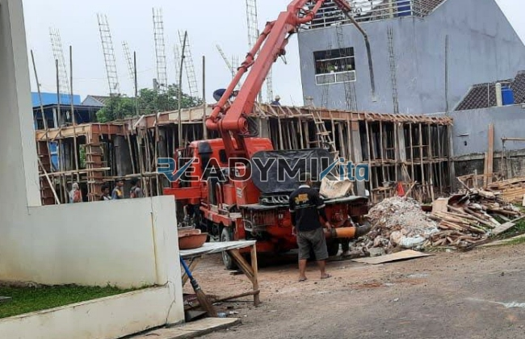

**Tempat Sewa Belalai Cor di Purabaya Sukabumi Harian** - Hai Mitra Readymix Kita! Punya proyek konstruksi di Purabaya Sukabumi yang butuh dukungan kecepatan dan efisiensi? Kami mengerti betul, pekerjaan pengecoran seringkali jadi titik kritis yang menentukan kelancaran proyek. Nah, ReadymixKita hadir sebagai solusi tepat untuk memastikan pengecoran Anda berjalan mulus.

Bagi Anda yang berlokasi di Purabaya Sukabumi dan sekitarnya, ReadymixKita siap menjadi mitra andalan dalam menyediakan jasa sewa concrete pump untuk berbagai kebutuhan konstruksi. Kami bukan sekadar penyedia alat, tapi juga solusi inovatif untuk mempercepat dan mempermudah pekerjaan Anda. 



## Apa Saja Keunggulan Menggunakan Belalai Cor?

Concrete pump, atau yang biasa disebut belalai cor, adalah alat modern yang dirancang untuk memindahkan beton secara efisien dari truk mixer ke lokasi pengecoran menggunakan sistem pipa. Alat ini sangat ideal untuk berbagai kondisi proyek, terutama ketika akses lokasi terbatas atau memerlukan pengecoran pada ketinggian tertentu. Berikut beberapa keunggulan utama yang ditawarkan:

1. **Hemat Waktu dan Tenaga**

   Pengecoran menggunakan concrete pump jauh lebih cepat dibandingkan metode manual. Beton cair dialirkan langsung ke area yang dituju, mengurangi kebutuhan tenaga kerja yang besar.

2. **Presisi Tinggi dalam Pengecoran**

   Alat ini memastikan beton ditempatkan dengan akurat, baik untuk aplikasi horizontal seperti lantai maupun vertikal seperti kolom dan dinding.

3. **Solusi untuk Lokasi Sulit Diakses**

   Dengan pipa yang fleksibel, concrete pump mampu menjangkau area-area yang sulit dijangkau, seperti gang sempit, bagian belakang bangunan, atau lantai tinggi.

4. **Kapasitas Pengecoran Besar**

   Concrete pump mampu menangani volume beton yang besar dalam waktu singkat, cocok untuk proyek konstruksi skala kecil hingga besar.

## Kenapa Harus Sewa Concrete Pump dari ReadymixKita?

Di antara banyaknya penyedia jasa sewa concrete pump di Purabaya Sukabumi, ReadymixKita menawarkan keunggulan yang membedakan kami:

1. **Pengalaman dan Reputasi Terpercaya**

   Kami telah berpengalaman melayani berbagai proyek konstruksi di Purabaya Sukabumi dengan tingkat kepuasan pelanggan yang tinggi. Tim kami terdiri dari tenaga ahli yang memastikan peralatan beroperasi dengan optimal.

2. **Pilihan Concrete Pump yang Beragam**

   Kami menyediakan berbagai jenis concrete pump yang dapat disesuaikan dengan kebutuhan spesifik proyek Anda, di antaranya:
   - **Mini Pump**: Ideal untuk proyek rumah tangga dan area terbatas.
   - **Standard Pump**: Cocok untuk proyek dengan skala sedang hingga besar.
   - **Long Boom Pump**: Dirancang khusus untuk proyek yang memerlukan jangkauan pengecoran tinggi dan jarak jauh.

3. **Perawatan Peralatan Terjamin**

   Semua unit concrete pump kami menjalani perawatan berkala yang ketat untuk memastikan performa maksimal dan mencegah gangguan operasional di lapangan.

4. **Layanan Profesional dan Responsif**

   Kami tidak hanya menyediakan alat, tetapi juga operator berpengalaman untuk memastikan proses pengecoran berjalan lancar dari awal hingga akhir.

## Mengapa Memilih ReadymixKita untuk Proyek di Purabaya Sukabumi?

Sebagai penyedia jasa lokal, kami memiliki pemahaman mendalam tentang tantangan konstruksi di Purabaya Sukabumi. Keunggulan utama yang kami tawarkan meliputi:

1. **Akses Cepat dan Mudah**

   Lokasi strategis gudang dan armada kami memungkinkan kami memberikan layanan yang cepat dan responsif ke seluruh wilayah Purabaya Sukabumi, baik di pusat kota maupun area pinggiran.

2. **Pemahaman Kondisi Lokal**

   Kami memahami betul karakteristik kondisi lapangan di Purabaya Sukabumi, termasuk kontur tanah yang bergelombang atau area yang padat penduduk. Hal ini memungkinkan kami memberikan solusi yang tepat sasaran.

3. **Harga yang Kompetitif**

   Kami menawarkan harga sewa yang bersaing tanpa mengorbankan kualitas layanan, menjadikan kami pilihan yang cerdas untuk anggaran konstruksi Anda.

## Informasi Harga dan Penawaran Spesial di Purabaya Sukabumi

Kami memahami bahwa harga adalah pertimbangan penting dalam setiap proyek. Oleh karena itu, kami menawarkan:

1. **Harga Transparan dan Jelas**

   Anda akan mendapatkan rincian harga sewa yang lengkap, termasuk biaya operator dan bahan bakar. Tidak ada biaya tersembunyi – semua informasi disajikan secara terbuka.

2. **Diskon dan Promosi Menarik**

   Nikmati diskon khusus untuk penyewaan jangka panjang atau pemesanan dalam jumlah besar. Kami juga menawarkan promo-promo menarik untuk proyek-proyek di wilayah Purabaya Sukabumi.

3. **Konsultasi Gratis**

   Bingung memilih jenis concrete pump yang tepat untuk proyek Anda? Jangan ragu untuk berkonsultasi dengan tim ahli kami secara gratis. Kami akan membantu Anda menemukan solusi yang optimal.

## Lihat Daftar Harga Sewa Belalai Cor Terkini di Purabaya Sukabumi



Jangan biarkan tantangan pengecoran menghambat kemajuan proyek Anda. Hubungi ReadymixKita sekarang juga untuk mendapatkan layanan sewa belalai cor terbaik di Purabaya Sukabumi!

Kami juga menyediakan layanan survei lokasi dan konsultasi gratis untuk memastikan semua kebutuhan Anda terpenuhi. Pesan sekarang dan rasakan kemudahan konstruksi yang cepat, efisien, dan memuaskan.

Proyek konstruksi yang sukses dimulai dengan peralatan yang tepat. Dengan layanan sewa belalai cor dari ReadymixKita, Anda dapat mencapai target proyek dengan lebih efisien, cepat, dan akurat. Segera hubungi kami untuk solusi pengecoran terbaik di Purabaya Sukabumi. Pilihan bijak untuk hasil yang sempurna! [Tempat Sewa Belalai Cor di Babakan Bogor Harian](/pompa/tempat-sewa-belalai-cor-di-babakan-bogor-harian/) — cek juga layanan kami di area sekitar Purabaya Sukabumi.