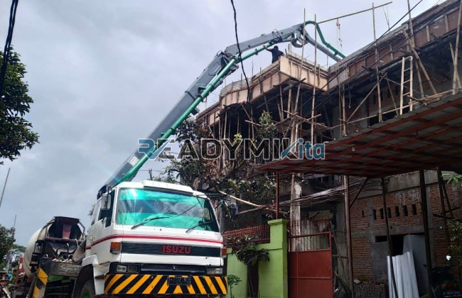

**Tempat Sewa Belalai Cor di Senayan Jakarta Harian** - Hai Mitra Readymix Kita! Butuh solusi cepat dan efisien untuk pengecoran beton di Senayan Jakarta? Kami dari ReadymixKita siap membantu! Pengecoran yang terencana dan tepat waktu adalah kunci sukses proyek Anda, dan kami punya jawabannya. Waktu berharga, tenaga terbatas, kualitas tak boleh ditawar – dengan pompa beton, semua itu bisa teratasi.

Butuh pompa beton yang handal di Senayan Jakarta? Layanan sewa belalai cor kami dirancang untuk memenuhi kebutuhan beragam proyek konstruksi. Kami hadir untuk memastikan proyek Anda berjalan lancar, tepat sasaran, dan sesuai anggaran.



## Apa Itu Belalai Cor dan Apa Saja Keunggulannya?

Mungkin beberapa dari Anda bertanya-tanya, apa sebenarnya *concrete pump* atau belalai cor itu? Singkatnya, ini adalah alat mutakhir yang digunakan untuk mentransfer beton cor liquid langsung dari truk mixer ke titik pengecoran menggunakan sistem perpipaan. Alat ini sangat ideal untuk beragam proyek, khususnya jika akses lokasi terbatas atau membutuhkan pengecoran pada ketinggian tertentu. Yuk, kita bedah lebih lanjut keunggulan yang ditawarkannya:

1. **Hemat Waktu dan Tenaga Kerja**

   Bayangkan, proses pengecoran yang biasanya memakan waktu dan tenaga banyak, kini bisa dipercepat secara signifikan! Pompa beton memindahkan beton cair secara langsung ke area pengecoran, meminimalkan kebutuhan tenaga kerja manual.

2. **Ketepatan Hasil Pengecoran**

   Perangkat ini menjamin penempatan material yang akurat, baik untuk struktur horizontal maupun vertikal—seperti lantai, kolom, atau dinding. Tentu saja, ini akan meningkatkan kualitas konstruksi Anda.

3. **Mengatasi Kendala Akses Lokasi**

   Dengan selang fleksibel yang dimilikinya, pompa beton mampu menjangkau area-area sulit dijangkau, misalnya gang sempit, belakang bangunan, atau struktur bertingkat tinggi. Sangat membantu, kan?

4. **Kapasitas Besar untuk Proyek Skala Apa Pun**

   Pompa beton mampu menangani volume material yang besar dalam waktu singkat. Ini menjadikannya solusi tepat untuk proyek konstruksi, mulai dari skala kecil hingga besar.

## Mengapa Memilih ReadymixKita?

Di antara banyaknya penyedia sewa pompa beton, ReadymixKita hadir menawarkan nilai tambah yang berbeda. Apa saja keunggulan kami?

1. **Pengalaman dan Kepercayaan Pelanggan**

   Kami telah berpengalaman melayani berbagai proyek konstruksi di Senayan Jakarta, dan telah mendapatkan reputasi baik dari para pelanggan kami.  Tim kami terdiri dari operator berpengalaman yang menjamin kinerja pompa beton maksimal.

2. **Pilihan Pompa Beton yang Lengkap**

   Kami menyediakan berbagai jenis pompa beton yang bisa disesuaikan dengan kebutuhan proyek Anda:
   - **Mini Pump**: Ideal untuk proyek perumahan atau area terbatas.
   - **Standard Pump**: Cocok untuk proyek menengah hingga besar.
   - **Long Boom Pump**: Dirancang untuk proyek yang membutuhkan jangkauan jauh.

3. **Perawatan Rutin untuk Performa Optimal**

   Setiap unit pompa beton kami menjalani perawatan berkala untuk memastikan performa terbaik. Anda dapat tenang karena risiko gangguan teknis selama pengecoran sangat kecil.

4. **Layanan Profesional dan Personal**

   Kami tidak hanya menyewakan alat, tetapi juga menyediakan operator terlatih yang akan memastikan proses penuangan beton berjalan lancar dari awal hingga akhir.

## Keunggulan Kami sebagai Penyedia Jasa di Senayan Jakarta

Sebagai penyedia jasa lokal, kami memahami betul seluk-beluk konstruksi di Senayan Jakarta. Apa saja keunggulan yang kami tawarkan?

1. **Akses Cepat dan Mudah**

   Lokasi strategis pabrik dan gudang kami memungkinkan kami memberikan layanan cepat ke seluruh area Senayan Jakarta, baik pusat kota maupun daerah sekitarnya.

2. **Memahami Kondisi Lokal Senayan Jakarta**

   Kami memiliki pengalaman bekerja di Senayan Jakarta. Ini membantu kami memahami tantangan spesifik seperti kondisi medan yang beragam atau kepadatan lalu lintas, sehingga kami dapat memberikan solusi terbaik bagi proyek Anda.

3. **Harga Sewa yang Kompetitif**

   Kami menawarkan harga sewa yang bersaing tanpa mengorbankan kualitas layanan, menjadikannya pilihan terbaik untuk anggaran proyek Anda.

## Harga Terjangkau dan Penawaran Menarik di Senayan Jakarta

Kami sadar bahwa anggaran merupakan pertimbangan penting dalam setiap proyek. Karena itu, kami menawarkan:

1. **Harga Sewa yang Jelas dan Transparan**

   Kami memberikan rincian harga sewa pompa beton—termasuk biaya operator dan bahan bakar—dengan jelas. Tidak ada biaya tambahan tersembunyi.

2. **Diskon dan Promosi Spesial**

   Nikmati diskon menarik untuk penyewaan jangka panjang atau pesanan dalam jumlah besar. Kami juga memiliki penawaran khusus untuk proyek-proyek di wilayah Senayan Jakarta, lho!

3. **Konsultasi Gratis – Kami Bantu Anda Memilih!**

   Bingung pompa beton jenis apa yang paling sesuai dengan proyek Anda? Jangan khawatir! Kami menyediakan layanan konsultasi gratis untuk membantu Anda memilih solusi yang optimal.

## Daftar Harga Sewa Belalai Cor di Senayan Jakarta



Jangan biarkan kesulitan dalam pengecoran beton memperlambat proyek Anda. Segera hubungi kami untuk mendapatkan layanan penyewaan belalai cor terbaik di Senayan Jakarta! Kami juga menyediakan layanan survei lokasi dan konsultasi gratis untuk memastikan semua kebutuhan Anda terpenuhi. Pesan sekarang dan rasakan efisiensi, efektivitas, dan kepuasan dalam setiap proyek Anda. 

Dengan pengalaman, komitmen terhadap kepuasan pelanggan, dan layanan berkualitas tinggi, ReadymixKita adalah mitra ideal untuk proyek konstruksi Anda di Senayan Jakarta. Percayakan kebutuhan penyewaan belalai cor Anda kepada kami, dan raih kesuksesan proyek impian Anda! Hubungi kami segera dan buktikan sendiri keunggulan layanan kami! [Tempat Sewa Belalai Cor di Ancol Jakarta Harian](/pompa/tempat-sewa-belalai-cor-di-ancol-jakarta-harian/) – kalau proyek Anda juga mencakup area di sana, kami juga punya solusi lengkap!