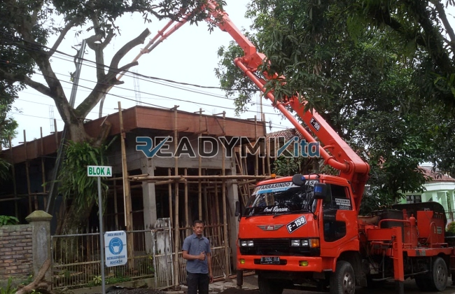

**Tempat Sewa Belalai Cor di Serdang Jakarta Harian** - Hai Mitra Readymix Kita! Punya proyek konstruksi di Serdang Jakarta dan ingin pengecoran beton yang lebih cepat dan efisien? Gimana kalau kita bahas solusinya? Kami dari ReadymixKita hadir sebagai penyedia layanan sewa pompa beton yang siap mendukung kelancaran proyek Anda.

Serdang Jakarta berkembang sangat dinamis, dengan berbagai proyek konstruksi yang terus bermunculan. Untuk menjawab kebutuhan konstruksi yang semakin beragam ini, ReadymixKita hadir menawarkan solusi modern: layanan sewa alat pompa beton. Pilihan cerdas untuk menjamin proyek di Serdang Jakarta berjalan lancar dan menghasilkan kualitas terbaik.



## Apa Itu Belalai Cor dan Mengapa Penting?

Concrete pump, atau yang lebih dikenal dengan belalai cor, adalah mesin canggih yang memindahkan beton cair langsung dari *mixer truck* ke area pengecoran menggunakan pipa. Alat ini sangat ideal untuk berbagai kondisi proyek, terutama ketika akses ke lokasi sulit atau membutuhkan ketinggian tertentu. Apa saja keunggulannya? Mari kita simak:

1. **Efisiensi Waktu dan Tenaga**

   Pengecoran menggunakan concrete pump jauh lebih cepat dibandingkan cara manual. Beton langsung dipindahkan ke lokasi yang dituju, mengurangi kebutuhan akan tenaga kerja yang besar.

2. **Hasil Pengecoran Presisi**

   Alat ini memastikan material dituangkan secara akurat ke tempat yang diinginkan, untuk struktur horizontal maupun vertikal seperti lantai, kolom, dan dinding. 

3. **Jangkauan Area Sulit**

   Dengan selang fleksibelnya, concrete pump bisa menjangkau area-area yang sulit diakses, seperti gang sempit, bagian belakang bangunan, atau struktur bertingkat tinggi.

4. **Kapasitas Besar untuk Berbagai Skala Proyek**

   Mampu menangani volume material yang besar dalam waktu singkat, concrete pump cocok untuk proyek kecil maupun besar.

## Mengapa Memilih Layanan Sewa ReadymixKita?

Di tengah banyaknya pilihan penyewaan pompa beton, **ReadymixKita** menawarkan keunggulan yang membedakan kami:

1. **Pengalaman dan Reputasi Terpercaya**

   Kami memiliki pengalaman luas dalam melayani berbagai proyek konstruksi di Serdang Jakarta, dengan tingkat kepuasan pelanggan yang tinggi. Tim kami yang terdiri dari operator berpengalaman memastikan alat beroperasi secara optimal.

2. **Pilihan Concrete Pump yang Lengkap**

   Kami menyediakan beragam tipe pompa beton yang dapat disesuaikan dengan kebutuhan spesifik proyek Anda:
   - **Mini Pump**: Ideal untuk proyek rumah tinggal dan area sempit.
   - **Standard Pump**: Cocok untuk proyek skala sedang hingga besar.
   - **Long Boom Pump**: Dikhususkan untuk proyek yang membutuhkan jangkauan tinggi dan jarak jauh.

3. **Perawatan Alat Berkala Terjamin**

   Kami melakukan perawatan rutin pada setiap unit pompa beton untuk memastikan performanya selalu prima. Ini memberikan Anda ketenangan pikiran selama proses pengecoran.

4. **Layanan Profesional dan Pelayanan Ramah**

   Kami tidak hanya menyediakan alat, tetapi juga operator berpengalaman yang memastikan proses penuangan berjalan lancar dari awal hingga akhir.

## Keunggulan Kami Sebagai Penyedia Lokal di Serdang Jakarta

Sebagai penyedia layanan lokal, kami sangat memahami karakteristik proyek konstruksi di wilayah Serdang Jakarta. Berikut adalah keunggulan utama kami:

1. **Akses Cepat dan Mudah**

   Lokasi strategis kantor dan penyimpanan kami memungkinkan kami memberikan layanan cepat ke seluruh wilayah Serdang Jakarta, baik pusat kota maupun daerah pinggiran.

2. **Pemahaman Kondisi Lokal yang Mendalam**

   Kami berpengalaman bekerja di Serdang Jakarta dan memahami tantangan spesifik seperti medan yang bergelombang atau area yang padat penduduk. Dengan begitu, kami dapat memberikan solusi terbaik yang disesuaikan dengan kebutuhan Anda.

3. **Harga Kompetitif dan Terjangkau**

   Kami menawarkan harga yang bersaing tanpa mengorbankan kualitas layanan. Kami adalah pilihan yang tepat untuk mendukung anggaran konstruksi Anda.

## Penawaran Spesial dan Harga Transparan di Serdang Jakarta

Kami mengerti bahwa anggaran adalah hal penting dalam setiap proyek. Oleh karena itu, kami menawarkan:

1. **Harga yang Jelas dan Transparan**

   Kami akan memberikan rincian harga penyewaan pompa beton, termasuk biaya operator dan bahan bakar. Tidak ada biaya tambahan yang tidak terduga.

2. **Diskon dan Promo Menarik**

   Nikmati diskon menarik untuk penyewaan jangka panjang atau pemesanan dalam jumlah besar. Kami juga menawarkan promo khusus untuk proyek-proyek di wilayah Serdang Jakarta.

3. **Konsultasi Gratis untuk Kebutuhan Anda**

   Bingung pompa beton jenis apa yang paling cocok untuk proyek Anda? Jangan ragu untuk memanfaatkan layanan konsultasi gratis kami. Kami akan membantu Anda memilih solusi terbaik.

## Informasi Harga Sewa Belalai Cor di Serdang Jakarta



Jangan biarkan kendala pengecoran menghambat kemajuan proyek Anda. Hubungi kami sekarang untuk mendapatkan layanan penyewaan pompa beton terbaik di Serdang Jakarta!

Kami juga menyediakan layanan survei lokasi dan konsultasi gratis untuk memastikan kebutuhan Anda terpenuhi dengan sempurna. Segera pesan dan nikmati proses konstruksi yang lebih cepat, efisien, dan memuaskan.

Konstruksi yang efisien dimulai dari pemilihan alat yang tepat. Percayakan kebutuhan pompa beton Anda pada ReadymixKita, dan raih target proyek Anda dengan lebih mudah. Hubungi kami sekarang untuk layanan sewa pompa cor terbaik di Serdang Jakarta. Pilihan cerdas untuk hasil yang sempurna!