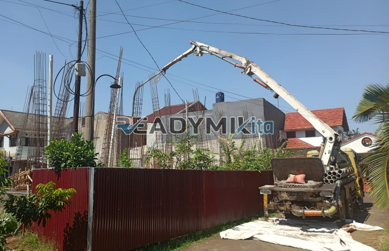

**Tempat Sewa Belalai Cor di Setu Tangerang Harian** - Hai Mitra Readymix Kita! Punya proyek konstruksi di Setu Tangerang yang butuh efisiensi tinggi? Nah, kami dari ReadymixKita hadir sebagai solusi tepat untuk kebutuhan pengecoran beton Anda. Kami menyediakan layanan sewa concrete pump harian yang akan memperlancar dan mempercepat pekerjaan Anda.

Setu Tangerang tengah berkembang pesat, dengan semakin banyaknya proyek pembangunan yang bermunculan. Kami memahami betul kebutuhan akan layanan pengecoran yang andal dan efisien di kawasan ini. Oleh karena itu, ReadymixKita hadir menawarkan solusi sewa concrete pump yang inovatif, memastikan proyek Anda di Setu Tangerang berjalan lancar dan berkualitas.



## Apa Itu Belalai Cor dan Mengapa Penting untuk Proyek Anda?

Concrete pump, atau yang biasa disebut belalai cor, adalah alat canggih yang berfungsi memindahkan beton cair langsung dari truk mixer ke lokasi pengecoran menggunakan sistem perpipaan. Alat ini sungguh ideal untuk berbagai kondisi proyek, terutama ketika akses lokasi terbatas atau memerlukan pengecoran pada ketinggian tertentu. Inilah beberapa keunggulan utama yang ditawarkan oleh concrete pump:

1. **Efisien Waktu dan Tenaga Kerja**

   Penggunaan concrete pump mempercepat proses pengecoran secara signifikan dibandingkan metode manual. Beton dapat dialirkan langsung ke titik yang dibutuhkan tanpa memerlukan banyak tenaga kerja.

2. **Presisi dan Akurasi Tinggi**

   Alat ini memastikan material ditempatkan dengan tepat pada area yang diinginkan, baik untuk konstruksi horizontal maupun vertikal – termasuk lantai, kolom, dan dinding. 

3. **Kemampuan Menjangkau Lokasi Sulit**

   Dengan pipa yang fleksibel, concrete pump mampu menjangkau area yang sulit diakses, seperti gang sempit, bagian belakang bangunan, atau area konstruksi bertingkat.

4. **Kapasitas Pengecoran Besar**

   Mampu menangani volume beton yang besar dalam waktu singkat, menjadikan alat ini pilihan tepat untuk proyek kecil maupun besar di Setu Tangerang.

## Mengapa Harus Memilih Jasa Sewa Concrete Pump dari ReadymixKita?

Di antara banyaknya penyedia layanan sewa concrete pump, **ReadymixKita** menawarkan nilai tambah yang membedakan kami:

1. **Pengalaman dan Kredibilitas Teruji**

   Kami telah berpengalaman melayani berbagai proyek konstruksi di Setu Tangerang dengan tingkat kepuasan pelanggan yang tinggi. Tim kami terdiri dari operator yang terlatih dan berpengalaman, menjamin alat beroperasi secara optimal.

2. **Pilihan Concrete Pump yang Beragam**

   Kami menyediakan beragam jenis concrete pump yang dapat disesuaikan dengan kebutuhan proyek Anda, termasuk:
   - **Mini Pump**: Sangat ideal untuk proyek perumahan atau area dengan akses terbatas.
   - **Standard Pump**: Cocok untuk proyek skala menengah hingga besar.
   - **Long Boom Pump**: Dirancang untuk proyek yang membutuhkan jangkauan vertikal atau horizontal yang tinggi.

3. **Perawatan Peralatan yang Rutin dan Terjamin**

   Seluruh unit concrete pump kami menjalani pemeriksaan berkala untuk memastikan performa yang optimal. Hal ini memberikan Anda ketenangan pikiran karena tidak perlu khawatir dengan kendala teknis selama proses pengecoran.

4. **Layanan Profesional dan Responsif**

   Kami tidak hanya menyediakan penyewaan alat, tetapi juga operator yang berpengalaman untuk membantu memastikan proses pengecoran berjalan lancar dari awal hingga akhir.

## Keunggulan Kami sebagai Penyedia Lokal di Setu Tangerang

Sebagai penyedia lokal, kami memahami betul karakteristik proyek konstruksi di Setu Tangerang. Inilah keunggulan yang kami tawarkan:

1. **Akses Cepat dan Mudah**

   Lokasi strategis pabrik dan gudang kami memungkinkan kami memberikan layanan cepat ke seluruh wilayah Setu Tangerang, baik pusat kota maupun daerah pinggiran.

2. **Pemahaman Kondisi Lokal yang Mendalam**

   Pengalaman kami bekerja di Setu Tangerang membuat kami memahami betul tantangan-tantangan spesifik seperti medan yang bergelombang atau lingkungan padat penduduk. Kami dapat memberikan solusi yang paling sesuai dengan kebutuhan Anda.

3. **Harga yang Bersaing**

   Kami menawarkan harga sewa yang kompetitif tanpa mengorbankan kualitas layanan, menjadikan kami pilihan terbaik untuk proyek konstruksi Anda di Setu Tangerang.

## Penawaran Terbaik dan Harga Kompetitif untuk Anda!

Kami tahu bahwa biaya adalah pertimbangan penting dalam setiap proyek. Oleh karena itu, kami menawarkan:

1. **Harga yang Jelas dan Transparan**

   Kami menyediakan rincian harga sewa yang jelas, termasuk biaya operator dan bahan bakar. Tidak ada biaya tambahan yang tersembunyi.

2. **Diskon dan Promosi Menarik**

   Nikmati diskon khusus untuk sewa jangka panjang atau pemesanan dalam jumlah besar. Kami juga menawarkan promosi khusus untuk proyek-proyek di wilayah Setu Tangerang.

3. **Konsultasi Gratis**

   Bingung memilih jenis concrete pump yang tepat untuk proyek Anda? Jangan ragu untuk menghubungi kami untuk mendapatkan konsultasi gratis.  Tim kami akan dengan senang hati membantu Anda menemukan solusi terbaik.

## Daftar Harga Sewa Belalai Cor di Setu Tangerang



Jangan biarkan kendala pengecoran menghambat kemajuan proyek Anda! Segera hubungi kami untuk layanan sewa concrete pump terbaik di Setu Tangerang. Kami siap membantu mewujudkan proyek impian Anda.

Selain penyewaan, kami juga menawarkan layanan survei lokasi dan konsultasi gratis untuk memastikan kebutuhan Anda terpenuhi sepenuhnya. Pesan sekarang dan rasakan kemudahan konstruksi yang efisien dan berkualitas. [Tempat Sewa Belalai Cor di Babakan Pasar Bogor Harian](/pompa/tempat-sewa-belalai-cor-di-babakan-pasar-bogor-harian/)

ReadymixKita adalah mitra terpercaya untuk proyek konstruksi Anda di Setu Tangerang. Dengan pengalaman, kualitas layanan, dan komitmen terhadap kepuasan pelanggan, serahkan kebutuhan penyewaan Belalai Cor Anda kepada kami, dan raih hasil yang optimal! Hubungi kami sekarang untuk informasi lebih lanjut.