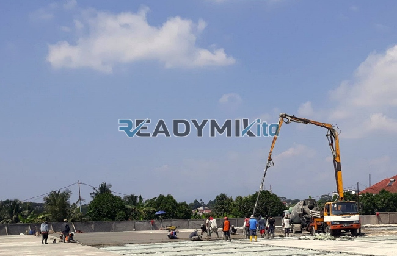

**Tempat Sewa Belalai Cor di Sukadiri Tangerang Harian** - Hai Mitra Readymix Kita! Punya proyek konstruksi di Sukadiri Tangerang yang perlu dipercepat? Kami mengerti betul, efisiensi adalah kunci utama kesuksesan di lapangan. Nah, ReadymixKita hadir sebagai solusi penyewaan belalai cor (concrete pump) handal yang dirancang untuk mendukung kelancaran proyek Anda.

Seiring dengan berkembangnya Sukadiri Tangerang, kebutuhan akan solusi konstruksi yang efisien dan berkualitas semakin meningkat. Untuk menjawab tantangan ini, kami dari ReadymixKita menyediakan jasa sewa belalai cor yang terpercaya dan terjangkau bagi Anda yang berada di Sukadiri Tangerang dan sekitarnya.



## Apa Itu Belalai Cor dan Apa Saja Kelebihannya?

Concrete pump, atau yang lebih dikenal sebagai belalai cor, adalah mesin konstruksi penting yang digunakan untuk memindahkan beton segar dari truk mixer ke lokasi pengecoran melalui pipa. Peralatan ini sangat ideal untuk berbagai kondisi proyek, terutama ketika akses ke lokasi pengecoran sulit atau memerlukan ketinggian tertentu. Mari kita lihat beberapa keunggulan utama belalai cor:

1. **Efisiensi Waktu dan Tenaga Kerja**

   Belalai cor secara signifikan mempercepat proses pengecoran dibandingkan metode manual. Transfer beton yang cepat dan langsung ke titik yang dibutuhkan mengurangi kebutuhan tenaga kerja yang besar.

2. **Ketepatan dan Presisi Tinggi**

   Alat ini memastikan penempatan material yang akurat, baik untuk struktur horizontal maupun vertikal seperti lantai, kolom, dan dinding.

3. **Jangkauan ke Lokasi Sulit**

   Dengan selang yang fleksibel dan bisa diatur, belalai cor mampu menjangkau area yang sulit diakses, seperti gang sempit, belakang bangunan, atau konstruksi bertingkat.

4. **Kapasitas Pengecoran Besar**

   Belalai cor mampu menangani volume beton yang signifikan dalam waktu singkat, menjadikannya pilihan yang tepat untuk proyek kecil, menengah, maupun besar.

## Mengapa Memilih ReadymixKita untuk Sewa Belalai Cor?

Di antara banyaknya pilihan penyewaan belalai cor, **ReadymixKita** menawarkan keunggulan yang membedakan kami:

1. **Pengalaman dan Reputasi Teruji**

   Kami telah berpengalaman melayani berbagai proyek konstruksi di Sukadiri Tangerang, dengan tingkat kepuasan pelanggan yang tinggi. Tim kami terdiri dari operator berpengalaman yang memastikan alat beroperasi secara optimal.

2. **Pilihan Belalai Cor yang Lengkap**

   Kami menyediakan beragam jenis concrete pump yang dapat disesuaikan dengan kebutuhan proyek Anda, termasuk:
   - **Mini Pump**: Ideal untuk proyek perumahan atau area dengan akses terbatas.
   - **Standard Pump**: Cocok untuk proyek skala menengah dan besar.
   - **Long Boom Pump**: Dirancang untuk proyek yang membutuhkan jangkauan vertikal tinggi.

3. **Perawatan Alat yang Terjamin**

   Setiap unit belalai cor kami menjalani perawatan berkala untuk memastikan performa yang andal. Anda bisa fokus pada proyek tanpa khawatir akan masalah teknis.

4. **Layanan Profesional dan Responsif**

   Kami tidak hanya menyediakan alat, tetapi juga operator terlatih yang siap membantu kelancaran proses pengecoran dari awal hingga akhir.

## Keuntungan Menyewa Belalai Cor di Sukadiri Tangerang dari Kami

Sebagai penyedia lokal, kami memahami betul karakteristik proyek konstruksi di Sukadiri Tangerang. Berikut adalah keunggulan utama kami:

1. **Akses Mudah dan Respon Cepat**

   Dengan lokasi yang strategis, kami dapat memberikan pelayanan cepat ke seluruh wilayah Sukadiri Tangerang, baik di pusat kota maupun area pinggiran.

2. **Pemahaman Kondisi Lokal yang Mendalam**

   Pengalaman kami di Sukadiri Tangerang memungkinkan kami memahami tantangan unik seperti kondisi tanah yang bervariasi dan lingkungan yang padat penduduk. Kami siap memberikan solusi yang paling sesuai.

3. **Harga yang Kompetitif**

   Kami menawarkan harga yang bersaing tanpa mengorbankan kualitas layanan, menjadikan kami pilihan yang hemat biaya untuk proyek konstruksi Anda.

## Penawaran Harga yang Bersaing dan Promo Spesial di Sukadiri Tangerang

Kami memahami bahwa anggaran adalah pertimbangan penting dalam setiap proyek. Oleh karena itu, kami menawarkan:

1. **Harga yang Transparan**

   Kami akan memberikan rincian harga penyewaan belalai cor secara jelas, termasuk biaya operator dan bahan bakar. Tidak ada biaya tambahan yang tersembunyi.

2. **Diskon dan Promo Menarik**

   Dapatkan potongan harga untuk penyewaan jangka panjang atau pemesanan dalam jumlah besar. Kami juga menyediakan penawaran khusus untuk proyek yang berlokasi di Sukadiri Tangerang.

3. **Konsultasi Gratis**

   Bingung memilih jenis belalai cor yang tepat untuk proyek Anda? Tim kami siap memberikan konsultasi gratis untuk membantu Anda menemukan solusi terbaik.

## Daftar Harga Sewa Belalai Cor Terbaru di Sukadiri Tangerang



Jangan biarkan kendala pengecoran menghambat kelancaran proyek Anda! Hubungi kami sekarang untuk mendapatkan layanan penyewaan belalai cor terbaik di Sukadiri Tangerang.

Kami juga menyediakan layanan survei lokasi gratis untuk memberikan rekomendasi yang paling sesuai dengan kebutuhan proyek Anda. Segera pesan dan rasakan kemudahan pengecoran yang cepat, efisien, dan memuaskan.

Proyek yang sukses dimulai dengan peralatan yang tepat. Dengan memilih jasa penyewaan Belalai Cor dari ReadymixKita, Anda dapat mencapai target proyek dengan lebih cepat, efisien, dan tepat sasaran. Hubungi kami sekarang untuk informasi lebih lanjut dan layanan sewa belalai cor terbaik di Sukadiri Tangerang. Ini adalah investasi cerdas untuk hasil yang optimal! [Tempat Sewa Belalai Cor di Babakan Bogor Harian](/pompa/tempat-sewa-belalai-cor-di-babakan-bogor-harian/)