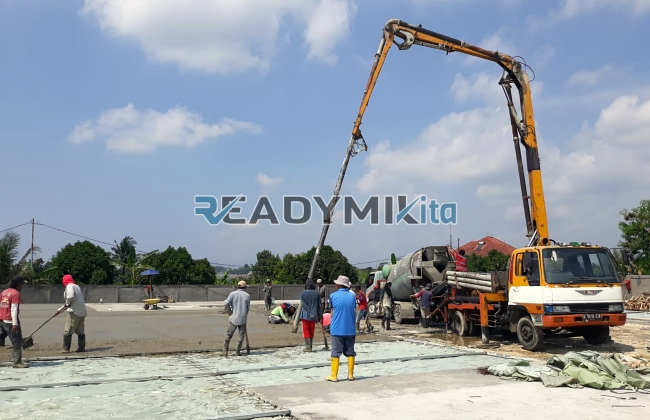

**Tempat Sewa Belalai Cor di Sukaraja Sukabumi Harian** - Hai Mitra Readymix Kita! Punya proyek pembangunan di Sukaraja Sukabumi yang butuh efisiensi? Pengecoran beton seringkali jadi titik krusial yang menentukan kelancaran proyek. Nah, ReadymixKita hadir sebagai solusi praktis untuk mengatasi tantangan tersebut, khususnya di area Sukaraja Sukabumi dan sekitarnya. Dengan layanan sewa belalai cor harian, pekerjaan pengecoran Anda jadi lebih cepat, tepat, dan hemat tenaga!

Di Sukaraja Sukabumi, ReadymixKita hadir sebagai penyedia jasa sewa concrete pump (belalai cor) terpercaya untuk berbagai kebutuhan konstruksi Anda. Kami memahami betul tantangan yang mungkin dihadapi di lapangan, dan berkomitmen memberikan solusi terbaik untuk kelancaran proyek Anda.



## Apa Itu Belalai Cor dan Apa Manfaatnya?

Belalai cor, atau *concrete pump*, adalah alat modern yang dirancang untuk memindahkan beton cair langsung dari *mixer truck* ke area pengecoran menggunakan sistem perpipaan. Alat ini benar-benar mengubah cara kerja pengecoran, terutama saat menghadapi akses lokasi yang sulit atau jika pengecoran membutuhkan ketinggian tertentu.  Berikut beberapa keuntungan utama menggunakan belalai cor:

1. **Hemat Waktu dan Biaya Tenaga**

   Bayangkan, pengecoran manual membutuhkan tim yang besar dan waktu yang lama. Dengan concrete pump, proses ini jadi jauh lebih efisien.  Beton cair dialirkan langsung ke titik yang dituju, mengurangi kebutuhan tenaga kerja manual.

2. **Presisi dan Kualitas Pengecoran Lebih Baik**

   Belalai cor memastikan beton ditempatkan secara akurat di area yang diinginkan. Ini sangat krusial untuk memastikan kekuatan dan kualitas struktur, baik untuk lantai, kolom, dinding, maupun elemen beton lainnya.

3. **Solusi untuk Lokasi yang Sulit Dijangkau**

   Punya proyek di area sempit, belakang gedung, atau lokasi bertingkat?  Pipa fleksibel pada concrete pump memungkinkan pengecoran di area yang sulit dijangkau oleh metode tradisional.

4. **Kapasitas Besar untuk Proyek Skala Apa Pun**

   Dengan kemampuannya mengelola volume material yang signifikan, belalai cor sangat ideal untuk proyek konstruksi kecil maupun besar.

## Mengapa Harus Memilih Jasa Sewa Belalai Cor dari ReadymixKita?

Di antara banyaknya penyedia jasa sewa concrete pump di Sukaraja Sukabumi, ReadymixKita menawarkan keunggulan yang nyata:

1. **Pengalaman dan Kredibilitas yang Teruji**

   Kami telah berpengalaman menangani beragam proyek konstruksi di Sukaraja Sukabumi dan sekitarnya. Reputasi kami dibangun atas dasar kepuasan pelanggan dan komitmen terhadap kualitas. Operator kami terlatih dan berpengalaman, menjamin operasional yang optimal.

2. **Pilihan Concrete Pump yang Beragam**

   Kami menyediakan berbagai tipe concrete pump yang dapat disesuaikan dengan kebutuhan proyek Anda:
   - **Mini Pump:** Cocok untuk proyek perumahan skala kecil dan area terbatas.
   - **Standard Pump:** Ideal untuk proyek dengan skala sedang hingga besar.
   - **Long Boom Pump:** Didesain khusus untuk proyek yang membutuhkan jangkauan tinggi.

3. **Jaminan Perawatan Alat yang Rutin**

   Kami secara berkala melakukan perawatan menyeluruh pada seluruh unit concrete pump kami untuk memastikan kinerjanya selalu prima. Ini berarti Anda bisa fokus pada proyek tanpa khawatir gangguan teknis.

4. **Layanan Profesional & Pelayanan Terbaik**

   Kami tidak hanya menyediakan unit, tapi juga operator berpengalaman yang siap membantu proses penuangan beton dari awal sampai akhir. Tim kami siap memberikan dukungan penuh.

## Keunggulan Memilih ReadymixKita di Sukaraja Sukabumi

Sebagai penyedia lokal, kami memiliki pemahaman mendalam tentang kondisi konstruksi di Sukaraja Sukabumi:

1. **Akses Mudah dan Respon Cepat**

   Lokasi strategis kami di Sukaraja Sukabumi memungkinkan kami memberikan layanan yang cepat dan responsif ke seluruh wilayah, baik di pusat kota maupun area pinggiran.

2. **Memahami Tantangan Lokal**

   Kami memahami betul karakteristik medan di Sukaraja Sukabumi, termasuk kondisi berbukit atau area yang padat penduduk.  Kami siap memberikan solusi yang paling sesuai dengan kondisi proyek Anda.

3. **Harga yang Kompetitif**

   Kami menawarkan harga sewa yang terjangkau tanpa mengorbankan kualitas layanan. Kami berkomitmen memberikan nilai terbaik untuk investasi Anda.

## Penawaran Harga Terbaik & Promo Spesial di Sukaraja Sukabumi

Kami memahami bahwa anggaran adalah pertimbangan penting dalam setiap proyek. Itulah mengapa kami menawarkan:

1. **Transparansi Harga**

   Anda akan mendapatkan rincian harga sewa yang jelas, termasuk biaya operator dan bahan bakar. Tidak ada biaya tambahan yang tersembunyi!

2. **Diskon dan Penawaran Menarik**

   Nikmati diskon khusus untuk penyewaan jangka panjang atau pemesanan dalam jumlah besar. Kami juga menawarkan penawaran khusus untuk proyek-proyek di Sukaraja Sukabumi.

3. **Konsultasi Gratis**

   Bingung memilih tipe concrete pump yang tepat? Jangan ragu untuk berkonsultasi dengan tim kami. Kami akan bantu Anda menemukan solusi terbaik.

## Daftar Harga Sewa Belalai Cor di Sukaraja Sukabumi



Jangan biarkan kendala pengecoran menghambat kelancaran proyek Anda! Hubungi ReadymixKita sekarang juga untuk mendapatkan layanan sewa belalai cor terbaik di Sukaraja Sukabumi.

Kami juga menyediakan layanan survei lokasi dan konsultasi gratis untuk memastikan solusi yang kami berikan sesuai dengan kebutuhan Anda. Pesan sekarang dan rasakan efisiensi, kecepatan, dan kualitas pengecoran yang optimal.

Dengan pengalaman, layanan berkualitas, dan komitmen terhadap kepuasan pelanggan, ReadymixKita adalah mitra terpercaya Anda untuk proyek konstruksi di Sukaraja Sukabumi. Percayakan kebutuhan sewa belalai cor Anda pada kami dan wujudkan proyek impian Anda dengan hasil yang maksimal. Jangan tunda lagi, hubungi kami sekarang juga dan rasakan perbedaannya! [anchor text](https://www.readymixkita.com/pompa/tempat-sewa-belalai-cor-di-ancol-jakarta-harian/)