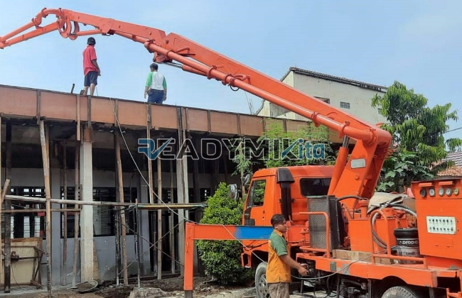

**Tempat Sewa Belalai Cor di Sukaresmi Bogor Harian** - Hai Mitra Readymix Kita! Pembangunan di Sukaresmi Bogor semakin berkembang pesat, ya? Proyek konstruksi baru bermunculan setiap hari, dan efisiensi pengecoran jadi kunci keberhasilan. Nah, ReadymixKita hadir sebagai solusi cerdas dengan layanan sewa concrete pump yang andal dan terpercaya di Sukaresmi Bogor!

Yuk, simak bagaimana layanan kami bisa mempercepat dan mempermudah proyek Anda. Kami menyediakan penyewaan alat concrete pump untuk berbagai kebutuhan konstruksi di Sukaresmi Bogor. Kami adalah mitra inovatif yang menjamin kelancaran dan kesuksesan proyek Anda.



## Concrete Pump: Solusi Pengecoran Modern yang Efisien

Concrete pump, atau yang sering disebut belalai cor, adalah perangkat canggih yang memompa beton cair langsung dari truk mixer ke lokasi pengecoran menggunakan pipa. Alat ini menjadi solusi ideal untuk proyek konstruksi dengan akses terbatas atau ketinggian tertentu. Tapi apa sebenarnya keunggulannya?

1. **Hemat Waktu dan Tenaga Kerja**

   Lupakan cara pengecoran manual yang memakan waktu dan tenaga! Concrete pump mempercepat proses penuangan secara signifikan, mengurangi kebutuhan tenaga kerja dan memperlancar alur pekerjaan.

2. **Ketepatan Penuangan Terjamin**

   Alat ini memastikan beton ditempatkan dengan presisi ke titik yang diinginkan, baik untuk fondasi, lantai, kolom, dinding, maupun struktur vertikal lainnya.

3. **Mengatasi Lokasi Sulit**

   Dengan pipa yang fleksibel, concrete pump mampu menjangkau area yang sulit diakses, seperti gang sempit, halaman belakang, atau lantai bangunan tinggi.

4. **Kapasitas Besar untuk Proyek Skala Apa Pun**

   Concrete pump dirancang untuk menangani volume beton yang besar dalam waktu singkat, cocok untuk proyek kecil maupun konstruksi skala besar.

## Mengapa Pilih ReadymixKita untuk Sewa Concrete Pump di Sukaresmi Bogor?

Di tengah banyaknya penyedia jasa sewa concrete pump, **ReadymixKita** menawarkan nilai lebih yang membedakan kami:

1. **Berpengalaman dan Terpercaya**

   Kami telah berpengalaman menangani berbagai proyek konstruksi di Sukaresmi Bogor dan sekitarnya, dengan reputasi yang terbukti dalam memberikan layanan berkualitas dan kepuasan pelanggan yang tinggi. Tim kami terdiri dari operator terlatih yang siap memastikan alat berfungsi optimal.

2. **Pilihan Concrete Pump yang Lengkap**

   Kami menyediakan beragam jenis concrete pump yang dapat disesuaikan dengan kebutuhan spesifik proyek Anda. Antara lain:
   - **Mini Pump**: Cocok untuk proyek rumah tangga atau area terbatas.
   - **Standard Pump**: Ideal untuk proyek menengah dan besar.
   - **Long Boom Pump**: Dirancang untuk proyek yang membutuhkan jangkauan jauh.

3. **Perawatan Terjadwal untuk Kinerja Maksimal**

   Seluruh unit concrete pump kami menjalani perawatan berkala yang ketat, memastikan kinerja optimal dan meminimalkan risiko gangguan teknis di lapangan. Anda dapat fokus pada proyek tanpa khawatir!

4. **Layanan Profesional dan Solutif**

   Kami tidak hanya menyediakan alat, tetapi juga didukung oleh tim profesional yang siap memberikan layanan konsultasi, pengoperasian, dan dukungan teknis sepanjang proyek Anda berjalan.

## Keunggulan Layanan Lokal Kami di Sukaresmi Bogor

Sebagai penyedia layanan lokal yang berdomisili di Sukaresmi Bogor, kami memahami betul karakteristik proyek yang ada di wilayah ini:

1. **Aksesibilitas dan Respon Cepat**

   Lokasi strategis kami memungkinkan kami memberikan layanan cepat dan responsif ke seluruh area Sukaresmi Bogor, termasuk pusat kota dan daerah pinggiran.

2. **Pemahaman Mendalam tentang Kondisi Lokal**

   Pengalaman kami di Sukaresmi Bogor membantu kami memahami tantangan spesifik yang mungkin dihadapi, seperti kontur tanah yang bervariasi atau area yang padat penduduk. Kami siap memberikan solusi optimal sesuai kebutuhan Anda.

3. **Harga Kompetitif dengan Kualitas Terjamin**

   Kami menawarkan harga sewa yang kompetitif tanpa mengorbankan kualitas layanan dan peralatan. Kami adalah pilihan cerdas untuk efisiensi anggaran proyek Anda.

## Penawaran Harga dan Promo Menarik di Sukaresmi Bogor

Kami menyadari bahwa anggaran adalah aspek krusial dalam setiap proyek konstruksi. Oleh karena itu, kami menawarkan:

1. **Rincian Harga yang Transparan**

   Anda akan mendapatkan rincian harga sewa yang jelas dan komprehensif, termasuk biaya operator dan bahan bakar jika diperlukan. Kami menjamin tidak ada biaya tersembunyi.

2. **Diskon dan Promo Eksklusif**

   Nikmati diskon menarik untuk penyewaan jangka panjang atau pemesanan dalam jumlah besar. Kami juga secara berkala menawarkan promo khusus untuk proyek di wilayah Sukaresmi Bogor.

3. **Konsultasi Gratis untuk Pemilihan Alat yang Tepat**

   Bingung menentukan jenis concrete pump yang paling sesuai untuk proyek Anda? Jangan ragu untuk berkonsultasi dengan tim ahli kami secara gratis. Kami akan membantu Anda menemukan solusi terbaik.

## Daftar Harga Sewa Belalai Cor di Sukaresmi Bogor



Jangan tunda lagi! Hubungi kami sekarang juga untuk mendapatkan penawaran harga terbaik dan layanan sewa concrete pump profesional di Sukaresmi Bogor!

Kami juga menyediakan layanan survei lokasi gratis untuk memastikan cakupan proyek yang optimal. Pesan sekarang dan rasakan kemudahan pengecoran yang cepat, efisien, dan memuaskan. Proyek konstruksi sukses dimulai dengan peralatan yang tepat – dan ReadymixKita siap menjadi mitra terpercaya Anda! Segera hubungi kami untuk layanan sewa belalai cor terbaik di Sukaresmi Bogor – pilihan cerdas untuk hasil yang sempurna!