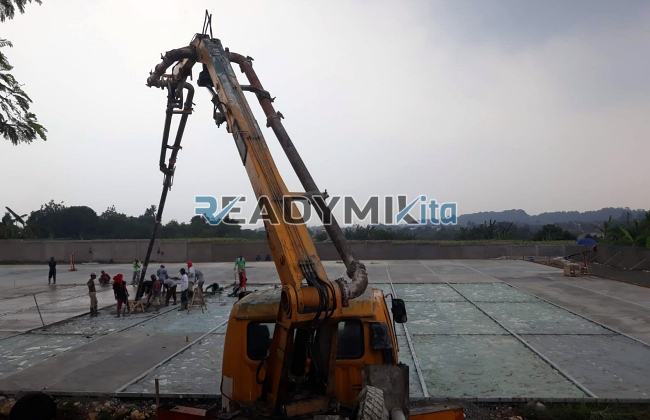

**Tempat Sewa Belalai Cor di Sungai Bambu Jakarta Harian** - Hai Mitra Readymix Kita! Mencari solusi pengecoran beton yang cepat dan efisien di Sungai Bambu Jakarta? Punya proyek konstruksi dengan akses terbatas atau membutuhkan penuangan presisi? Kami punya jawabannya! ReadymixKita hadir sebagai penyedia jasa sewa concrete pump terpercaya, siap mendukung kelancaran proyek Anda.

Mengatasi berbagai tantangan konstruksi, mulai dari akses lokasi sulit hingga kebutuhan pengecoran cepat, seringkali memerlukan solusi inovatif. Untungnya, concrete pump hadir sebagai jawaban cerdas. Di Sungai Bambu Jakarta, kami dari ReadymixKita siap menjadi mitra Anda untuk efisiensi dan akurasi dalam setiap proyek. Layanan kami dirancang untuk mempermudah pekerjaan Anda, memastikan proyek berjalan sesuai jadwal dan anggaran.



## Apa Itu Belalai Cor dan Mengapa Penting?

Concrete pump, atau yang sering disebut belalai cor, adalah alat modern untuk memindahkan beton cair dari truk mixer langsung ke lokasi pengecoran menggunakan sistem pipa. Bayangkan kemudahan dan kecepatan yang ditawarkan! Alat ini sangat ideal untuk berbagai proyek konstruksi, terutama ketika akses lokasi terbatas atau memerlukan pengecoran pada ketinggian tertentu. Berikut beberapa keunggulan yang bisa Anda dapatkan:

1. **Efisiensi Waktu & Biaya**

   Dibandingkan metode manual, concrete pump mempercepat proses pengecoran secara signifikan. Mengurangi kebutuhan tenaga kerja juga berarti penghematan biaya yang optimal.

2. **Presisi Tanpa Kompromi**

   Alat ini menjamin penempatan beton yang akurat pada area yang ditargetkan, baik untuk struktur vertikal seperti kolom dan dinding, maupun horizontal seperti lantai.

3. **Solusi Akses Lokasi Sulit**

   Dengan pipa yang fleksibel, concrete pump dapat menjangkau lokasi yang sulit diakses, seperti gang sempit, area belakang bangunan, atau lantai-lantai tinggi.

4. **Kapasitas Pengecoran Besar**

   Mampu menangani volume beton yang besar dalam waktu singkat, alat ini cocok untuk proyek skala kecil hingga besar.

## Mengapa Memilih ReadymixKita di Sungai Bambu Jakarta?

Di antara banyaknya pilihan penyewaan concrete pump, ReadymixKita menawarkan keunggulan kompetitif yang akan memberikan nilai tambah bagi proyek Anda:

1. **Pengalaman & Kepercayaan Pelanggan**

   Kami telah berpengalaman melayani beragam proyek konstruksi di Sungai Bambu Jakarta, selalu mengutamakan kepuasan pelanggan. Operator kami adalah tenaga profesional yang terlatih, menjamin pengoperasian alat yang efisien dan aman.

2. **Pilihan Concrete Pump yang Lengkap**

   Kami menyediakan berbagai tipe concrete pump yang dapat disesuaikan dengan kebutuhan proyek Anda:
   - **Mini Pump**: Ideal untuk proyek perumahan dengan ruang terbatas.
   - **Standard Pump**: Cocok untuk proyek dengan skala sedang hingga besar.
   - **Long Boom Pump**: Dirancang untuk proyek yang membutuhkan jangkauan horizontal maupun vertikal yang luas.

3. **Perawatan Terjamin, Kinerja Optimal**

   Kami melakukan perawatan berkala secara rutin pada seluruh unit concrete pump untuk memastikan kinerja yang andal dan mencegah gangguan di lokasi proyek.

4. **Layanan Profesional & Responsif**

   Kami tidak hanya menyediakan alat, tetapi juga operator berpengalaman yang siap memberikan dukungan penuh selama proses pengecoran.

## Keunggulan Jasa Sewa Concrete Pump Lokal di Sungai Bambu Jakarta

Sebagai penyedia lokal, ReadymixKita memahami tantangan dan karakteristik proyek konstruksi di Sungai Bambu Jakarta:

1. **Akses Cepat & Kemudahan Servis**

   Lokasi strategis kami memungkinkan kami memberikan respons cepat ke seluruh wilayah Sungai Bambu Jakarta, termasuk area pusat dan pinggiran kota.

2. **Pemahaman Kondisi Lokal**

   Pengalaman kami di Sungai Bambu Jakarta memungkinkan kami memahami kondisi medan, kepadatan lalu lintas, dan regulasi setempat. Kami siap memberikan solusi yang paling sesuai untuk kebutuhan Anda.

3. **Harga Bersaing, Kualitas Terjamin**

   Kami menawarkan harga sewa yang kompetitif tanpa mengorbankan kualitas layanan. Investasi cerdas untuk proyek konstruksi Anda.

## Penawaran Harga & Promo Spesial di Sungai Bambu Jakarta

Kami memahami bahwa anggaran adalah faktor penting dalam setiap proyek konstruksi. Karena itu, kami menawarkan:

1. **Harga Transparan & Jelas**

   Anda akan mendapatkan rincian harga sewa yang komprehensif, termasuk biaya operator (jika diperlukan) dan bahan bakar. Tanpa biaya tersembunyi!

2. **Diskon & Promo Menarik**

   Nikmati potongan harga untuk penyewaan jangka panjang atau pemesanan dalam jumlah besar. Kami juga sering menawarkan promo khusus untuk proyek di wilayah Sungai Bambu Jakarta.

3. **Konsultasi Gratis – Temukan Solusi Terbaik!**

   Bingung memilih jenis concrete pump yang tepat? Tim ahli kami siap memberikan konsultasi gratis untuk membantu Anda menemukan solusi yang paling optimal.

## Daftar Harga Sewa Belalai Cor di Sungai Bambu Jakarta



Jangan biarkan kendala pengecoran menghambat kemajuan proyek Anda. Hubungi ReadymixKita sekarang untuk mendapatkan layanan sewa concrete pump terbaik di Sungai Bambu Jakarta!

Kami juga menyediakan layanan survei lokasi dan konsultasi gratis untuk memastikan semua kebutuhan Anda terpenuhi. Pesan sekarang dan rasakan kemudahan pengecoran yang efisien, cepat, dan memuaskan. [Tempat Sewa Belalai Cor di Ancol Jakarta Harian](/pompa/tempat-sewa-belalai-cor-di-ancol-jakarta-harian/)

Dengan pengalaman, layanan berkualitas, dan komitmen terhadap kepuasan pelanggan, ReadymixKita adalah mitra terpercaya untuk proyek konstruksi Anda di Sungai Bambu Jakarta. Serahkan kebutuhan penyewaan Belalai Cor Anda kepada kami dan wujudkan proyek impian Anda dengan hasil yang maksimal! Segera hubungi kami dan buktikan sendiri keunggulan layanan kami.