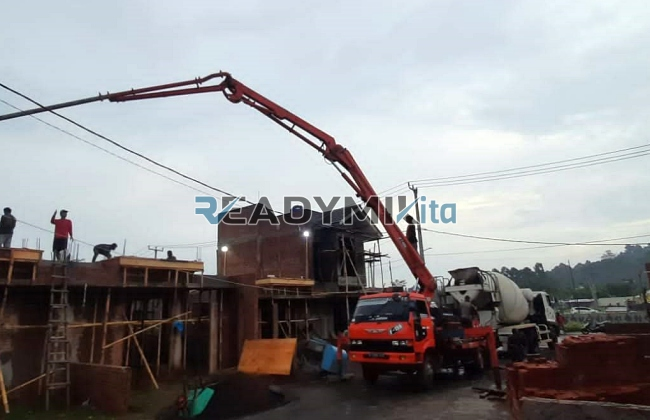

**Tempat Sewa Belalai Cor di Tegal Alur Jakarta Harian** - Hai Mitra Readymix Kita! Punya proyek konstruksi di Tegal Alur Jakarta yang butuh percepatan? Kami mengerti betul, efisiensi waktu itu krusial. Nah, ReadymixKita hadir sebagai solusi cerdas untuk memastikan proyek Anda berjalan lancar dan sesuai jadwal.

Waktu adalah aset paling berharga dalam dunia konstruksi. Dengan memanfaatkan concrete pump, Anda bisa menghemat waktu dan tenaga tanpa mengorbankan kualitas pengecoran. Di Tegal Alur Jakarta, ReadymixKita hadir sebagai mitra terpercaya yang siap mendukung kesuksesan setiap rencana penuangan beton Anda.



## Mengenal Lebih Dekat Belalai Cor: Fungsi dan Manfaatnya

Concrete pump, atau yang lebih dikenal dengan sebutan belalai cor, adalah mesin canggih yang digunakan untuk memindahkan beton siap pakai dari truk mixer langsung ke lokasi pengecoran dengan bantuan pipa. Alat ini sangat ideal untuk berbagai jenis proyek konstruksi, terutama di area dengan akses terbatas atau ketinggian yang menantang. Berikut beberapa keunggulan utama yang ditawarkannya:

1. **Efisiensi Pengecoran: Hemat Waktu dan Tenaga**

   Dibandingkan metode manual, concrete pump mempercepat proses pengecoran secara signifikan. Beton dicampur dan dipindahkan langsung ke titik yang dituju, mengurangi kebutuhan tenaga kerja manual yang besar.

2. **Presisi Tinggi: Hasil yang Optimal**

   Alat ini memastikan beton dituangkan dengan akurat sesuai area yang ditentukan, baik untuk struktur horizontal seperti lantai maupun vertikal seperti kolom dan dinding.

3. **Solusi untuk Lokasi Sulit: Jangkauan Tanpa Batas**

   Berkat pipa yang fleksibel, concrete pump mampu menjangkau sudut-sudut sulit, area sempit, atau bahkan bangunan bertingkat tinggi dengan mudah.

4. **Kapasitas Besar: Cocok untuk Proyek Skala Apa Pun**

   Dengan kemampuannya mengelola volume material yang besar dalam jangka waktu singkat, belalai cor adalah pilihan cerdas untuk proyek kecil hingga berskala besar.

## Apa yang Membuat ReadymixKita Unggul?

Di antara begitu banyaknya penyedia layanan sewa concrete pump, **ReadymixKita** memiliki keunggulan kompetitif yang membedakan kami:

1. **Pengalaman dan Kepercayaan Pelanggan**

   Kami telah berhasil menangani beragam proyek konstruksi di Tegal Alur Jakarta, membangun reputasi solid berdasarkan kepuasan pelanggan. Tim kami terdiri dari operator yang terlatih dan berpengalaman, memastikan alat beroperasi dengan performa optimal.

2. **Pilihan Concrete Pump yang Lengkap**

   Kami menyediakan berbagai jenis concrete pump sesuai kebutuhan proyek Anda:
   - **Mini Pump**: Ideal untuk proyek rumah tangga atau area terbatas.
   - **Standard Pump**: Cocok untuk proyek menengah hingga besar.
   - **Long Boom Pump**: Dirancang untuk proyek yang membutuhkan jangkauan vertikal tinggi.

3. **Perawatan Rutin: Kinerja Optimal Terjamin**

   Semua unit concrete pump kami menjalani pemeriksaan berkala untuk memastikan kinerja yang andal di lapangan. Ini memberikan Anda ketenangan pikiran, bebas dari kekhawatiran akan masalah teknis selama pengecoran.

4. **Layanan Profesional dan Responsif**

   Kami tidak hanya menyediakan alat, tetapi juga operator berpengalaman yang akan mengawasi proses pengecoran dari awal hingga akhir, menjamin kelancaran dan efisiensi.

## Keunggulan Lokal: Mengapa Memilih Kami di Tegal Alur Jakarta?

Sebagai penyedia jasa lokal, kami memahami betul dinamika dan tantangan konstruksi di Tegal Alur Jakarta. Berikut beberapa keunggulan yang kami tawarkan:

1. **Akses Mudah dan Waktu Tanggap Cepat**

   Lokasi strategis kami di Tegal Alur Jakarta memungkinkan kami memberikan layanan cepat ke seluruh wilayah, termasuk area perkotaan dan pinggiran.

2. **Pemahaman Kondisi Medan Lokal**

   Dengan pengalaman bertahun-tahun beroperasi di Tegal Alur Jakarta, kami sangat memahami kondisi medan yang beragam, mulai dari kontur bergelombang hingga kepadatan lalu lintas. Ini memungkinkan kami memberikan solusi yang paling tepat sesuai kebutuhan proyek Anda.

3. **Harga yang Bersaing: Kualitas Terbaik dengan Investasi Efisien**

   Kami berkomitmen menawarkan harga yang terjangkau tanpa mengorbankan kualitas layanan, menjadikan kami pilihan ideal untuk anggaran proyek Anda.

## Penawaran Menarik dan Harga Spesial di Tegal Alur Jakarta

Kami paham betul bahwa anggaran adalah pertimbangan penting dalam setiap proyek. Inilah yang kami tawarkan:

1. **Transparansi Harga**

   Anda akan menerima rincian lengkap harga sewa, termasuk biaya tambahan (jika ada) seperti operator dan bahan bakar. Tidak ada biaya tersembunyi yang akan mengejutkan Anda.

2. **Diskon dan Promosi Eksklusif**

   Nikmati diskon menarik untuk sewa jangka panjang atau pesanan dengan volume besar. Kami juga menawarkan promosi khusus untuk proyek-proyek di wilayah Tegal Alur Jakarta.

3. **Konsultasi Gratis: Temukan Solusi yang Tepat**

   Tak yakin concrete pump mana yang paling sesuai dengan proyek Anda? Tim ahli kami siap memberikan konsultasi tanpa biaya untuk membantu Anda membuat keputusan yang terbaik.

## Informasi Harga Sewa Belalai Cor di Tegal Alur Jakarta



Jangan biarkan kendala pengecoran menghambat kemajuan proyek Anda! Hubungi kami sekarang untuk layanan sewa belalai cor terbaik di Tegal Alur Jakarta!

Kami juga menyediakan layanan survei lokasi dan konsultasi gratis untuk memastikan semua kebutuhan Anda terpenuhi. Pesan segera dan rasakan kemudahan, kecepatan, dan kepuasan dalam setiap proses konstruksi Anda.

Investasi cerdas dalam alat yang tepat akan mempercepat pencapaian target proyek Anda. Dengan memilih layanan sewa belalai cor dari ReadymixKita, Anda mendapatkan solusi efektif, tepat, dan efisien. Segera hubungi kami untuk penawaran terbaik dan layanan sewa cor terbaik di Tegal Alur Jakarta. Keputusan cerdas untuk hasil yang sempurna! [Tempat Sewa Belalai Cor di Angke Jakarta Harian](/pompa/tempat-sewa-belalai-cor-di-angke-jakarta-harian/) — temukan solusi pengecoran di dekat Anda!