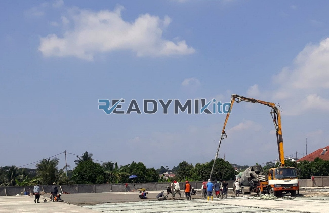

**Tempat Sewa Belalai Cor di Tegal Buleud Sukabumi Harian** - Hai Mitra Readymix Kita! Proyek konstruksi di Tegal Buleud Sukabumi sedang berjalan? Kami paham betul, efisiensi waktu dan biaya itu krusial, kan? Nah, ReadymixKita hadir sebagai solusi penyewaan concrete pump harian yang tepat untuk kelancaran pekerjaan Anda. Pengecoran jadi lebih cepat dan hasil lebih presisi – itu janji kami!



## Concrete Pump: Apa Itu dan Apa Saja Kelebihannya?

Concrete pump, atau yang sering disebut “belalai cor”, adalah alat modern yang dirancang khusus untuk memindahkan beton cor readymix dari truk mixer langsung ke lokasi pengecoran menggunakan sistem perpipaan. Bayangkan, nggak perlu lagi tenaga manual berlebihan untuk memindahkan beton! Alat ini sangat ideal untuk proyek-proyek di Tegal Buleud Sukabumi, terutama yang memiliki akses terbatas atau membutuhkan pengecoran di ketinggian. Apa saja keunggulannya? Yuk, simak:

1. **Efisiensi Waktu dan Tenaga Kerja**

   Pengecoran manual tentu lebih lambat dan butuh banyak tenaga. Dengan concrete pump, proses penuangan beton jadi jauh lebih cepat dan efisien, memangkas waktu dan biaya operasional proyek Anda.

2. **Akurasi dan Presisi Tinggi**

   Alat ini memastikan beton ditempatkan dengan akurat pada area yang ditentukan, baik untuk struktur horizontal (lantai) maupun vertikal (kolom, dinding). Hasilnya? Konstruksi yang lebih kuat dan rapi.

3. **Solusi untuk Lokasi Sulit Dijangkau**

   Pipa concrete pump yang fleksibel mampu menjangkau area yang sulit diakses, seperti gang sempit, bagian belakang bangunan, atau lantai-lantai pada bangunan bertingkat di Tegal Buleud Sukabumi.

4. **Kapasitas Besar untuk Proyek Apapun**

   Baik proyek kecil maupun besar, concrete pump dapat menangani volume beton yang signifikan dalam waktu singkat. Ini sangat membantu dalam mempercepat progres konstruksi.

## Kenapa Harus Sewa Concrete Pump di ReadymixKita?

Mungkin Anda bertanya, kenapa harus pilih ReadymixKita di antara banyaknya penyedia jasa? Nah, inilah yang membedakan kami:

1. **Pengalaman dan Kepercayaan Pelanggan**

   Kami sudah berpengalaman menangani berbagai proyek konstruksi di Tegal Buleud Sukabumi dan sekitarnya. Reputasi kami dibangun atas dasar kualitas layanan dan kepuasan pelanggan. Operator kami terlatih dan profesional.

2. **Pilihan Concrete Pump yang Beragam**

   Kami menyediakan berbagai tipe concrete pump yang bisa disesuaikan dengan kebutuhan spesifik proyek Anda:
   - **Mini Pump**: Cocok untuk proyek rumah tangga atau area sempit.
   - **Standard Pump**: Ideal untuk proyek skala menengah.
   - **Long Boom Pump**: Dirancang untuk pengecoran dengan jangkauan yang lebih jauh.

3. **Perawatan Berkala untuk Performa Optimal**

   Kami memastikan semua unit concrete pump dalam kondisi prima melalui perawatan berkala. Anda bisa fokus pada pekerjaan tanpa khawatir masalah teknis di lapangan.

4. **Layanan Profesional dan Solutif**

   Kami tidak hanya menyediakan alat, tapi juga operator yang berpengalaman dan siap membantu kelancaran proses pengecoran dari awal hingga akhir.

## Keunggulan Sewa Belalai Cor di Tegal Buleud Sukabumi Bersama Kami

Sebagai penyedia lokal, ReadymixKita memahami betul seluk-beluk proyek konstruksi di Tegal Buleud Sukabumi. Inilah keunggulan yang kami tawarkan:

1. **Akses Cepat dan Mudah**

   Lokasi strategis kami memungkinkan kami memberikan layanan sewa concrete pump dengan cepat ke seluruh wilayah Tegal Buleud Sukabumi, baik pusat kota maupun daerah pinggiran.

2. **Pemahaman Kondisi Lokal**

   Lama berkecimpung di Tegal Buleud Sukabumi membuat kami paham betul karakteristik medan dan lingkungan proyek di sini. Kami bisa memberikan solusi paling efektif untuk kebutuhan Anda.

3. **Harga Kompetitif dan Terjangkau**

   Kami menawarkan harga sewa yang kompetitif tanpa mengurangi kualitas layanan. Investasi yang cerdas untuk kelancaran proyek Anda.

## Info Harga & Penawaran Spesial di Tegal Buleud Sukabumi

Kami mengerti bahwa anggaran merupakan faktor penting dalam setiap proyek konstruksi. Karena itu, kami menawarkan:

1. **Harga Sewa Transparan**

   Anda akan mendapatkan rincian harga sewa yang jelas, termasuk biaya operator dan bahan bakar. Tidak ada biaya tambahan yang tersembunyi.

2. **Diskon dan Promosi Menarik**

   Nikmati diskon khusus untuk sewa jangka panjang atau pemesanan dalam jumlah besar. Kami juga sering memberikan penawaran spesial untuk proyek-proyek di Tegal Buleud Sukabumi.

3. **Konsultasi Gratis Tanpa Batas**

   Bingung memilih jenis concrete pump yang tepat? Jangan ragu untuk berkonsultasi dengan tim ahli kami. Kami siap membantu Anda menemukan solusi terbaik.

## Daftar Harga Sewa Belalai Cor di Tegal Buleud Sukabumi



Jangan biarkan kendala pengecoran menghambat proyek Anda. Hubungi kami sekarang juga untuk mendapatkan layanan sewa concrete pump terbaik di Tegal Buleud Sukabumi!

Kami juga menyediakan layanan survei lokasi gratis untuk memastikan kesesuaian alat dengan kebutuhan proyek Anda. Pesan sekarang dan rasakan efisiensi pengecoran yang maksimal.

Dengan pengalaman, kualitas layanan, dan komitmen terhadap kepuasan pelanggan, ReadymixKita adalah mitra terpercaya untuk proyek konstruksi Anda di Tegal Buleud Sukabumi. Percayakan kebutuhan penyewaan concrete pump Anda kepada kami untuk hasil yang berkualitas dan tepat waktu. Hubungi kami segera!