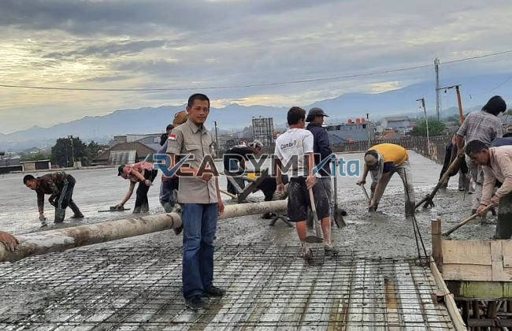

**Jasa Cor Readymix di Abadijaya Depok Murah** - Hai Mitra Readymix Kita! Sedang merencanakan proyek konstruksi di Abadijaya Depok? Nah, Anda datang ke tempat yang tepat! Kami dari Readymix Kita hadir sebagai solusi pengecoran modern yang efisien dan terpercaya. Kenyamanan dan kualitas adalah prioritas utama kami untuk setiap proyek di Abadijaya Depok Murah.



## Mengapa Memilih Pengecoran dengan Readymix?

Beton Cor Readymix: Solusi praktis untuk konstruksi modern. Bayangkan, proses pencampuran beton yang presisi dilakukan di pabrik, lalu langsung dikirim ke lokasi proyek Anda. Lantas, apa saja keunggulan signifikan dari metode pengecoran ini dibandingkan cara tradisional? Yuk, kita lihat bersama:

1. **Hemat Waktu dan Biaya Tenaga**

   Pengecoran manual seringkali memakan waktu lama dan membutuhkan banyak tenaga kerja. Dengan Readymix, Anda bisa mempersingkat jadwal proyek dan menghemat biaya operasional.

2. **Jaminan Kualitas yang Konsisten**

   Proses produksi beton Cor Readymix dikontrol ketat menggunakan teknologi modern dan bahan baku berkualitas tinggi. Hasilnya? Kualitas beton yang seragam dan minim risiko kerusakan.

3. **Fleksibilitas Kapasitas Produksi**

   Kebutuhan beton proyek Anda besar atau kecil? Kami bisa mengakomodasi semuanya! Readymix menyediakan volume beton sesuai kebutuhan, tanpa khawatir kekurangan atau kelebihan material.

4. **Dampak Lingkungan yang Lebih Rendah**

   Proses produksi yang terkontrol di pabrik membantu mengurangi limbah material dan emisi debu selama konstruksi.

## Keunggulan Jasa ReadymixKita di Abadijaya Depok

Di tengah banyaknya pilihan penyedia jasa pengecoran, kenapa harus memilih **ReadymixKita** di Abadijaya Depok? Ini dia jawabannya:

1. **Pengalaman dan Reputasi Teruji**

   Kami telah berpengalaman melayani berbagai proyek konstruksi, mulai dari perumahan hingga infrastruktur skala besar. Kepercayaan pelanggan adalah bukti kualitas layanan kami.

2. **Pilihan Mutu Beton yang Lengkap**

   Kami menyediakan berbagai kelas mutu beton, mulai dari K-225 hingga K-500, sesuai dengan kebutuhan spesifik proyek Anda. Konsultasikan dengan tim ahli kami untuk mendapatkan rekomendasi terbaik.

3. **Dilengkapi dengan Peralatan Modern**

   Kami berinvestasi pada peralatan canggih seperti concrete pump untuk memastikan proses pengecoran berjalan lancar, cepat, dan merata.

4. **Tim Ahli yang Siap Membantu**

   Tim profesional kami siap memberikan dukungan penuh, mulai dari perencanaan hingga pelaksanaan di lapangan. Kami fleksibel dan dapat menyesuaikan layanan dengan jadwal proyek Anda.

## Layanan Kami yang Disesuaikan untuk Abadijaya Depok

Sebagai penyedia jasa lokal di Abadijaya Depok, kami memahami betul tantangan konstruksi di kawasan ini. Medan yang beragam, mulai dari area datar hingga berbukit, membutuhkan solusi yang tepat. **ReadymixKita** menawarkan:

1. **Pengiriman Tepat Waktu**

   Kami menjamin pengiriman beton tepat waktu ke lokasi proyek Anda di Abadijaya Depok dan sekitarnya, didukung oleh armada transportasi yang handal.

2. **Konsultasi Teknis Gratis**

   Bingung memilih jenis beton yang tepat? Tim ahli kami siap memberikan konsultasi gratis untuk membantu Anda menentukan solusi terbaik.

3. **Penawaran Spesial untuk Pelanggan Lokal**

   Dapatkan harga khusus dan diskon menarik untuk proyek-proyek di wilayah Abadijaya Depok.

## Harga Terjangkau dan Promo Menarik di Abadijaya Depok

Kami memahami bahwa anggaran adalah pertimbangan penting dalam setiap proyek konstruksi. Karena itu, **ReadymixKita** berkomitmen untuk memberikan:

1. **Harga Kompetitif dan Transparan**

   Kami menawarkan harga yang bersaing tanpa mengorbankan kualitas beton. Informasi harga, termasuk biaya pengiriman dan penggunaan concrete pump, kami sampaikan secara jelas dan transparan.

2. **Promo dan Diskon Eksklusif**

   Nikmati berbagai promo menarik, seperti diskon untuk pemesanan volume besar atau proyek jangka panjang.

3. **Kepuasan Pelanggan sebagai Prioritas Utama**

   Kami memberikan garansi kepuasan penuh. Jika ada kendala dalam proses pengecoran, tim kami akan segera memberikan solusi hingga proyek Anda selesai dengan sempurna.

## Daftar Harga Jasa Cor Readymix di Abadijaya Depok



Jangan tunda lagi! Segera hubungi kami untuk mendapatkan penawaran terbaik dan solusi pengecoran yang tepat untuk proyek Anda di Abadijaya Depok Murah. [Jasa Cor Readymix di Baktijaya Depok Murah](/readymix/jasa-cor-readymix-di-baktijaya-depok-murah/) adalah salah satu layanan unggulan kami.

Kami juga menyediakan layanan survei lokasi dan konsultasi gratis untuk memastikan kebutuhan Anda terpenuhi dengan optimal. Pesan sekarang dan nikmati hasil konstruksi yang kuat, awet, dan sesuai dengan harapan Anda. Bangun struktur yang kokoh dengan ReadymixKita!