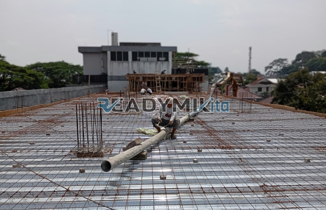

**Jasa Cor Readymix di Babakan Bogor Murah** - Hai Mitra Readymix Kita! Apakah Anda sedang merencanakan proyek konstruksi di Babakan Bogor? Mencari material berkualitas yang bisa diandalkan? Kami hadir sebagai solusi pengecoran terbaik untuk memastikan bangunan Anda kokoh dan tahan lama. Pondasi yang kuat adalah kunci utama, dan beton readymix adalah jawabannya! Yuk, simak bagaimana ReadymixKita bisa membantu proyek Anda.



## Mengapa Memilih Layanan Pengecoran dengan Readymix?

Beton Cor Readymix, atau sering disebut beton ready mix, adalah campuran beton yang diproduksi secara presisi di pabrik modern. Semua bahan baku ditimbang dan dicampur dengan akurat menggunakan teknologi terkini, lalu diangkut langsung ke lokasi proyek Anda dengan truk mixer khusus. Apa saja keuntungan memilih beton readymix dibanding cara tradisional? Berikut ulasannya:

1. **Efisiensi Waktu dan Tenaga**

   Pencampuran beton manual di lokasi proyek tentu memakan banyak waktu dan tenaga. Dengan Readymix, Anda hemat waktu karena beton sudah siap pakai. Ini memungkinkan pekerjaan konstruksi Anda berjalan lebih cepat dan efisien.

2. **Konsistensi Kualitas Terjamin**

   Proses produksi di pabrik kami diawasi ketat untuk memastikan konsistensi kualitas beton. Takaran yang akurat dan peralatan canggih meminimalkan risiko kesalahan pencampuran yang dapat mempengaruhi kekuatan struktur.

3. **Kapasitas Produksi Fleksibel**

   ReadymixKita mampu memenuhi kebutuhan beton dalam skala besar maupun kecil. Baik untuk proyek perumahan skala rumahan, gedung komersial, maupun infrastruktur yang lebih besar, kami siap melayani.

4. **Dukungan Ramah Lingkungan**

   Proses produksi yang terkelola dengan baik di pabrik kami meminimalkan limbah material konstruksi, sehingga lebih ramah lingkungan.

## Keunggulan Jasa Kami di Babakan Bogor

Di Babakan Bogor, banyak pilihan penyedia jasa pengecoran. Tapi, mengapa harus memilih **ReadymixKita**? Kami menawarkan lebih dari sekadar beton cor berkualitas:

1. **Reputasi Terpercaya dan Pengalaman Luas**

   Selama bertahun-tahun, kami telah menjadi bagian dari berbagai proyek konstruksi di Babakan Bogor dan sekitarnya. Pengalaman ini menjadikan kami paham betul kebutuhan dan tantangan yang dihadapi.

2. **Pilihan Mutu Beton yang Beragam**

   Kami menyediakan berbagai grade beton readymix, mulai dari K-225 hingga K-500, tergantung pada kebutuhan spesifik proyek Anda. Konsultasikan kebutuhan Anda dengan tim kami untuk mendapatkan rekomendasi terbaik.

3. **Peralatan Modern dan Terawat**

   Kami menggunakan peralatan pengecoran modern, termasuk pompa beton (concrete pump) yang memastikan pengecoran cepat, merata, dan efisien, bahkan di area yang sulit dijangkau.

4. **Tim Profesional dan Berdedikasi**

   Tim kami terdiri dari ahli konstruksi berpengalaman yang siap memberikan panduan, mulai dari perencanaan hingga eksekusi di lapangan. Kami fleksibel dan siap menyesuaikan jadwal dengan kebutuhan proyek Anda.

## Layanan Khusus untuk Kondisi Babakan Bogor

Kami memahami karakteristik unik wilayah Babakan Bogor. Medan yang bervariasi, mulai dari area perkotaan padat hingga kawasan perbukitan, membutuhkan solusi konstruksi yang adaptif. **ReadymixKita** menghadirkan layanan yang dirancang khusus untuk menjawab tantangan tersebut:

1. **Pengiriman Tepat Waktu**

   Lokasi pabrik kami yang strategis memungkinkan pengiriman beton readymix ke Babakan Bogor dan sekitarnya secara cepat dan efisien. Kami mengutamakan ketepatan waktu agar proyek Anda berjalan lancar.

2. **Konsultasi Proyek Gratis**

   Dapatkan layanan konsultasi gratis dari ahli konstruksi kami. Kami akan membantu Anda memilih jenis beton yang paling sesuai dengan kebutuhan proyek Anda dan memberikan solusi optimal.

3. **Penawaran Istimewa untuk Proyek Lokal**

   Khusus untuk klien di wilayah Babakan Bogor, kami menawarkan harga spesial dan diskon menarik untuk proyek-proyek besar.

## Harga Beton Readymix Terjangkau dan Promo Menarik di Babakan Bogor

Kami sadar betul bahwa anggaran adalah pertimbangan utama dalam setiap proyek. Oleh karena itu, **ReadymixKita** berkomitmen untuk memberikan:

1. **Harga Kompetitif dan Transparan**

   Kami menawarkan harga beton readymix yang kompetitif tanpa mengorbankan kualitas. Kami akan memberikan rincian harga yang jelas, termasuk biaya pengiriman dan biaya tambahan lainnya.

2. **Promo dan Diskon Eksklusif**

   Manfaatkan promo menarik untuk pemesanan dalam jumlah besar, proyek jangka panjang, atau untuk klien baru di Babakan Bogor. Jangan lewatkan kesempatan ini!

3. **Jaminan Kepuasan Pelanggan**

   Kami menjamin kepuasan Anda dengan hasil pengecoran yang berkualitas. Jika ada kendala, tim kami akan segera memberikan solusi hingga proyek Anda selesai dengan sempurna.

## Daftar Harga Jasa Cor Readymix di Babakan Bogor



Jangan tunda lagi! Pastikan proyek konstruksi Anda berjalan sukses dengan beton readymix berkualitas dari ReadymixKita. Hubungi kami sekarang juga untuk penawaran terbaik dan layanan konsultasi gratis.

Kami siap membantu Anda mewujudkan bangunan yang kokoh, tahan lama, dan sesuai dengan harapan Anda. Bersama **ReadymixKita**, kesuksesan proyek Anda adalah prioritas kami. Gunakan layanan pengecoran dengan beton readymix dari ReadymixKita untuk solusi konstruksi unggulan di Babakan Bogor! [Jasa Cor Readymix di Baranangsiang Bogor Murah](/readymix/jasa-cor-readymix-di-baranangsiang-bogor-murah/) — Berikut adalah informasi lebih lanjut mengenai layanan kami di Bogor.