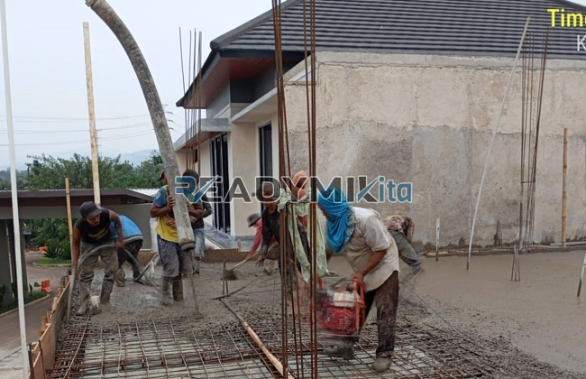

**Jasa Cor Readymix di Baktijaya Depok Murah** - Hai Mitra Readymix Kita! Mencari solusi pengecoran yang tepat untuk proyek Anda di Baktijaya Depok? Kini, Anda tak perlu lagi pusing mencari kualitas dan harga terbaik. Kami hadir sebagai penyedia beton readymix terpercaya, siap mendukung kesuksesan konstruksi Anda. Kualitas terjamin, pengiriman cepat, dan harga bersaing — itulah komitmen kami.



## Mengapa Memilih Beton Readymix untuk Proyek Anda?

Pernahkah Anda bertanya-tanya, apa sebenarnya beton Cor Readymix itu? Sederhananya, beton readymix adalah campuran beton yang diproduksi secara presisi di pabrik modern, menggunakan material baku pilihan. Lalu, campuran ini diangkut langsung ke lokasi proyek Anda menggunakan truk mixer canggih. Dibandingkan metode konvensional, beton readymix menawarkan sejumlah keuntungan signifikan:

1. **Hemat Waktu dan Biaya Operasional**

   Proses pencampuran di lokasi proyek seringkali memakan waktu dan tenaga. Dengan readymix, Anda menghemat keduanya. Beton siap cor ini langsung bisa digunakan begitu tiba di lokasi.

2. **Kualitas Terstandarisasi dan Konsisten**

   Pencampuran yang terkontrol di pabrik menghasilkan beton dengan kualitas yang konsisten. Risiko kesalahan takaran yang bisa melemahkan konstruksi, jadi diminimalkan.

3. **Skalabilitas Produksi**

   Apapun skala proyek Anda, dari pembangunan rumah hingga gedung bertingkat, beton readymix dapat diproduksi dalam jumlah yang sesuai dengan kebutuhan.

4. **Dukungan untuk Konstruksi Berkelanjutan**

   Proses produksi yang lebih efisien mengurangi pemborosan material dan limbah konstruksi, mendukung praktik pembangunan yang lebih ramah lingkungan.

## Keunggulan Memilih ReadymixKita di Baktijaya Depok

Di antara banyaknya penyedia beton readymix di Baktijaya Depok, **ReadymixKita** hadir dengan serangkaian keunggulan yang menjamin kepuasan Anda:

1. **Pengalaman dan Keahlian Teruji**

   Berbekal pengalaman bertahun-tahun di industri konstruksi, kami memahami seluk-beluk kebutuhan proyek Anda, mulai dari perumahan hingga infrastruktur skala besar.

2. **Pilihan Mutu Beton yang Lengkap**

   Kami menyediakan beragam kelas mutu beton, mulai dari K-225 untuk aplikasi standar, hingga K-500 yang dirancang untuk konstruksi dengan beban berat. Pilihan yang disesuaikan tepat dengan spesifikasi proyek Anda.

3. **Teknologi Pengecoran Modern**

   Kami dilengkapi dengan peralatan canggih, termasuk concrete pump, untuk memastikan pengecoran berlangsung cepat, merata, dan efisien.

4. **Tim Solid yang Siap Melayani**

   Tim profesional kami siap memberikan dukungan penuh, mulai dari konsultasi perencanaan hingga pengawasan pelaksanaan di lapangan. Kami fleksibel dan adaptif terhadap jadwal proyek Anda.

## Layanan Spesifik untuk Kondisi Baktijaya Depok

Sebagai pelaku konstruksi lokal, **ReadymixKita** memahami betul karakteristik wilayah Baktijaya Depok dan sekitarnya. Kami sadar akan tantangan yang mungkin muncul, seperti variasi kontur tanah dan kondisi jalan. Oleh karena itu, kami menawarkan solusi yang dirancang khusus untuk mengatasi tantangan ini:

1. **Jaringan Distribusi yang Optimal**

   Kami memastikan pengiriman beton readymix yang tepat waktu, bahkan ke lokasi proyek yang sulit dijangkau di Baktijaya Depok dan daerah sekitarnya. Lokasi pabrik yang strategis mempercepat proses pengiriman.

2. **Konsultasi Teknis Gratis**

   Kami menyediakan layanan konsultasi gratis untuk membantu Anda memilih jenis beton yang paling sesuai dengan kebutuhan proyek, sekaligus memberikan saran tentang metode pengecoran yang optimal.

3. **Penawaran Istimewa untuk Proyek Lokal**

   Khusus untuk klien di wilayah Baktijaya Depok, nikmati harga yang lebih bersahabat dan penawaran menarik untuk proyek-proyek besar.

## Harga Bersaing dan Promo Menarik di Baktijaya Depok

Biaya konstruksi adalah pertimbangan penting dalam setiap proyek. **ReadymixKita** memahami hal ini, dan berkomitmen untuk memberikan solusi yang terjangkau:

1. **Harga yang Kompetitif**

   Kami menawarkan harga yang kompetitif, tanpa mengorbankan kualitas beton readymix yang kami hasilkan. Transparansi harga kami menjamin Anda mendapatkan penawaran terbaik.

2. **Program Diskon Spesial**

   Manfaatkan promo diskon menarik untuk pemesanan dalam jumlah besar atau proyek yang berjalan dalam jangka waktu lama.

3. **Jaminan Kepuasan Pelanggan**

   Kami berkomitmen untuk memberikan layanan terbaik. Jika terjadi kendala dalam proses pengecoran, tim kami akan segera memberikan solusi hingga proyek Anda selesai dengan sempurna.

## Informasi Harga Jasa Cor Readymix di Baktijaya Depok



Jangan tunda lagi! Segera hubungi kami untuk mendapatkan penawaran terbaik dan solusi pengecoran berkualitas di Baktijaya Depok.

Kami juga menawarkan layanan survei lokasi gratis untuk memahami kebutuhan proyek Anda secara lebih detail. Pesan beton readymix dari **ReadymixKita** sekarang, dan rasakan ketenangan pikiran karena Anda menggunakan material konstruksi yang andal dan tahan lama. Bangun masa depan Anda dengan pondasi yang kokoh bersama kami! [Jasa Cor Readymix di Baranangsiang Bogor Murah](/readymix/jasa-cor-readymix-di-baranangsiang-bogor-murah/) dapat menjadi referensi tambahan untuk melihat layanan kami di wilayah Bogor.