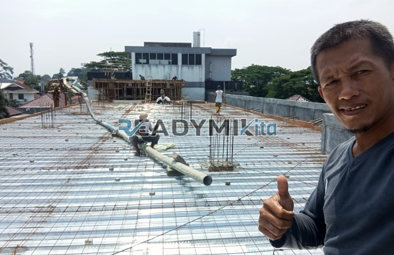

**Jasa Cor Readymix di Balaraja Tangerang Murah** - Hai Mitra Readymix Kita! Sedang mencari solusi pengecoran yang andal dan efisien di Balaraja Tangerang? Nah, Anda berada di tempat yang tepat! Kami dari Readymix Kita hadir sebagai penyedia beton cor readymix berkualitas tinggi dan layanan sewa concrete pump yang siap mendukung kelancaran proyek konstruksi Anda di Balaraja Tangerang Murah.



## Keunggulan Menggunakan Readymix untuk Proyek Anda

Mungkin Anda bertanya, apa sebenarnya beton Cor Readymix itu? Sederhananya, beton Cor Readymix adalah campuran beton yang diproduksi secara presisi di pabrik modern, menggunakan bahan baku pilihan terbaik. Proses ini memastikan kualitas yang konsisten dan siap digunakan langsung di lokasi proyek Anda. Dibandingkan metode konvensional, menggunakan beton Cor Readymix menawarkan sejumlah keuntungan signifikan:

1. **Efisiensi Waktu & Biaya**

   Pencampuran beton di lokasi proyek seringkali memakan waktu dan tenaga yang tidak sedikit. Dengan memilih beton Cor Readymix, Anda menghemat waktu pengerjaan secara signifikan karena proses pencampuran sudah dilakukan sebelumnya di pabrik kami. Ini berarti proyek Anda bisa selesai lebih cepat dan biaya operasional lebih efisien.

2. **Kualitas Terjamin Konsisten**

   Beton Cor Readymix diproduksi dengan takaran yang sangat akurat menggunakan peralatan canggih, menjamin kualitas yang seragam setiap saat. Risiko terjadinya kegagalan struktur akibat kesalahan pencampuran dapat diminimalkan dengan investasi pada kualitas ini.

3. **Skalabilitas Produksi**

   Kapasitas produksi beton Cor Readymix sangat fleksibel. Kami dapat memenuhi kebutuhan proyek Anda, mulai dari skala kecil seperti pembangunan rumah hingga proyek besar seperti infrastruktur komersial.

4. **Dukungan untuk Lingkungan yang Lebih Baik**

   Proses produksi beton Cor Readymix yang terkelola dengan baik turut berkontribusi pada pengurangan limbah material di lokasi konstruksi, menjadikannya solusi yang lebih ramah lingkungan.

## Mengapa ReadymixKita adalah Pilihan Terbaik di Balaraja Tangerang?

Di tengah banyaknya penyedia jasa pengecoran di pasar, **ReadymixKita** menonjol karena komitmen kami terhadap kualitas dan pelayanan yang prima. Berikut adalah keunggulan yang akan Anda dapatkan saat bermitra dengan kami di Balaraja Tangerang Murah:

1. **Pengalaman & Reputasi Teruji**

   Kami telah berkecimpung lama di industri konstruksi, membekali kami dengan pemahaman mendalam tentang kebutuhan proyek-proyek di Balaraja Tangerang. Pengalaman ini memungkinkan kami memberikan solusi terbaik untuk Anda.

2. **Pilihan Mutu Beton yang Lengkap**

   Kami menyediakan berbagai pilihan mutu beton, mulai dari K-225 (untuk kebutuhan standar) hingga K-500 (untuk konstruksi yang lebih berat), disesuaikan dengan spesifikasi proyek Anda. Konsultasikan dengan tim kami untuk mendapatkan rekomendasi yang tepat.

3. **Didukung Teknologi Modern**

   Kami menggunakan peralatan pengecoran modern, termasuk concrete pump (pompa beton), untuk memastikan proses pengecoran berlangsung cepat, merata, dan efisien. 

4. **Tim Ahli yang Siap Membantu**

   Tim profesional kami siap memberikan panduan dari tahap perencanaan hingga pelaksanaan di lokasi proyek. Kami juga fleksibel dalam menyesuaikan jadwal pengerjaan dengan kebutuhan Anda.

## Layanan Kami yang Disesuaikan untuk Kondisi Balaraja Tangerang

Sebagai pemain lokal, kami memahami betul tantangan konstruksi di Balaraja Tangerang. Daerah ini memiliki karakteristik yang beragam, mulai dari area perkotaan padat hingga area perbukitan. **ReadymixKita** menawarkan layanan yang dirancang khusus untuk mengatasi tantangan-tantangan ini:

1. **Pengiriman Tepat Waktu**

   Kami menjamin pengiriman beton readymix yang tepat waktu karena jaringan distribusi kami yang luas dan lokasi pabrik yang strategis di Balaraja Tangerang dan sekitarnya.

2. **Konsultasi Proyek Gratis**

   Kami menyediakan layanan konsultasi gratis untuk membantu Anda memilih jenis beton dan metode pengecoran yang paling sesuai dengan kebutuhan proyek Anda.

3. **Penawaran Spesial untuk Proyek Lokal**

   Sebagai bentuk apresiasi, kami menawarkan tarif spesial dan diskon menarik untuk proyek-proyek konstruksi yang berlokasi di Balaraja Tangerang.

## Harga Terjangkau dan Penawaran Menguntungkan di Balaraja Tangerang

Kami mengerti bahwa anggaran adalah pertimbangan krusial dalam setiap proyek konstruksi. Oleh karena itu, **ReadymixKita** berkomitmen untuk memberikan:

1. **Harga yang Kompetitif**

   Kami menawarkan harga yang bersaing tanpa mengorbankan kualitas beton. Informasi harga yang transparan, termasuk biaya pengiriman dan penggunaan pompa beton, akan kami sampaikan dengan jelas.

2. **Promo Menarik**

   Manfaatkan diskon besar untuk pemesanan dalam jumlah besar atau proyek kerja sama jangka panjang.

3. **Jaminan Kepuasan**

   Kami meyakini kualitas layanan kami. Jika terjadi kendala selama proses pengecoran, tim kami akan segera menanganinya hingga proyek Anda selesai dengan sempurna.

## Informasi Harga Jasa Cor Readymix di Balaraja Tangerang



Jangan biarkan kualitas material yang buruk menghambat kemajuan proyek Anda. Hubungi kami sekarang juga untuk mendapatkan solusi pengecoran terbaik di Balaraja Tangerang Murah!

Kami juga menyediakan layanan survei lokasi gratis dan konsultasi ahli untuk memastikan kebutuhan Anda terpenuhi secara optimal. Pesan sekarang dan rasakan keunggulan konstruksi yang kokoh, tahan lama, dan memuaskan. 

Dengan memilih jasa Pengecoran dengan Cor Readymix dari ReadymixKita, Anda mendapatkan kombinasi ideal antara efisiensi, kualitas, dan pelayanan profesional. Hubungi kami untuk penawaran terbaik dan solusi pengecoran terpercaya di Balaraja Tangerang! [Jasa Cor Readymix di Abadijaya Depok Murah](/readymix/jasa-cor-readymix-di-abadijaya-depok-murah/) — Bandingkan layanan kami dengan penyedia lainnya di Depok untuk mendapatkan pilihan terbaik bagi proyek Anda. Dengan ReadymixKita, bangun kekuatan dan keandalan sejak fondasi!