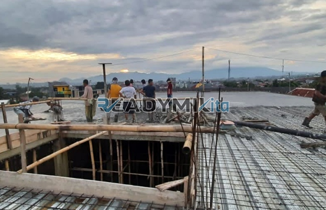

**Jasa Cor Readymix di Bale Kambang Jakarta Murah** - Hai Mitra Readymix Kita! Proyek konstruksi di Bale Kambang Jakarta sedang berjalan? Atau mungkin baru sebatas perencanaan? Nah, Anda sudah berada di tempat yang tepat! Kami dari Readymix Kita hadir sebagai solusi pengecoran efisien dan berkualitas tinggi untuk setiap kebutuhan proyek Anda. Dapatkan beton cor readymix terbaik di Bale Kambang Jakarta dengan layanan yang cepat, tepat, dan terpercaya.



## Mengapa Memilih Pengecoran dengan Readymix?

Mungkin sebagian Mitra bertanya-tanya, apa sih kelebihan beton Cor Readymix dibandingkan metode tradisional? Sederhana saja: beton Cor Readymix adalah campuran beton siap pakai yang diformulasikan secara presisi di pabrik modern kami, menggunakan bahan baku pilihan. Kemudian, beton ini diantar langsung ke lokasi proyek Anda menggunakan truk mixer khusus. Bayangkan kemudahan dan efisiensi yang didapat! Berikut beberapa keunggulan lainnya:

1. **Efisiensi Waktu dan Tenaga**

   Tidak perlu lagi repot mencampur beton di lokasi proyek. Beton readymix menghemat waktu dan tenaga kerja Anda secara signifikan, sehingga proyek bisa selesai lebih cepat.

2. **Konsistensi Kualitas Terjamin**

   Proses pencampuran yang terkontrol dan bahan baku berkualitas memastikan mutu beton readymix konsisten setiap saat. Risiko kesalahan pencampuran yang bisa mengganggu kekuatan struktur bangunan, jadi minimal sekali.

3. **Skala Produksi Fleksibel**

   Baik untuk proyek kecil maupun konstruksi berskala besar, beton Cor Readymix dapat disesuaikan dengan kebutuhan Anda. Kami siap menyediakan volume yang Anda butuhkan, kapanpun Anda butuhkan.

4. **Dukungan untuk Lingkungan yang Lebih Baik**

   Proses produksi yang terkelola dengan baik mengurangi limbah material di lokasi proyek, menjadikan beton readymix pilihan yang lebih ramah lingkungan.

## Apa yang Membedakan ReadymixKita di Bale Kambang Jakarta?

Di antara banyaknya penyedia jasa pengecoran di Bale Kambang Jakarta, **ReadymixKita** menawarkan lebih dari sekadar beton berkualitas. Kami berkomitmen menjadi mitra terpercaya Anda dalam membangun masa depan. Apa saja keunggulan kami?

1. **Pengalaman dan Kepercayaan Pelanggan**

   Selama bertahun-tahun, kami telah berhasil menyelesaikan berbagai proyek konstruksi di Bale Kambang Jakarta dan sekitarnya. Reputasi kami dibangun atas dasar kepercayaan dan kepuasan pelanggan.

2. **Pilihan Mutu Beton yang Lengkap**

   Kami menyediakan beragam pilihan mutu beton, mulai dari K-225 hingga K-500, dan opsi lainnya. Tim ahli kami siap membantu Anda memilih mutu beton yang paling tepat, sesuai dengan spesifikasi proyek Anda.

3. **Didukung Peralatan Mutakhir**

   Kami berinvestasi pada peralatan pengecoran modern, termasuk concrete pump, untuk memastikan proses pengecoran berjalan cepat, presisi, dan efisien.

4. **Tim Profesional yang Siap Membantu**

   Tim ahli kami siap memberikan dukungan penuh, mulai dari perencanaan, pelaksanaan, hingga penyelesaian proyek Anda. Kami fleksibel dan adaptif terhadap kebutuhan spesifik Anda.

## Layanan Khusus Kami untuk Proyek di Bale Kambang Jakarta

Sebagai penyedia jasa lokal, **ReadymixKita** memahami betul karakteristik dan tantangan konstruksi di Bale Kambang Jakarta. Kami memberikan layanan yang dirancang khusus untuk memudahkan Anda:

1. **Pengiriman Tepat Waktu**

   Kami menjamin pengiriman beton readymix tepat waktu, berkat lokasi strategis pabrik kami di Bale Kambang Jakarta dan sekitarnya, serta armada yang handal.

2. **Konsultasi Ahli Gratis**

   Jangan ragu untuk berkonsultasi dengan tim ahli kami. Kami akan membantu Anda menentukan jenis beton yang paling sesuai dengan kebutuhan proyek Anda secara gratis.

3. **Penawaran Spesial untuk Proyek Lokal**

   Khusus untuk klien di Bale Kambang Jakarta, kami menawarkan harga spesial dan diskon menarik untuk proyek-proyek besar.

## Harga Beton Readymix Terjangkau dan Promo Menarik di Bale Kambang Jakarta

Kami menyadari bahwa anggaran merupakan pertimbangan krusial dalam setiap proyek konstruksi. Karena itu, **ReadymixKita** berkomitmen untuk memberikan solusi yang terjangkau tanpa mengorbankan kualitas.

1. **Harga Kompetitif dan Transparan**

   Kami menawarkan harga beton readymix yang kompetitif. Untuk informasi lebih detail mengenai biaya pengiriman dan tambahan lainnya, silakan lihat tabel harga di atas atau hubungi tim kami.

2. **Promo dan Diskon Menarik**

   Manfaatkan promo dan diskon khusus untuk pemesanan volume besar atau proyek jangka panjang.

3. **Jaminan Kepuasan Pelanggan**

   Kami memberikan jaminan kepuasan. Jika ada kendala, tim kami akan segera membantu hingga proyek Anda selesai dengan sempurna.

## Daftar Harga Jasa Cor Readymix di Bale Kambang Jakarta



Jangan tunda lagi! Pastikan proyek Anda dibangun dengan fondasi yang kokoh dan berkualitas. Segera hubungi **ReadymixKita** untuk mendapatkan solusi pengecoran terbaik di Bale Kambang Jakarta! Kami juga menyediakan layanan survei lokasi gratis untuk membantu Anda menentukan kebutuhan beton yang tepat. Pesan beton readymix sekarang dan rasakan kemudahan dalam membangun impian Anda. [Jasa Cor Readymix di Baranangsiang Bogor Murah](/readymix/jasa-cor-readymix-di-baranangsiang-bogor-murah/)

Kami di ReadymixKita berdedikasi untuk memberikan layanan yang tak tertandingi. Melalui pengalaman, kualitas, dan layanan profesional kami, kami yakin bisa menjadi mitra konstruksi yang ideal untuk Anda. Hubungi kami untuk informasi lebih lanjut dan buktikan sendiri kualitas jasa Pengecoran dg Cor Readymix di Bale Kambang Jakarta dari ReadymixKita. Bersama, kita wujudkan proyek impian Anda!