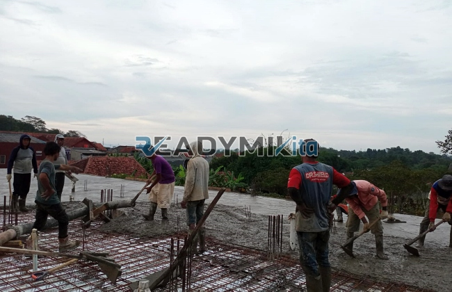

**Jasa Cor Readymix di Bali Mester Jakarta Murah** - Hai Mitra Readymix Kita! Punya proyek konstruksi di Bali Mester Jakarta? Pertimbangkan efisiensi dan kualitas! Kami hadir sebagai solusi pengecoran readymix terpercaya, menawarkan kemudahan dan hasil terbaik untuk berbagai skala proyek Anda. Dari pondasi rumah hingga infrastruktur besar, kami siap mendukung kelancaran konstruksi Anda.



## Kenapa Memilih Beton Readymix?

Beton cor *readymix* adalah campuran beton yang diproduksi secara presisi di pabrik modern, menggunakan bahan baku pilihan. Lalu, langsung diantar ke lokasi proyek Anda menggunakan truk mixer khusus. Nah, apa saja kelebihannya dibandingkan metode tradisional?

1. **Lebih Cepat & Praktis**

   Proses pencampuran di lokasi proyek seringkali memakan waktu dan tenaga. Dengan readymix, Anda hemat waktu dan tenaga karena beton sudah siap pakai saat tiba di lokasi.

2. **Kualitas Terjamin Konsisten**

   Readymix dibuat dengan takaran yang presisi dan kontrol kualitas ketat, memastikan setiap batch beton memiliki mutu yang seragam. Ini meminimalkan risiko kegagalan struktur akibat campuran yang tidak tepat.

3. **Fleksibilitas Volume Produksi**

   Kebutuhan beton proyek bervariasi. Readymix siap memenuhi permintaan, mulai dari volume kecil untuk renovasi rumah hingga volume besar untuk proyek-proyek komersial.

4. **Dukungan Ramah Lingkungan**

   Proses produksi readymix yang terkontrol menghasilkan lebih sedikit limbah material dibandingkan metode konvensional, sehingga lebih bersahabat terhadap lingkungan.

## Keunggulan ReadymixKita di Bali Mester Jakarta

Di antara banyak pilihan penyedia jasa, **ReadymixKita** hadir dengan keunggulan yang menjadikannya mitra ideal untuk proyek Anda di Bali Mester Jakarta:

1. **Pengalaman & Keandalan**

   Dengan pengalaman bertahun-tahun di dunia konstruksi, kami memahami betul kebutuhan proyek Anda – mulai dari bangunan residensial hingga proyek infrastruktur berskala besar.

2. **Pilihan Mutu Beton Lengkap**

   Kami menawarkan berbagai mutu beton, termasuk K-225 yang ideal untuk konstruksi umum, hingga K-500 untuk kebutuhan daya tahan ekstra. Pilihan disesuaikan dengan kebutuhan spesifik proyek Anda.

3. **Teknologi Pengecoran Modern**

   Didukung oleh peralatan canggih seperti *concrete pump*, kami memastikan proses pengecoran berjalan cepat, efisien, dan merata, bahkan di area yang sulit dijangkau.

4. **Tenaga Ahli Berdedikasi**

   Tim kami terdiri dari para profesional berpengalaman yang siap memberikan dukungan penuh, mulai dari perencanaan hingga pelaksanaan di lokasi. Kami fleksibel menyesuaikan jadwal dengan kebutuhan Anda.

## Layanan Kami yang Menyasar Kebutuhan Bali Mester Jakarta

Sebagai penyedia lokal, **ReadymixKita** memahami betul karakteristik wilayah Bali Mester Jakarta. Kondisi medan yang beragam, mulai dari area padat penduduk hingga perbukitan, membutuhkan penanganan yang tepat.

1. **Pengiriman Tepat Waktu**

   Lokasi pabrik kami yang strategis di sekitar Bali Mester Jakarta memungkinkan kami menjamin pengiriman cepat dan tepat waktu.

2. **Konsultasi Teknis Gratis**

   Kami menyediakan layanan konsultasi tanpa biaya, membantu Anda memilih jenis beton dan metode pengecoran yang paling sesuai untuk proyek Anda.

3. **Promo Eksklusif untuk Pelanggan Lokal**

   Dapatkan penawaran khusus dan diskon menarik untuk proyek yang berlokasi di wilayah Bali Mester Jakarta.

## Investasi Tepat dengan Harga Kompetitif di Bali Mester Jakarta

Kami percaya bahwa kualitas tidak harus mahal. **ReadymixKita** menyediakan solusi pengecoran readymix dengan harga yang kompetitif dan transparan, serta berbagai penawaran menarik:

1. **Harga Terjangkau**

   Kami menawarkan harga yang bersaing tanpa mengorbankan kualitas beton dan layanan. Rincian harga, termasuk biaya pengiriman dan penggunaan *concrete pump*, akan kami informasikan secara jelas.

2. **Promo & Diskon Menarik**

   Nikmati diskon khusus untuk pemesanan volume besar atau proyek jangka panjang.

3. **Kepuasan Pelanggan Prioritas Kami**

   Kami menjamin kepuasan Anda. Jika ada kendala selama proses pengecoran, tim kami siap memberikan solusi hingga proyek selesai dengan sempurna.

## Informasi Harga Jasa Cor Readymix di Bali Mester Jakarta



Jangan tunda lagi! Pastikan proyek Anda dibangun dengan fondasi yang kuat dan tahan lama. Hubungi **ReadymixKita** sekarang juga untuk mendapatkan penawaran terbaik dan layanan pengecoran readymix berkualitas di Bali Mester Jakarta!

Kami juga menyediakan layanan survei lokasi dan konsultasi gratis untuk membantu Anda merencanakan proyek Anda. Pesan sekarang dan rasakan kemudahan pengecoran dengan **ReadymixKita** – mitra terpercaya Anda dalam membangun impian. Dengan layanan unggul, mutu terjamin, dan tim yang profesional, kami berkomitmen untuk mewujudkan proyek Anda secara sukses. Hubungi kami untuk detail lebih lanjut! Bangun masa depan yang kokoh bersama **ReadymixKita** di Bali Mester Jakarta. [Jasa Cor Readymix di Balaraja Tangerang Murah](/readymix/jasa-cor-readymix-di-balaraja-tangerang-murah/) – Pelajari bagaimana kami melayani area sekitar Bali Mester Jakarta.