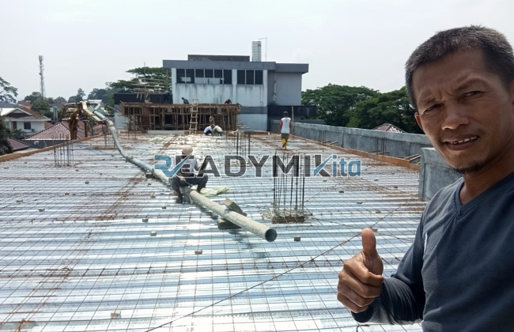

**Jasa Cor Readymix di Baranangsiang Bogor Murah** - Hai Mitra Readymix Kita! Proyek konstruksi di Baranangsiang Bogor sedang berkembang pesat? Nah, Anda sudah berada di tempat yang tepat! Kami dari Readymix Kita hadir sebagai solusi beton cor readymix berkualitas tinggi yang siap mendukung kelancaran proyek Anda, mulai dari pondasi rumah hingga bangunan komersial besar. Kami memahami betul kebutuhan konstruksi di Baranangsiang Bogor dan sekitarnya.



## Mengapa Memilih Pengecoran dengan Readymix?

Apa sih yang membuat beton readymix jadi pilihan cerdas untuk proyek konstruksi Anda? Beton Cor Readymix itu adalah campuran beton siap pakai yang diproduksi secara akurat di pabrik kami, menggunakan bahan baku terbaik. Selanjutnya, campuran ini langsung diantarkan ke lokasi proyek Anda dengan truk mixer khusus. Intip beberapa keunggulan utama beton readymix dibandingkan cara konvensional:

1. **Efisiensi Waktu & Biaya**

   Pengecoran manual memakan waktu dan tenaga yang signifikan. Dengan readymix, waktu pengerjaan dipangkas drastis karena proses pencampuran sudah ditangani di pabrik. Ini berarti Anda bisa lebih cepat menyelesaikan proyek dan mengurangi biaya operasional.

2. **Kualitas Konsisten dan Terjamin**

   Proses pencampuran beton Cor Readymix kami menggunakan takaran presisi dan teknologi modern, menghasilkan kualitas yang stabil dan dapat diandalkan. Risiko kesalahan pencampuran yang bisa mengancam kekuatan struktur, jadi diminimalkan.

3. **Skalabilitas Produksi**

   Kami mampu memenuhi kebutuhan beton dalam volume besar maupun kecil dengan cepat dan efisien. Cocok untuk proyek perumahan, gedung bertingkat, hingga infrastruktur jalan.

4. **Dukungan Ramah Lingkungan**

   Proses produksi beton readymix yang terkontrol lebih efisien dalam penggunaan material, sehingga mengurangi limbah konstruksi di lokasi proyek Anda.

## Apa yang Membuat Kami Unggul di Baranangsiang Bogor?

Di antara banyak penyedia jasa serupa, **ReadymixKita** menawarkan keunggulan yang membuat kami menjadi mitra terbaik dalam proyek Anda di Baranangsiang Bogor:

1. **Pengalaman & Reputasi Terpercaya**

   Selama bertahun-tahun, kami telah melayani berbagai proyek konstruksi di Baranangsiang Bogor dan sekitarnya. Kami memahami seluk-beluk konstruksi dan mampu memberikan solusi yang tepat untuk kebutuhan spesifik Anda.

2. **Pilihan Mutu Beton yang Lengkap**

   Kami menyediakan beragam kelas mutu beton, mulai dari K-225 untuk proyek standar, hingga K-500 untuk konstruksi yang memerlukan kekuatan ekstra. Pilihlah yang paling sesuai dengan kebutuhan struktur bangunan Anda. 

3. **Didukung Peralatan Pengecoran Modern**

   Kami dilengkapi dengan peralatan pengecoran canggih, termasuk pompa beton (concrete pump) yang mampu mempercepat proses pengecoran dan memastikan hasil yang lebih rata dan presisi.

4. **Tim Ahli yang Siap Membantu Anda**

   Tim profesional kami siap memberikan dukungan penuh, mulai dari konsultasi perencanaan hingga pengawasan pelaksanaan di lapangan. Kami fleksibel dan menyesuaikan layanan dengan jadwal proyek Anda.

## Layanan Spesifik Kami di Baranangsiang Bogor & Sekitarnya

Sebagai penyedia jasa lokal, kami benar-benar memahami tantangan konstruksi di Baranangsiang Bogor. Kondisi medan yang beragam—dari area padat hingga wilayah perbukitan—membutuhkan solusi yang tepat. **ReadymixKita** menawarkan layanan khusus:

1. **Pengiriman Tepat Waktu**

   Kami menjamin pengiriman beton readymix tepat sesuai jadwal yang Anda tentukan. Lokasi pabrik kami yang strategis memungkinkan kami melayani Baranangsiang Bogor dan sekitarnya dengan cepat.

2. **Konsultasi Gratis untuk Proyek Anda**

   Bimbang memilih jenis beton yang paling tepat? Dapatkan layanan konsultasi gratis dari tim ahli kami, untuk memastikan Anda mendapatkan solusi yang optimal.

3. **Penawaran Istimewa untuk Pelanggan Lokal**

   Para pelanggan di Baranangsiang Bogor akan mendapatkan penawaran spesial, diskon menarik, terutama untuk proyek-proyek berskala besar.

## Harga Terjangkau & Promo Menarik di Baranangsiang Bogor

Kami tahu, anggaran adalah hal krusial dalam setiap proyek. Itulah mengapa **ReadymixKita** menawarkan:

1. **Harga yang Bersaing**

   Kami memberikan harga yang kompetitif tanpa mengorbankan kualitas beton readymix yang kami produksi. Informasi harga transparan, termasuk biaya pengiriman dan penggunaan peralatan tambahan seperti pompa beton.

2. **Promo & Diskon Spesial**

   Nikmati diskon menarik untuk pemesanan dalam jumlah besar atau proyek yang berjalan dalam jangka waktu lama.

3. **Kepuasan Pelanggan adalah Prioritas Kami**

   Jika ada kendala selama proses pengecoran, tim kami siap memberikan solusi cepat dan efektif sampai proyek Anda selesai sesuai harapan.

## Informasi Harga Jasa Cor Readymix di Baranangsiang Bogor



Yuk, segera wujudkan proyek impian Anda! Jangan tunda lagi, hubungi kami sekarang untuk mendapatkan solusi pengecoran terbaik di Baranangsiang Bogor. 

Kami juga menyediakan layanan survei lokasi gratis dan konsultasi mendalam untuk memastikan kebutuhan Anda terpenuhi dengan sempurna. Pesan sekarang dan rasakan kemudahan serta kualitas beton readymix yang tak tertandingi.

Kualitas konstruksi adalah kunci keberhasilan. Dengan menggunakan jasa Pengecoran dg Cor Readymix dari ReadymixKita, Anda mendapatkan kombinasi ideal antara kecepatan, mutu, dan pelayanan profesional. Jangan ragu untuk menghubungi kami untuk solusi pengecoran terbaik di Baranangsiang Bogor. Bersama ReadymixKita, bangunan Anda kokoh dan tahan lama! [Jasa Cor Readymix di Babakan Bogor Murah](/readymix/jasa-cor-readymix-di-babakan-bogor-murah/) bisa menjadi alternatif solusi pengecoran Anda.