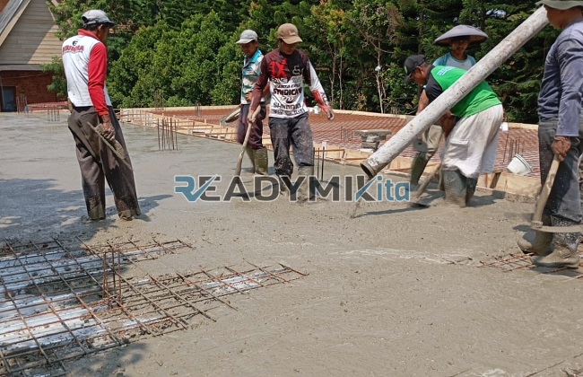

**Jasa Cor Readymix di Baru Jakarta Murah** - Hai Mitra Readymix Kita! Butuh solusi konstruksi yang cepat, kuat, dan andal di Baru Jakarta? Nah, Anda sudah berada di tempat yang tepat! Kami dari Readymix Kita hadir sebagai partner terpercaya untuk semua kebutuhan pengecoran proyek Anda. Dengan layanan pengecoran *readymix* berkualitas, kami siap mendukung kelancaran pembangunan di Baru Jakarta dan sekitarnya.



## Mengapa Memilih Beton Cor Readymix?

Apa sih yang membuat beton *readymix* jadi pilihan utama bagi banyak kontraktor dan pemilik proyek? Sederhana saja: efisiensi dan kualitasnya! Beton Cor Readymix adalah campuran beton yang diproduksi secara presisi di pabrik modern, menggunakan material pilihan. Kemudian, beton siap pakai ini diangkut langsung ke lokasi proyek menggunakan truk mixer. Berikut adalah beberapa keunggulan utama dibandingkan cara konvensional:

1. **Hemat Waktu & Tenaga Kerja**

   Proses pencampuran di lokasi itu memakan waktu dan tenaga, kan? Dengan *readymix*, Anda bebas dari kerepotan itu. Beton sudah siap cor, percepat proyek Anda!

2. **Kualitas Terjamin & Konsisten**

   Takaran bahan yang akurat dan proses produksi terkontrol memastikan kualitas beton yang konsisten. Risiko kesalahan pencampuran? Hampir tidak ada!

3. **Kapasitas Produksi Fleksibel**

   Butuh volume besar atau hanya sedikit? Kami siap melayani! Kapasitas produksi *readymix* bisa disesuaikan dengan skala proyek Anda.

4. **Dukungan Ramah Lingkungan**

   Dengan meminimalkan limbah material di lokasi, beton *readymix* juga berkontribusi pada praktik konstruksi yang lebih berkelanjutan. 

## Apa yang Membedakan ReadymixKita di Baru Jakarta?

Di antara banyaknya penyedia jasa pengecoran di Baru Jakarta, **ReadymixKita** punya beberapa keunggulan yang membuat kami layak menjadi pilihan utama Anda:

1. **Pengalaman & Reputasi Solid**

   Kami telah bertahun-tahun melayani proyek konstruksi di Jakarta dan sekitarnya. Pengalaman ini menjadi bekal kami untuk memahami setiap tantangan dan memberikan solusi terbaik.

2. **Pilihan Mutu Beton yang Lengkap**

   Dari K-225 untuk pekerjaan ringan hingga K-500 untuk struktur berat, kami menyediakan berbagai kelas mutu beton untuk memenuhi kebutuhan proyek Anda. 

3. **Didukung Peralatan Modern**

   Kami menggunakan pompa beton (concrete pump) modern untuk mempercepat proses pengecoran dan memastikan pemerataan beton yang optimal.

4. **Tim Ahli yang Siap Membantu**

   Tim profesional kami siap memberikan konsultasi, dukungan teknis, dan memastikan proyek Anda berjalan lancar dari awal hingga akhir. Kami juga sangat fleksibel dalam menyesuaikan dengan jadwal proyek Anda, lho!

## Layanan Kami yang Disesuaikan untuk Baru Jakarta

Kami memahami betul karakteristik wilayah Baru Jakarta—mulai dari kepadatan penduduk, hingga variasi jenis tanah dan medan. **ReadymixKita** menawarkan layanan yang dirancang khusus untuk mengatasi tantangan-tantangan tersebut:

1. **Pengiriman Tepat Waktu**

   Jarak pabrik kami yang strategis memungkinkan kami menjamin pengiriman beton tepat waktu ke lokasi proyek di Baru Jakarta dan sekitarnya.

2. **Konsultasi Gratis & Personal**

   Bingung memilih jenis beton yang tepat? Jangan khawatir! Kami menyediakan layanan konsultasi gratis untuk membantu Anda menentukan solusi terbaik.

3. **Penawaran Spesial untuk Proyek Lokal**

   Sebagai bentuk dukungan kepada komunitas lokal, kami menawarkan tarif spesial dan diskon menarik untuk proyek-proyek di wilayah Baru Jakarta.

## Harga Terjangkau & Penawaran Menarik di Baru Jakarta

Kami percaya bahwa kualitas tidak harus mahal. **ReadymixKita** berkomitmen untuk memberikan harga yang kompetitif tanpa mengorbankan mutu beton. Berikut beberapa keunggulan harga yang kami tawarkan:

1. **Harga Transparan & Bersaing**

   Kami memberikan informasi harga yang jelas dan terbuka, termasuk biaya pengiriman dan penggunaan peralatan tambahan.

2. **Promo & Diskon Menarik**

   Dapatkan diskon khusus untuk pemesanan dalam jumlah besar atau proyek yang berjalan dalam jangka waktu tertentu.

3. **Jaminan Kepuasan Pelanggan**

   Kepuasan Anda adalah prioritas kami! Jika ada kendala, kami akan segera mencari solusi hingga proyek Anda tuntas sempurna.

## Daftar Harga Jasa Cor Readymix di Baru Jakarta



Yuk, jangan tunda lagi! Segera hubungi tim **ReadymixKita** untuk mendapatkan penawaran terbaik dan solusi pengecoran yang paling sesuai dengan kebutuhan proyek Anda di Baru Jakarta. 

Kami juga menyediakan layanan survei lokasi gratis untuk memberikan rekomendasi terbaik. Dapatkan bangunan yang kuat, tahan lama, dan sesuai dengan harapan Anda hanya dengan **ReadymixKita**!

Pastikan kualitas konstruksi Anda terjamin dengan menggunakan jasa Pengecoran dg Cor Readymix dari ReadymixKita. Kami hadir untuk memberikan kombinasi optimal antara kecepatan, kualitas, dan layanan profesional di Baru Jakarta. Hubungi kami sekarang dan wujudkan bangunan impian Anda! Bersama ReadymixKita, proyek Anda akan lebih lancar dan hasilnya lebih memuaskan. [Jasa Cor Readymix di Babakan Bogor Murah](/readymix/jasa-cor-readymix-di-babakan-bogor-murah/) <mark>pilihan tepat untuk proyek Anda</mark>. [Jasa Cor Readymix di Bali Mester Jakarta Murah](/readymix/jasa-cor-readymix-di-bali-mester-jakarta-murah/) juga bisa menjadi referensi tambahan.