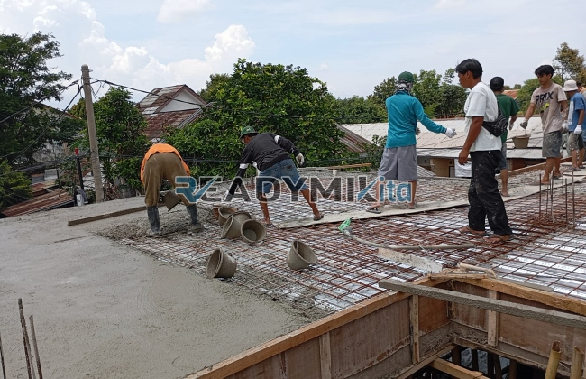

**Jasa Cor Readymix di Beji Depok Murah** - Hai Mitra Readymix Kita! Bagaimana kabar Anda? Di Beji Depok yang dinamis ini, pembangunan terus bergulir. Nah, kami dari Readymix Kita hadir untuk mendukung kelancaran proyek konstruksi Anda dengan solusi pengecoran modern dan efisien. Kami adalah penyedia beton cor *readymix* berkualitas, siap melayani kebutuhan Anda di Beji Depok Murah dan sekitarnya.



## Mengapa Memilih Layanan Pengecoran Readymix?

Apakah Anda tahu apa itu beton *readymix*? Sederhananya, beton *readymix* adalah campuran beton siap pakai yang diproduksi secara presisi di pabrik kami, menggunakan material pilihan. Beton ini kemudian diangkut langsung ke lokasi proyek Anda menggunakan truk *mixer*. Dibandingkan metode tradisional, menggunakan beton *readymix* menawarkan sejumlah keuntungan signifikan:

1.  **Hemat Waktu dan Sumber Daya**

    Pencampuran beton di lokasi proyek seringkali memakan waktu dan tenaga kerja yang besar. Dengan *readymix*, Anda menghemat keduanya, karena proses pencampuran sudah dilakukan di pabrik.

2.  **Kualitas Terjamin Konsisten**

    Formulasi beton *readymix* kami dipantau dengan ketat menggunakan teknologi canggih. Ini memastikan mutu beton yang dihasilkan selalu konsisten, meminimalkan risiko kegagalan konstruksi akibat kesalahan takaran.

3.  **Fleksibilitas Kapasitas Produksi**

    Butuh beton dalam jumlah besar atau kecil? Kami siap melayani! Kapasitas produksi *readymix* yang besar memungkinkan kami memenuhi kebutuhan proyek dari skala kecil hingga mega-proyek.

4.  **Berkontribusi pada Lingkungan yang Lebih Baik**

    Proses produksi *readymix* yang terkontrol membantu mengurangi pemborosan material konstruksi dan meminimalkan dampak lingkungan.

## Keunggulan Readymix Kita di Beji Depok

Di antara beragam penyedia jasa pengecoran, apa yang membuat **ReadymixKita** menjadi pilihan terbaik di Beji Depok? Jawabannya ada pada komitmen kami terhadap kualitas, pelayanan, dan kepuasan pelanggan:

1. **Pengalaman dan Keahlian yang Teruji**

   Kami telah lama berkecimpung di industri konstruksi, memahami seluk-beluk proyek properti dan infrastruktur. Pengalaman ini memungkinkan kami memberikan solusi terbaik sesuai kebutuhan Anda.

2. **Pilihan Mutu Beton yang Lengkap**

   Dari K-225 hingga K-500, kami menyediakan berbagai kelas mutu beton untuk memenuhi spesifikasi proyek Anda. Konsultasikan kebutuhan Anda dengan tim kami untuk mendapatkan rekomendasi optimal.

3. **Didukung Peralatan Pengecoran Modern**

   Kami melengkapi layanan kami dengan peralatan pengecoran terkini, termasuk *concrete pump* yang dapat menjangkau area sulit dan mempercepat proses pengecoran.

4. **Didukung Tim Profesional yang Berdedikasi**

   Tim ahli kami yang berpengalaman siap membantu Anda mulai dari perencanaan, pemilihan material, hingga pelaksanaan pengecoran di lokasi proyek Anda di Beji Depok Murah.

## Cakupan Layanan Kami di Beji Depok

Kami memahami karakteristik unik wilayah Beji Depok yang bervariasi, mulai dari area padat penduduk hingga kawasan perumahan berkembang. **ReadymixKita** menawarkan layanan yang disesuaikan untuk mengatasi tantangan lokal:

1. **Pengiriman Tepat Waktu dan Efisien**

   Kami menjamin pengiriman beton *readymix* tepat waktu ke lokasi proyek Anda di Beji Depok, berkat jaringan distribusi yang teroptimasi dan armada kendaraan yang memadai.

2. **Konsultasi Teknis Gratis**

   Bingung memilih jenis beton yang tepat? Tim teknis kami siap memberikan konsultasi gratis untuk membantu Anda menentukan solusi terbaik untuk proyek Anda.

3. **Penawaran Spesial untuk Pelanggan Lokal**

   Sebagai bentuk apresiasi kepada mitra di Beji Depok, kami menawarkan penawaran khusus dan diskon menarik untuk proyek-proyek besar dan menengah.

## Investasi Cerdas: Harga Terjangkau dan Promo Menarik

Kami percaya bahwa kualitas tidak harus mahal. **ReadymixKita** berkomitmen untuk memberikan harga yang kompetitif dan terjangkau tanpa mengorbankan mutu beton *readymix* yang kami sediakan:

1. **Harga Bersaing dan Transparan**

   Kami menawarkan harga yang bersaing di pasar Beji Depok Murah dengan rincian biaya yang jelas, termasuk biaya pengiriman dan biaya tambahan (jika ada).

2. **Promo dan Diskon Spesial**

   Jangan lewatkan promo menarik dan diskon khusus untuk pemesanan dalam jumlah besar atau proyek konstruksi jangka panjang.

3. **Kepuasan Pelanggan adalah Prioritas Kami**

   Kami menjamin kepuasan Anda dengan layanan dan kualitas beton *readymix* yang kami berikan. Jika ada kendala, tim kami akan segera memberikan solusi terbaik.

## Informasi Lebih Lanjut dan Pemesanan



Jangan tunda lagi! Dapatkan solusi pengecoran terbaik untuk proyek Anda di Beji Depok. Hubungi kami sekarang untuk konsultasi gratis dan penawaran harga khusus!

Kami siap membantu Anda mewujudkan proyek konstruksi yang kuat, tahan lama, dan sesuai anggaran. Dengan **ReadymixKita**, Anda mendapatkan beton berkualitas, layanan profesional, dan ketenangan pikiran. Hubungi kami untuk informasi lebih lanjut dan jadikan proyek Anda sukses! [Jasa Cor Readymix di Abadijaya Depok Murah](/readymix/jasa-cor-readymix-di-abadijaya-depok-murah/) adalah salah satu contoh layanan kami yang terpercaya di area Depok.