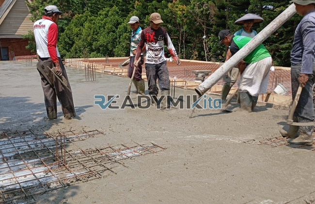

**Jasa Cor Readymix di Bendungan Hilir Jakarta Murah** - Hai Mitra Readymix Kita! Sedang memikirkan proyek konstruksi di Bendungan Hilir Jakarta? Mencari solusi pengecoran yang cepat, efisien, dan terpercaya? Kami dari ReadymixKita hadir untuk menjadi bagian dari kesuksesan proyek Anda. Dengan layanan pengecoran readymix berkualitas, kami menjamin hasil optimal untuk setiap kebutuhan konstruksi Anda di Bendungan Hilir Jakarta Murah.



## Mengapa Memilih Beton Readymix?

Beton readymix, atau beton cor siap pakai, adalah solusi modern untuk kebutuhan konstruksi Anda. Dibuat dengan formula yang presisi di pabrik kami, beton ini kemudian diantar langsung ke lokasi proyek menggunakan truk mixer. Tapi, apa sih kelebihannya dibandingkan cara tradisional? Yuk, kita lihat!

1. **Hemat Waktu dan Biaya:** Lupakan proses mencampur manual yang lama dan melelahkan! Beton readymix menghemat waktu dan tenaga kerja Anda secara signifikan.
2. **Kualitas Terjamin:**  Dengan kontrol mutu yang ketat dan penggunaan bahan baku berkualitas tinggi, beton readymix menghasilkan campuran yang konsisten dan kuat. Ini meminimalkan risiko kegagalan konstruksi.
3. **Fleksibilitas Volume:**  Butuh sedikit atau banyak beton? Kami siap melayani! Kapasitas produksi kami mampu memenuhi proyek kecil maupun besar.
4. **Ramah Lingkungan:** Proses produksi yang terukur mengurangi limbah material di lokasi proyek, mendukung praktik konstruksi berkelanjutan.

## ReadymixKita: Partner Pengecoran Terpercaya di Bendungan Hilir Jakarta

Di antara banyak penyedia jasa, kenapa harus memilih **ReadymixKita** untuk proyek di Bendungan Hilir Jakarta? Ini dia alasannya:

1. **Pengalaman dan Keahlian:**  Kami telah bertahun-tahun berkecimpung dalam industri konstruksi, memahami seluk beluk proyek dari berbagai skala, mulai dari bangunan residensial hingga infrastruktur komersial.
2. **Pilihan Mutu Beton Lengkap:**  Kami menyediakan beragam kelas mutu beton, seperti K-225, K-300, K-350, hingga K-500.  Pilih yang paling sesuai dengan kebutuhan struktural proyek Anda.
3. **Teknologi Mutakhir:** Kami menggunakan peralatan modern, termasuk *concrete pump*, untuk memastikan pengecoran cepat, merata, dan efisien.
4. **Tim Profesional yang Siap Membantu:**  Tim kami yang berpengalaman siap mendampingi Anda dari perencanaan sampai penyelesaian proyek. Kami fleksibel dan siap beradaptasi dengan jadwal Anda. 

## Layanan Khusus untuk Proyek di Bendungan Hilir Jakarta

Kami bukan sekadar penyedia beton readymix. Kami adalah mitra lokal yang memahami tantangan konstruksi di Bendungan Hilir Jakarta. Nah, apa yang kami tawarkan untuk proyek Anda?

1. **Pengiriman Tepat Waktu:** Lokasi pabrik kami yang strategis memungkinkan kami mengirimkan beton readymix langsung ke lokasi proyek Anda di Bendungan Hilir Jakarta dengan cepat dan tepat waktu.
2. **Konsultasi Teknis Gratis:** Bingung memilih jenis beton yang tepat?  Tim ahli kami siap memberikan konsultasi gratis untuk membantu Anda menentukan solusi terbaik.
3. **Penawaran Spesial untuk Pelanggan Lokal:** Kami menghargai dukungan Anda! Pelanggan di Bendungan Hilir Jakarta bisa menikmati penawaran menarik untuk proyek-proyek konstruksi mereka.

## Investasi Cerdas dengan Harga Terjangkau

Kami percaya bahwa kualitas tidak harus mahal. **ReadymixKita** menawarkan:

1. **Harga yang Kompetitif:** Kami berkomitmen memberikan harga yang kompetitif tanpa mengorbankan kualitas beton readymix.
2. **Promo dan Diskon Menarik:** Dapatkan diskon khusus untuk pemesanan dalam jumlah besar atau proyek jangka panjang.
3. **Jaminan Kepuasan:** Kepuasan Anda adalah prioritas utama kami. Kami menjamin kualitas beton readymix dan memberikan dukungan penuh selama proses pengecoran.

## Daftar Harga Readymix di Bendungan Hilir Jakarta



Jangan tunda lagi! Dapatkan penawaran terbaik sekarang juga untuk kebutuhan cor readymix di Bendungan Hilir Jakarta Murah. 

Kami siap membantu mewujudkan proyek impian Anda dengan beton readymix berkualitas tinggi dan layanan yang profesional. Hubungi kami untuk mendapatkan konsultasi gratis dan penawaran khusus. Percayakan proyek Anda pada ahlinya – ReadymixKita! [Jasa Cor Readymix di Bali Mester Jakarta Murah](/readymix/jasa-cor-readymix-di-bali-mester-jakarta-murah/) dapat menjadi pertimbangan tambahan untuk perbandingan layanan serupa di area Jakarta lainnya. Bangun masa depan yang kokoh bersama kami!