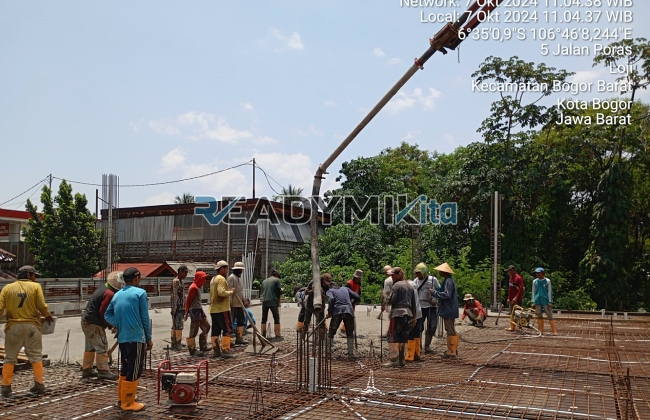

**Jasa Cor Readymix di Bidara Cina Jakarta Murah** - Hai Mitra Readymix Kita! Sedang merencanakan pembangunan di Bidara Cina Jakarta? Mencari solusi beton yang praktis, berkualitas, dan terjangkau? Nah, Anda sudah berada di tempat yang tepat! Kami dari Readymix Kita hadir sebagai penyedia beton cor readymix terpercaya di Bidara Cina Jakarta, siap mendukung kelancaran proyek konstruksi Anda. Pondasi kuat, bangunan hebat – itu komitmen kami.



## Mengapa Memilih Beton Readymix untuk Proyek Anda?

Apa itu beton readymix? Sederhananya, beton readymix adalah campuran beton yang diproduksi di pabrik dengan standar mutu tinggi. Beton ini kemudian diangkut menggunakan truk mixer langsung ke lokasi proyek Anda. Kenapa memilih beton readymix dibandingkan cara konvensional? Berikut keunggulannya:

1. **Hemat Waktu dan Biaya Tenaga**

   Pencampuran beton di lokasi proyek sering memakan waktu dan membutuhkan banyak tenaga kerja. Dengan readymix, Anda menghemat keduanya karena proses pencampuran telah dilakukan secara profesional di pabrik.

2. **Kualitas Terjamin Konsisten**

   Proses produksi readymix menggunakan takaran yang presisi dan teknologi modern. Hasilnya? Kualitas beton yang konsisten dan andal, meminimalkan risiko kegagalan struktur.

3. **Kapasitas Produksi Fleksibel**

   Apapun skala proyek Anda, readymix dapat memenuhi kebutuhan volume beton dengan cepat dan efisien. Kami siap menyediakan beton untuk proyek kecil maupun besar.

4. **Lebih Ramah Lingkungan**

   Proses produksi readymix lebih terkontrol, mengurangi potensi limbah material di lokasi konstruksi—sebuah langkah kecil menuju lingkungan yang lebih baik.

## Keunggulan ReadymixKita di Bidara Cina Jakarta

Di antara banyaknya penyedia beton readymix di Bidara Cina Jakarta, apa yang membedakan ReadymixKita? Kami berikan beberapa alasannya:

1. **Pengalaman dan Reputasi Teruji**

   Bertahun-tahun melayani proyek konstruksi di Bidara Cina Jakarta menjadikan kami ahli dalam memahami kebutuhan Anda. Kami mengutamakan kepuasan pelanggan dan kualitas kerja yang terbaik.

2. **Pilihan Mutu Beton yang Lengkap**

   Kami menyediakan berbagai kelas mutu beton, mulai dari K-225 (umum digunakan untuk fondasi rumah) hingga K-500 (cocok untuk bangunan bertingkat tinggi dan infrastruktur berat). Pilih sesuai kebutuhan proyek Anda.

3. **Didukung Peralatan Modern**

   Kami menggunakan peralatan pengecoran terkini, termasuk pompa beton (concrete pump), untuk memastikan pengecoran cepat, merata, dan efisien.

4. **Tim Ahli yang Siap Membantu**

   Tim profesional kami siap memberikan dukungan dari perencanaan hingga eksekusi di lapangan. Kami adaptif dan fleksibel menyesuaikan dengan jadwal proyek Anda.

## Layanan Kami yang Dirancang untuk Bidara Cina Jakarta

Sebagai bagian dari komunitas Bidara Cina Jakarta, kami memahami betul tantangan konstruksi di area ini. Berikut layanan khusus kami:

1. **Pengiriman Tepat Waktu**

   Lokasi pabrik kami yang strategis memungkinkan kami menjamin pengiriman beton readymix yang cepat dan tepat waktu ke seluruh wilayah Bidara Cina Jakarta.

2. **Konsultasi Gratis**

   Bingung memilih jenis beton yang tepat? Jangan khawatir! Kami menawarkan layanan konsultasi gratis untuk membantu Anda menentukan pilihan terbaik untuk proyek Anda.

3. **Penawaran Khusus untuk Proyek Lokal**

   Khusus untuk pelanggan di Bidara Cina Jakarta, kami memberikan penawaran harga spesial untuk proyek-proyek skala besar dan jangka panjang.

## Harga Beton Readymix Terjangkau di Bidara Cina Jakarta

Kami mengerti bahwa biaya merupakan pertimbangan penting dalam setiap proyek konstruksi. Karena itu, ReadymixKita berkomitmen untuk memberikan:

1. **Harga Kompetitif**

   Kami menawarkan harga beton readymix yang bersaing tanpa mengorbankan kualitas. Informasi lengkap mengenai harga, termasuk biaya pengiriman dan penggunaan concrete pump, tersedia di bawah ini.

2. **Promo Menarik**

   Dapatkan diskon spesial untuk pemesanan dalam jumlah besar atau proyek dengan durasi waktu yang panjang.

3. **Kepuasan Pelanggan Terjamin**

   Kami menjamin kualitas produk dan layanan. Jika ada masalah selama proses pengecoran, tim kami akan segera memberikan solusi.

## Daftar Harga Jasa Cor Readymix di Bidara Cina Jakarta



Jangan tunda lagi! Bangun pondasi yang kuat dengan beton readymix berkualitas dari ReadymixKita. Kami siap menjadi mitra terpercaya Anda di Bidara Cina Jakarta. Hubungi kami sekarang juga untuk mendapatkan penawaran harga terbaik dan layanan konsultasi gratis!

<table class="table">
  <caption>Spesifikasi Mutu Beton Readymix</caption>
  <thead>
    <tr><th>Mutu Beton</th><th>Kekuatan Tekan (MPa)</th><th>Aplikasi Umum</th></tr>
  </thead>
  <tbody>
    <tr><td>K-225</td><td>22.5</td><td>Pondasi rumah, lantai carport</td></tr>
    <tr><td>K-300</td><td>30.0</td><td>Kolom, balok, lantai</td></tr>
    <tr><td>K-400</td><td>40.0</td><td>Bangunan bertingkat, struktur berat</td></tr>
    <tr><td>K-500</td><td>50.0</td><td>Jembatan, tiang pancang</td></tr>
  </tbody>
</table>

Kami juga menyediakan layanan survei lokasi untuk membantu Anda menentukan kebutuhan beton readymix yang tepat. Segera hubungi kami untuk solusi pengecoran terbaik di Bidara Cina Jakarta! Dengan ReadymixKita, proyek Anda akan berjalan lancar dan menghasilkan bangunan yang kuat dan tahan lama! [Jasa Cor Readymix di Balaraja Tangerang Murah](/readymix/jasa-cor-readymix-di-balaraja-tangerang-murah/) – Cari tahu juga layanan kami di wilayah sekitar Bidara Cina Jakarta.