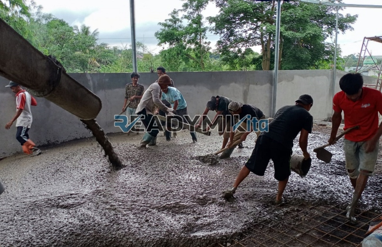

**Jasa Cor Readymix di Bintaro Jakarta Murah** - Hai Mitra Readymix Kita! Sedang merencanakan proyek konstruksi di Bintaro Jakarta? Mencari solusi cepat, efisien, dan berkualitas untuk kebutuhan beton Anda? Nah, Anda sudah berada di tempat yang tepat! Kami dari Readymix Kita hadir sebagai penyedia jasa cor readymix terpercaya di Bintaro Jakarta Murah, siap mendukung kesuksesan proyek Anda. Apa yang membuat kami berbeda? Yuk, simak selengkapnya!



## Mengapa Memilih Pengecoran dengan Readymix?

Apa sih sebenarnya beton cor readymix itu? Sederhananya, beton readymix adalah campuran beton siap pakai yang diproduksi di pabrik dengan formula presisi dan bahan baku berkualitas tinggi. Kemudian, beton ini diangkut langsung ke lokasi proyek Anda menggunakan truk mixer. Dibandingkan dengan metode konvensional, pengecoran dengan readymix menawarkan banyak keunggulan. Mari kita bahas lebih lanjut:

1. **Hemat Waktu dan Tenaga**

   Proses pencampuran beton di lokasi konstruksi seringkali memakan waktu dan membutuhkan tenaga kerja yang cukup besar. Dengan readymix, Anda bisa langsung fokus pada tahap pengecoran, karena beton sudah siap pakai begitu tiba di lokasi.

2. **Konsistensi Kualitas Terjamin**

   Dengan teknologi modern dan kontrol kualitas yang ketat, beton readymix memastikan konsistensi mutu yang optimal. Ini meminimalkan risiko kegagalan struktural akibat kesalahan pencampuran.

3. **Fleksibilitas Kapasitas Produksi**

   Apakah proyek Anda skala kecil atau besar? Readymix mampu memenuhi kebutuhan volume beton dari berbagai ukuran proyek dengan cepat dan efisien.

4. **Dukungan Ramah Lingkungan**

   Proses produksi readymix yang terkontrol menghasilkan lebih sedikit limbah material dibandingkan dengan pencampuran manual di lokasi proyek.

## Keunggulan Jasa Kami di Bintaro Jakarta

Di antara banyaknya penyedia jasa pengecoran, **ReadymixKita** menonjol sebagai pilihan terbaik di Bintaro Jakarta. Apa saja keunggulan kami?

1. **Pengalaman dan Kepercayaan**

   Kami telah bertahun-tahun berkecimpung dalam industri konstruksi, memahami betul tantangan dan kebutuhan spesifik proyek di Bintaro Jakarta.

2. **Pilihan Mutu Beton yang Lengkap**

   Kami menyediakan beragam mutu beton, mulai dari K-225 yang ideal untuk konstruksi standar hingga K-500 untuk proyek yang membutuhkan kekuatan ekstra. Pilihan mutu disesuaikan dengan kebutuhan proyek Anda.

3. **Didukung Peralatan Modern**

   Kami mengoperasikan peralatan pengecoran modern, termasuk pompa beton (concrete pump) yang handal, untuk memastikan proses pengecoran yang cepat, merata, dan efisien.

4. **Tim Profesional Berdedikasi**

   Tim ahli kami siap memberikan panduan dan dukungan, mulai dari perencanaan hingga pelaksanaan pengecoran di lokasi. Kami fleksibel dan dapat menyesuaikan layanan dengan jadwal proyek Anda.

## Layanan Kami yang Terintegrasi di Bintaro Jakarta

Sebagai penyedia jasa lokal, kami sangat familiar dengan kondisi geografis dan tantangan konstruksi di Bintaro Jakarta. Baik area perkotaan padat maupun kawasan perbukitan, kami siap memberikan solusi yang tepat. Berikut adalah layanan khusus kami:

1. **Pengiriman Tepat Waktu**

   Pabrik kami berlokasi strategis di Bintaro Jakarta dan sekitarnya, memungkinkan kami menjamin pengiriman beton yang tepat waktu dan efisien.

2. **Konsultasi Gratis**

   Kami menyediakan layanan konsultasi gratis untuk membantu Anda memilih jenis beton dan metode pengecoran yang paling sesuai dengan proyek Anda.

3. **Penawaran Istimewa**

   Klien di wilayah Bintaro Jakarta berhak mendapatkan harga spesial dan diskon menarik untuk proyek-proyek besar.

## Harga Terjangkau dan Promo Menarik di Bintaro Jakarta

Kami memahami betul pentingnya anggaran dalam sebuah proyek konstruksi. Oleh karena itu, **ReadymixKita** berkomitmen untuk memberikan:

1. **Harga yang Bersaing**

   Kami menawarkan harga yang kompetitif tanpa mengorbankan kualitas beton. Informasi harga, termasuk biaya pengiriman dan penggunaan concrete pump, akan kami sampaikan secara transparan.

2. **Promo dan Diskon Eksklusif**

   Nikmati diskon menarik untuk pemesanan volume besar atau proyek yang berlangsung dalam jangka waktu tertentu.

3. **Kepuasan Pelanggan Terjamin**

   Kami memberikan garansi kepuasan penuh. Jika ada masalah selama proses pengecoran, tim kami akan segera turun tangan untuk memastikan semuanya berjalan lancar.

## Informasi Harga Jasa Cor Readymix di Bintaro Jakarta



Jangan biarkan proyek Anda tertunda karena masalah material! Percayakan pengecoran Anda pada ahlinya—**ReadymixKita** di Bintaro Jakarta Murah. Hubungi kami sekarang untuk mendapatkan penawaran terbaik dan solusi pengecoran yang tepat untuk kebutuhan Anda!

Kami juga menawarkan layanan survei lokasi gratis untuk memastikan kesesuaian beton dengan spesifikasi proyek Anda. Yuk, segera pesan dan rasakan kemudahan serta kualitas pengecoran readymix dari ReadymixKita. Investasikan masa depan dengan fondasi yang kuat bersama kami! Hubungi kami segera dan rasakan sendiri keunggulan jasa Pengecoran dg Cor Readymix di Bintaro Jakarta dari ReadymixKita.