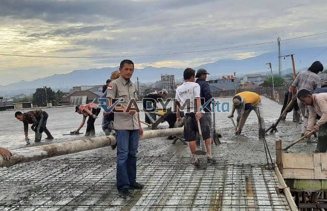

**Jasa Cor Readymix di Bojong Depok Murah** - Hai Mitra Readymix Kita! Gimana kabarnya? Proyek konstruksi di Bojong Depok sedang berjalan? Nah, kami dari Readymix Kita siap jadi partner terpercaya Anda. Kami adalah penyedia jasa cor readymix yang berkomitmen memberikan solusi optimal untuk setiap kebutuhan pengecoran Anda di Bojong Depok dan sekitarnya. Dengan layanan cepat, kualitas terjamin, dan harga yang bersaing, percayakan kebutuhan beton Anda pada ahlinya!



## Mengapa Memilih Cor Readymix untuk Proyek Anda?

Beton readymix, atau beton cor siap pakai, dibuat dengan formula presisi di pabrik modern. Bahan-bahan berkualitas tinggi dicampur secara optimal, lalu diangkut langsung ke lokasi proyek menggunakan truk mixer. Metode ini menawarkan banyak keunggulan dibandingkan cara konvensional. Apa saja kelebihannya? Yuk, simak detailnya:

1. **Efisiensi Waktu & Biaya**

   Bayangkan, Anda tidak perlu lagi repot menyiapkan material, mencampur, dan mengangkut beton sendiri. Pengerjaan jadi lebih cepat, tenaga kerja bisa dialokasikan ke tugas lain, dan efisiensi biaya pun meningkat.

2. **Kualitas Konsisten dan Terukur**

   Proses produksi yang terkontrol di pabrik menjamin kualitas beton yang seragam dan sesuai standar.  Setiap batch beton readymix melalui pengujian ketat, meminimalkan risiko kegagalan struktur.

3. **Kapasitas Produksi Fleksibel**

   Butuh beton dalam jumlah besar untuk proyek skala besar? Atau hanya sedikit untuk perbaikan kecil? Kami siap memenuhi kebutuhan Anda dengan fleksibilitas tinggi.

4. **Dukungan Ramah Lingkungan**

   Dengan meminimalkan limbah material di lokasi proyek, beton readymix turut berkontribusi pada praktik konstruksi yang lebih berkelanjutan.

## Keunggulan ReadymixKita di Bojong Depok

Diantara banyaknya supplier beton di Bojong Depok, **ReadymixKita** hadir dengan diferensiasi yang jelas. Kami bukan sekadar penyedia material, tapi mitra yang memahami tantangan proyek Anda.

1. **Pengalaman dan Reputasi Teruji**

   Bertahun-tahun berkecimpung di industri konstruksi menjadikan kami ahli dalam memahami karakter proyek, mulai dari perumahan, bangunan komersial, hingga infrastruktur publik.

2. **Pilihan Mutu Beton yang Lengkap**

   Kami menyediakan beragam kelas mutu beton, mulai dari K-225, K-300, K-350, hingga K-500. Konsultasikan kebutuhan spesifik proyek Anda, dan kami akan merekomendasikan mutu yang paling tepat.

3. **Layanan Pengecoran Modern dengan Concrete Pump**

   Dilengkapi dengan armada concrete pump yang handal, kami memastikan proses pengecoran berjalan cepat, presisi, dan merata, bahkan di area yang sulit dijangkau.

4. **Tim Profesional yang Siap Membantu**

   Kami memiliki tim yang terdiri dari ahli beton, operator pompa, dan tenaga pendukung yang kompeten. Kami siap memberikan konsultasi, bantuan teknis, dan layanan purna jual yang memuaskan.

## Layanan Kami yang Disesuaikan untuk Bojong Depok

Kami memahami betul karakteristik wilayah Bojong Depok Murah. Medan yang bervariasi, dari area perkotaan padat hingga kawasan perbukitan, membutuhkan pendekatan khusus. **ReadymixKita** hadir dengan solusi yang tepat:

1. **Pengiriman Tepat Waktu, Jangkauan Luas**

   Lokasi pabrik kami yang strategis di Bojong Depok memungkinkan kami menjamin pengiriman beton cepat dan tepat waktu ke seluruh wilayah Bojong Depok Murah dan sekitarnya.

2. **Konsultasi Gratis & Perencanaan Matang**

   Bingung memilih jenis beton yang sesuai? Tim ahli kami siap memberikan konsultasi gratis untuk membantu Anda merencanakan kebutuhan beton secara optimal.

3. **Penawaran Spesial untuk Proyek Lokal**

   Kami memberikan penawaran khusus dan diskon menarik untuk proyek konstruksi yang berlokasi di Bojong Depok Murah.

## Harga Beton Readymix Bojong Depok yang Bersaing

Kami percaya bahwa kualitas tidak harus mahal. **ReadymixKita** berkomitmen untuk memberikan harga beton readymix yang kompetitif di Bojong Depok Murah, tanpa mengorbankan mutu.

1. **Transparansi Harga**

   Kami memberikan rincian harga yang jelas dan transparan, termasuk biaya beton per kubik, biaya pengiriman, dan biaya tambahan (jika ada).

2. **Promo Menarik & Diskon Volume**

   Nikmati promo menarik dan diskon khusus untuk pemesanan dalam jumlah besar atau proyek jangka panjang.

3. **Jaminan Kepuasan Pelanggan**

   Kami memberikan jaminan kepuasan pelanggan. Jika Anda tidak puas dengan layanan kami, tim kami akan segera memberikan solusi terbaik.

## Daftar Harga Terkini & Penawaran Khusus



Jangan tunda lagi! Bangun proyek impian Anda dengan beton readymix berkualitas dari **ReadymixKita** di Bojong Depok Murah.  Dapatkan penawaran harga terbaik dan konsultasi gratis sekarang!

Kami siap membantu mewujudkan proyek Anda. Hubungi kami untuk mendapatkan solusi pengecoran yang tepat, efisien, dan terpercaya.  Dengan **ReadymixKita**, konstruksi Anda akan lebih solid dan tahan lama! [Jasa Cor Readymix di Abadijaya Depok Murah](/readymix/jasa-cor-readymix-di-abadijaya-depok-murah/)