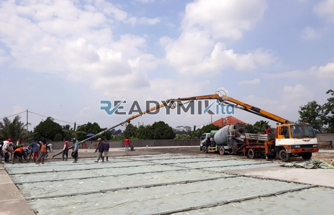

**Jasa Cor Readymix di Bojong Genteng Sukabumi Murah** - Hai Mitra Readymix Kita! Punya proyek konstruksi di Bojong Genteng Sukabumi dan mencari solusi pengecoran yang cepat, efisien, serta terpercaya? Nah, Anda sudah berada di tempat yang tepat! Kami, Readymix Kita, hadir sebagai penyedia jasa cor readymix terkemuka yang siap mendukung kesuksesan proyek Anda. Permasalahan lambatnya pengerjaan atau kualitas beton yang kurang konsisten? Itu bukan lagi masalah!



## Mengapa Memilih Cor Readymix untuk Proyek Anda?

Kira-kira, apa sih yang membuat beton readymix begitu digemari di dunia konstruksi? Sederhananya, beton readymix adalah campuran beton yang dibuat di pabrik dengan formula presisi, lalu diantar langsung ke lokasi proyek Anda menggunakan truk mixer khusus. Ini berbeda dengan metode tradisional yang memerlukan pencampuran di lokasi. Apa saja kelebihannya? Mari kita lihat:

1. **Hemat Waktu & Tenaga Kerja**

   Pencampuran beton di lokasi membutuhkan waktu dan sumber daya manusia yang lumayan besar. Dengan readymix, Anda bisa langsung fokus pada tahapan konstruksi lainnya.

2. **Kualitas Terjamin Konsisten**

   Proses produksi yang terkontrol di pabrik memastikan setiap batch beton memiliki kualitas yang seragam dan sesuai standar.

3. **Skalabilitas – Cocok untuk Segala Ukuran Proyek**

   Baik proyek kecil seperti pembangunan rumah hingga proyek besar seperti gedung bertingkat, readymix mampu menyediakan volume beton yang sesuai kebutuhan. 

4. **Minimalkan Limbah Konstruksi & Lebih Ramah Lingkungan**

   Proses produksi readymix yang terkelola dengan baik menghasilkan limbah yang lebih sedikit dibandingkan pencampuran tradisional.

## Keunggulan Readymix Kita di Bojong Genteng Sukabumi

Di antara sekian banyak penyedia jasa, apa yang membedakan Readymix Kita di Bojong Genteng Sukabumi? Kami tidak hanya menawarkan beton berkualitas, tapi juga pengalaman dan pelayanan yang dirancang untuk memenuhi kebutuhan unik Anda:

1. **Pengalaman & Kepercayaan yang Teruji**

   Kami telah lama berkecimpung di industri konstruksi, dengan rekam jejak proyek yang sukses di berbagai skala. 

2. **Pilihan Mutu Beton yang Lengkap**

   Kami menyediakan berbagai pilihan mutu beton, mulai dari K-225 untuk pekerjaan ringan hingga K-500 untuk struktur berat. Pilihan yang tepat untuk memastikan kekuatan dan ketahanan bangunan Anda.

3. **Dilengkapi Peralatan Mutakhir, Termasuk Concrete Pump**

   Kami berinvestasi pada peralatan modern seperti pompa beton (concrete pump) untuk memastikan pengecoran cepat, merata, dan efisien.

4. **Didukung Tim Profesional yang Kompeten**

   Tim kami terdiri dari para ahli yang siap memberikan konsultasi terbaik, mulai dari perencanaan hingga pelaksanaan pengecoran.

## Layanan Kami yang Dirancang Khusus untuk Bojong Genteng Sukabumi

Sebagai penyedia jasa lokal, kami memahami betul tantangan dan kebutuhan konstruksi di Bojong Genteng Sukabumi dan sekitarnya. Kondisi geografis yang beragam, mulai dari dataran hingga perbukitan, memerlukan solusi khusus:

1. **Pengiriman Tepat Waktu, Melayani Seluruh Wilayah Bojong Genteng Sukabumi**

   Kami berkomitmen untuk mengirimkan beton readymix tepat waktu, memastikan kelancaran jadwal proyek Anda. Lokasi pabrik kami yang strategis mendukung pengiriman cepat ke seluruh area Bojong Genteng Sukabumi.

2. **Konsultasi Gratis untuk Kebutuhan Proyek Anda**

   Bingung memilih jenis beton yang tepat? Jangan khawatir! Kami menyediakan layanan konsultasi gratis untuk membantu Anda menentukan solusi terbaik.

3. **Penawaran Spesial untuk Proyek di Bojong Genteng Sukabumi**

   Sebagai bentuk dukungan kami terhadap pembangunan di Bojong Genteng Sukabumi, kami menawarkan harga spesial dan diskon menarik untuk proyek-proyek lokal.

## Harga Terjangkau & Penawaran Menarik di Bojong Genteng Sukabumi

Kami percaya bahwa kualitas tinggi tidak harus mahal. Oleh karena itu, Readymix Kita menawarkan:

1. **Harga Kompetitif & Transparan**

   Kami menawarkan harga yang bersaing tanpa mengorbankan kualitas beton readymix. Informasi harga yang jelas dapat Anda temukan di tabel di bawah ini.

2. **Promo & Diskon Berlimpah**

   Dapatkan potongan harga menarik untuk pemesanan dalam jumlah besar atau proyek jangka panjang.

3. **Kepuasan Anda adalah Prioritas Kami**

   Kami menjamin kualitas layanan dan beton readymix yang kami berikan. Jika ada kendala, tim kami siap membantu hingga proyek Anda selesai dengan memuaskan.

## Daftar Harga Jasa Cor Readymix di Bojong Genteng Sukabumi



Jangan tunda lagi! Percayakan proyek Anda pada ahlinya. Hubungi kami sekarang dan dapatkan penawaran terbaik untuk jasa pengecoran readymix di Bojong Genteng Sukabumi! Kami juga siap melakukan survei lokasi dan memberikan konsultasi gratis. Pesan sekarang dan rasakan sendiri bagaimana beton readymix berkualitas tinggi dapat mempercepat dan menyempurnakan proyek Anda.

Dengan Readymix Kita, Anda tidak hanya mendapatkan beton berkualitas, tapi juga mitra yang siap membantu mewujudkan bangunan yang kokoh, aman, dan tahan lama di Bojong Genteng Sukabumi. [Jasa Cor Readymix di Balaraja Tangerang Murah](/readymix/jasa-cor-readymix-di-balaraja-tangerang-murah/) juga merupakan salah satu layanan kami yang populer. Segera hubungi kami untuk memulai proyek impian Anda!