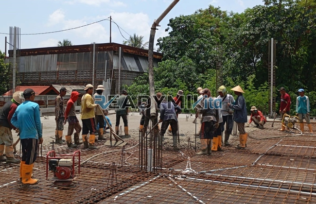

**Jasa Cor Readymix di Bojongkerta Bogor Murah** - Hai Mitra Readymix Kita! Punya proyek konstruksi di Bojongkerta Bogor? Banyak tantangan yang muncul, mulai dari urusan material hingga efisiensi waktu. Nah, kami hadir sebagai solusi tepat! Readymix Kita menyediakan jasa cor readymix berkualitas tinggi dan layanan sewa concrete pump yang siap mendukung proyek Anda, apapun skalanya.



## Mengapa Memilih Pengecoran dengan Readymix?

Apa sih yang membuat beton readymix jadi pilihan cerdas? Sederhananya, beton readymix adalah campuran beton yang dibuat di pabrik modern dengan presisi tinggi. Bahan baku terbaik diproses secara terkontrol dan kemudian diantar langsung ke lokasi proyek menggunakan truk mixer. Ini beda banget dengan cara tradisional, lho! Keunggulannya? Coba lihat daftar berikut:

1. **Hemat Waktu & Tenaga:** Pikiran nggak lagi pusing soal mencampur beton di lokasi proyek. Semuanya sudah beres di pabrik, jadi waktu dan tenaga kerja Anda bisa dialokasikan untuk hal lain.
2. **Kualitas Terjamin:** Formulasi beton yang akurat dan pengawasan mutu yang ketat memastikan Anda mendapatkan beton dengan kualitas konsisten dan terpercaya. Risiko kesalahan pencampuran? Minim banget!
3. **Skala Proyek Fleksibel:** Butuh beton dalam jumlah kecil untuk perbaikan rumah? Atau dalam volume besar untuk membangun gedung bertingkat? Beton readymix siap memenuhi kebutuhan Anda.
4. **Dukungan Ramah Lingkungan:** Proses produksi yang terkendali membantu mengurangi limbah material, sehingga lebih ramah terhadap lingkungan.

## Keunggulan ReadymixKita di Bojongkerta Bogor

Di antara banyaknya penyedia jasa pengecoran, **ReadymixKita** menonjol sebagai pilihan terbaik di Bojongkerta Bogor. Kenapa? Ini dia alasannya:

1. **Pengalaman Luas Terpercaya:**  Kami sudah lama berkecimpung di dunia konstruksi dan memahami betul seluk-beluk pembangunan di Bojongkerta Bogor. Pengalaman ini jadi modal berharga untuk melayani Anda.
2. **Pilihan Mutu Beton Lengkap:**  Mau beton K-225 yang standar atau K-500 yang super kuat? Kami sediakan semuanya! Pilihan mutu beton kami beragam, disesuaikan dengan kebutuhan spesifik proyek Anda.
3. **Teknologi Modern:** Kami berinvestasi pada peralatan canggih, termasuk pompa beton (concrete pump) yang memudahkan dan mempercepat proses pengecoran, terutama di lokasi yang sulit dijangkau.
4. **Tim Profesional & Responsif:**  Tim kami bukan cuma ahli di bidangnya, tapi juga siap memberikan dukungan dan konsultasi dari awal hingga akhir proyek. Fleksibilitas pelayanan adalah prioritas kami.

## Layanan Kami yang Terdepan di Bojongkerta Bogor

Sebagai penyedia lokal, kami sangat memahami karakteristik wilayah Bojongkerta Bogor. Mulai dari kontur tanah yang beragam, hingga kebutuhan konstruksi yang spesifik. Karena itu, kami menawarkan layanan yang dirancang khusus untuk Anda:

1. **Pengiriman Tepat Waktu:** Kami menjamin beton sampai di lokasi proyek tepat waktu, menghindari keterlambatan yang dapat mengganggu jadwal kerja Anda.
2. **Konsultasi Teknis Gratis:** Bingung memilih jenis beton yang tepat? Butuh saran tentang metode pengecoran? Jangan ragu konsultasi dengan tim ahli kami, tanpa biaya!
3. **Penawaran Spesial untuk Proyek Lokal:**  Khusus untuk proyek di Bojongkerta Bogor dan sekitarnya, kami berikan harga spesial dan penawaran menarik lainnya.

## Harga Beton Readymix yang Bersaing di Bojongkerta Bogor

Kami paham betul pentingnya anggaran dalam setiap proyek. **ReadymixKita** menawarkan:

1. **Harga Kompetitif:** Kami berkomitmen memberikan harga yang bersaing tanpa mengorbankan kualitas. Untuk informasi lebih detail, lihat tabel harga di atas atau hubungi kami.
2. **Promo Menarik:** Dapatkan diskon khusus untuk pemesanan dalam jumlah besar atau proyek dengan durasi panjang.
3. **Kepuasan Pelanggan Prioritas:**  Kami berikan garansi kepuasan. Jika ada masalah dalam proses pengecoran, tim kami akan segera membantu sampai tuntas.

## Update Harga Jasa Cor Readymix di Bojongkerta Bogor



Yuk, jangan tunda lagi! Pastikan proyek Anda dibangun dengan material berkualitas tinggi dan layanan yang profesional. Hubungi **ReadymixKita** sekarang juga untuk mendapatkan solusi pengecoran terbaik di Bojongkerta Bogor! Kami siap membantu mewujudkan bangunan impian Anda.

Butuh informasi lebih lanjut? Silakan hubungi tim kami untuk survei lokasi gratis dan konsultasi proyek Anda. Manfaatkan promo menarik yang sedang berlangsung! Bersama ReadymixKita, bangunan Anda akan berdiri kokoh dan tahan lama. [Jasa Cor Readymix di Babakan Bogor Murah](/readymix/jasa-cor-readymix-di-babakan-bogor-murah/) bisa menjadi referensi Anda.