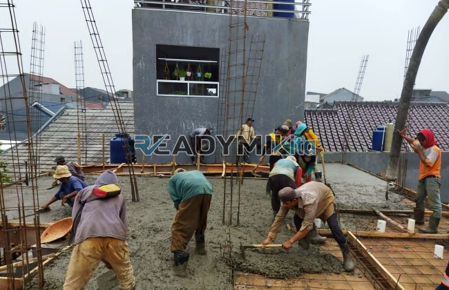

**Jasa Cor Readymix di Bojongsari Baru Depok Murah** - Hai Mitra Readymix Kita! Apakah Anda tengah merencanakan pembangunan di Bojongsari Baru Depok? Mencari beton berkualitas yang bisa diandalkan untuk proyek Anda? Nah, Anda berada di tempat yang tepat! Kami dari Readymix Kita hadir sebagai solusi pengecoran readymix yang efisien, terpercaya, dan tentu saja, dengan harga yang bersahabat. Kami siap mendukung kesuksesan proyek konstruksi Anda di Bojongsari Baru Depok Murah.



## Mengapa Memilih Beton Readymix?

Beton readymix, atau beton cor siap pakai, adalah pilihan cerdas untuk berbagai proyek konstruksi. Diproduksi secara presisi di pabrik dengan kontrol kualitas ketat, beton ini diantar langsung ke lokasi Anda dengan truk mixer. Apa saja kelebihannya? Mari kita simak:

1. **Hemat Waktu dan Tenaga**

   Pencampuran beton di lokasi proyek seringkali memakan waktu dan membutuhkan tenaga kerja yang cukup banyak. Dengan readymix, proses ini sudah dilakukan di pabrik, menghemat waktu dan energi Anda.

2. **Kualitas Terjamin Konsisten**

   Campuran beton readymix diformulasikan dengan takaran yang tepat dan menggunakan peralatan modern. Hal ini menjamin kualitas yang konsisten setiap saat, mengurangi risiko kegagalan struktur.

3. **Fleksibilitas Volume Produksi**

   Apakah proyek Anda berskala kecil atau besar? Beton readymix dapat diproduksi dalam volume yang sesuai kebutuhan, sehingga sangat fleksibel.

4. **Berkontribusi pada Lingkungan yang Lebih Baik**

   Proses produksi yang terkontrol di pabrik meminimalkan limbah material di lokasi konstruksi, menjadikan beton readymix pilihan yang lebih ramah lingkungan.

## Keunggulan Jasa Readymix Kita di Bojongsari Baru Depok

Di antara banyaknya penyedia jasa pengecoran, **ReadymixKita** menonjol dengan berbagai kelebihan yang menjadikannya mitra ideal Anda di Bojongsari Baru Depok:

1. **Pengalaman dan Keandalan yang Teruji**

   Kami telah lama berkecimpung di industri konstruksi, berbekal pengalaman bertahun-tahun untuk memahami setiap tantangan proyek, baik itu bangunan residensial maupun infrastruktur.

2. **Pilihan Mutu Beton yang Lengkap**

   Kami menawarkan beragam pilihan mutu beton, mulai dari K-225 untuk kebutuhan standar hingga K-500 untuk struktur yang memerlukan kekuatan ekstra.  Tersedia solusi yang pas untuk setiap kebutuhan proyek Anda.

3. **Didukung Peralatan Canggih**

   Kami berinvestasi pada peralatan modern, termasuk pompa beton (concrete pump), untuk memastikan proses pengecoran berjalan lancar, cepat, dan merata.

4. **Tim Profesional yang Siap Membantu**

   Tim kami yang berpengalaman siap memberikan pendampingan, mulai dari perencanaan hingga pelaksanaan di lapangan. Kami juga fleksibel dalam menyesuaikan jadwal dengan kebutuhan proyek Anda.

## Solusi Pengecoran Tepat Sasaran di Bojongsari Baru Depok

Sebagai penyedia jasa lokal, **ReadymixKita** memahami betul karakteristik wilayah Bojongsari Baru Depok dan sekitarnya. Kami siap mengatasi berbagai tantangan, termasuk variasi kondisi medan yang ada.

1. **Pengiriman Tepat Waktu**

   Lokasi pabrik kami strategis di Bojongsari Baru Depok, memungkinkan kami menjamin pengiriman beton yang cepat dan tepat waktu.

2. **Konsultasi Proyek Gratis**

   Kami menyediakan layanan konsultasi gratis untuk membantu Anda memilih jenis beton dan metode pengecoran yang paling sesuai dengan proyek Anda.

3. **Penawaran Spesial untuk Pelanggan Lokal**

   Bagi pelanggan di Bojongsari Baru Depok, kami menawarkan harga spesial dan diskon menarik untuk proyek-proyek besar.

## Harga Bersahabat dan Promo Menarik di Bojongsari Baru Depok

Kami memahami bahwa anggaran merupakan pertimbangan penting dalam setiap proyek konstruksi. Oleh karena itu, **ReadymixKita** berkomitmen untuk memberikan:

1. **Harga yang Kompetitif**

   Kami menawarkan harga yang bersaing tanpa mengorbankan kualitas beton readymix yang kami sediakan. Informasi harga yang transparan, termasuk biaya pengiriman dan penggunaan pompa beton, tersedia bagi Anda.

2. **Promo Eksklusif**

   Nikmati diskon menarik untuk pemesanan dalam jumlah besar atau proyek pembangunan jangka panjang.

3. **Kepuasan Anda Adalah Prioritas Kami**

   Kami akan berusaha semaksimal mungkin untuk menyelesaikan pekerjaan dengan baik. Apabila ada kendala, tim kami siap membantu hingga proyek Anda berjalan mulus.

## Informasi Harga Jasa Cor Readymix di Bojongsari Baru Depok



Jangan tunda lagi! Hubungi kami sekarang untuk mendapatkan solusi pengecoran terbaik di Bojongsari Baru Depok Murah.

Kami juga menyediakan layanan survei lokasi gratis dan konsultasi proyek untuk memastikan kebutuhan Anda terpenuhi secara optimal. Pesan sekarang dan rasakan ketenangan pikiran dengan hasil konstruksi yang solid dan memuaskan. [Jasa Cor Readymix di Abadijaya Depok Murah](/readymix/jasa-cor-readymix-di-abadijaya-depok-murah/) juga tersedia, lho! Di ReadymixKita, kami berdedikasi untuk memberikan layanan terbaik kepada setiap pelanggan. Dengan pengalaman, kualitas terjamin, dan pelayanan yang ramah, kami siap menjadi mitra terpercaya Anda dalam mewujudkan proyek impian. Segera hubungi kami dan rasakan sendiri kualitas jasa Pengecoran dengan Cor Readymix di Bojongsari Baru Depok dari ReadymixKita. Bersama, kita bangun masa depan yang lebih kuat!