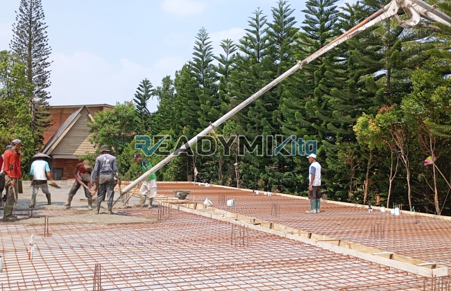

**Jasa Cor Readymix di Bondongan Bogor Murah** - Hai Mitra Readymix Kita! Apakah Anda sedang membangun di Bondongan Bogor dan mencari solusi pengecoran yang cepat, praktis, dan berkualitas? Nah, Anda sudah berada di tempat yang tepat! Kami dari Readymix Kita hadir sebagai penyedia beton cor readymix terpercaya di Bondongan Bogor Murah, siap mendukung kelancaran proyek konstruksi Anda.



## Mengapa Memilih Beton Readymix untuk Proyek Anda?

Material konstruksi yang tepat adalah kunci keberhasilan sebuah proyek. Beton readymix menjadi pilihan cerdas karena kemudahan dan keunggulannya. Tapi, apa sebenarnya beton readymix itu? Beton Cor Readymix adalah campuran beton yang diproduksi di pabrik dengan presisi tinggi, menggunakan bahan baku pilihan yang terjamin kualitasnya. Kemudian, beton ini diangkut menggunakan truk mixer khusus dan langsung dituang di lokasi proyek Anda. Dibandingkan metode konvensional, beton readymix menawarkan sejumlah keunggulan yang signifikan:

1. **Efisiensi Waktu dan Tenaga Kerja**

   Proses pencampuran di lokasi proyek seringkali memakan waktu dan membutuhkan tenaga kerja yang tidak sedikit. Dengan menggunakan beton readymix, Anda bisa menghemat waktu dan tenaga karena pencampuran sudah dilakukan secara profesional di pabrik kami.

2. **Jaminan Konsistensi Kualitas**

   Beton Cor Readymix diproduksi dengan takaran yang akurat dan peralatan modern, sehingga menghasilkan kualitas beton yang konsisten dan dapat diandalkan. Hal ini meminimalkan risiko kegagalan struktur akibat kesalahan pencampuran.

3. **Kemampuan Produksi Skala Besar**

   Kapasitas produksi beton Cor Readymix kami sangat besar, sehingga mampu memenuhi kebutuhan proyek dengan volume berapa pun, mulai dari proyek rumahan hingga proyek konstruksi berskala besar.

4. **Dukungan untuk Pembangunan Berkelanjutan**

   Proses produksi beton Cor Readymix yang terkontrol membantu mengurangi limbah material dan dampaknya terhadap lingkungan.

## Apa yang Membuat ReadymixKita Unggul di Bondongan Bogor?

Di antara banyaknya penyedia jasa pengecoran di Bondongan Bogor Murah, **ReadymixKita** hadir sebagai solusi yang paling tepat karena berbagai keunggulan yang kami tawarkan:

1. **Pengalaman dan Reputasi Terpercaya**

   Dengan pengalaman bertahun-tahun di industri konstruksi, kami memahami betul kebutuhan setiap proyek. Kami telah berhasil menyelesaikan berbagai proyek, mulai dari pembangunan rumah, gedung komersial, hingga proyek infrastruktur.

2. **Pilihan Mutu Beton yang Lengkap**

   Kami menyediakan beragam kelas mutu beton, mulai dari K-225 untuk kebutuhan standar hingga K-500 untuk konstruksi yang membutuhkan kekuatan ekstra. Pilihan mutu beton kami disesuaikan dengan kebutuhan spesifik proyek Anda.

3. **Teknologi Pengecoran Modern**

   Kami menggunakan peralatan pengecoran modern, termasuk pompa beton (concrete pump) yang handal, untuk memastikan pengecoran berlangsung cepat, merata, dan tepat sasaran.

4. **Tim Ahli yang Berdedikasi**

   Kami memiliki tim profesional yang berpengalaman dan siap memberikan dukungan penuh, mulai dari perencanaan hingga pelaksanaan di lokasi. Kami juga fleksibel dalam menyesuaikan jadwal dengan kebutuhan proyek Anda.

## Layanan Kami yang Disesuaikan untuk Bondongan Bogor

Sebagai penyedia jasa lokal di Bondongan Bogor, kami memahami betul karakteristik dan tantangan konstruksi di daerah ini. Kami menawarkan layanan yang dirancang khusus untuk menjawab kebutuhan tersebut:

1. **Pengiriman Tepat Waktu**

   Lokasi pabrik kami yang strategis di Bondongan Bogor dan sekitarnya memungkinkan kami menjamin pengiriman beton yang cepat dan tepat waktu.

2. **Konsultasi Ahli Gratis**

   Kami menyediakan layanan konsultasi gratis untuk membantu Anda memilih jenis beton dan metode pengecoran yang paling sesuai dengan kebutuhan proyek Anda.

3. **Penawaran Khusus untuk Pelanggan Lokal**

   Para pelanggan di wilayah Bondongan Bogor berkesempatan mendapatkan harga spesial dan diskon menarik untuk proyek-proyek besar.

## Harga yang Bersahabat dan Promo Menarik di Bondongan Bogor

Kami memahami bahwa anggaran adalah pertimbangan penting dalam setiap proyek konstruksi. Oleh karena itu, **ReadymixKita** berkomitmen untuk menyediakan:

1. **Harga yang Kompetitif**

   Kami menawarkan harga yang kompetitif tanpa mengorbankan kualitas beton dan layanan kami. Informasi harga yang transparan, termasuk biaya pengiriman dan biaya tambahan untuk pompa beton, tersedia bagi Anda.

2. **Promo & Diskon Eksklusif**

   Manfaatkan diskon menarik untuk pemesanan dalam jumlah besar atau proyek jangka panjang. Ada banyak promo menarik lainnya yang bisa Anda nikmati!

3. **Jaminan Kepuasan Pelanggan**

   Kepuasan Anda adalah prioritas utama kami. Jika ada kendala selama proses pengecoran, tim kami akan siap membantu menyelesaikan masalahnya sampai proyek Anda selesai dengan baik.

## Informasi Harga Jasa Cor Readymix di Bondongan Bogor



Jangan tunda lagi! Hubungi kami sekarang dan dapatkan penawaran terbaik untuk kebutuhan pengecoran Anda di Bondongan Bogor! [Tunggu apa lagi?](https://wa.me/nomor_telepon)

Kami juga menawarkan layanan survei lokasi dan konsultasi gratis untuk memastikan Anda mendapatkan solusi pengecoran yang tepat. Pesan sekarang dan rasakan hasil konstruksi yang solid, awet, dan memuaskan. 

Kepuasan Anda adalah tujuan kami. Dengan pengalaman, kualitas, dan pelayanan terbaik, kami yakin dapat menjadi mitra yang andal dalam mewujudkan proyek impian Anda. Segera hubungi kami dan rasakan keunggulan jasa Pengecoran dg Cor Readymix di Bondongan Bogor dari ReadymixKita. Mari bangun masa depan yang kokoh bersama! [Dapatkan penawaran khusus hari ini!](https://wa.me/nomor_telepon)