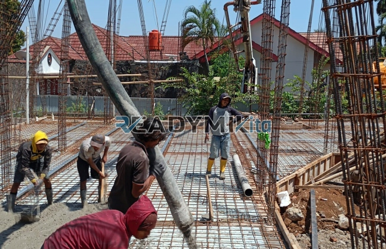

**Jasa Cor Readymix di Bubulak Bogor Murah** - Hai Mitra Readymix Kita! Butuh solusi pengecoran cepat dan berkualitas untuk proyek Anda di Bubulak Bogor? Kami hadir sebagai jawaban tepat! Sebagai penyedia beton cor readymix terpercaya, kami siap mendukung kelancaran konstruksi Anda dengan mutu terjamin dan layanan prima. Nah, yuk simak lebih lanjut apa yang bisa kami tawarkan untuk proyek Anda.



## Mengapa Memilih Beton Readymix untuk Proyek Anda?

Apakah Anda familiar dengan beton readymix? Sederhananya, beton readymix adalah campuran beton yang diproduksi di pabrik dengan formula presisi menggunakan material pilihan. Setelah jadi, beton ini diangkut menggunakan truk mixer langsung ke lokasi proyek Anda. Menggunakan beton readymix ini punya banyak keuntungan dibanding metode tradisional, lho. Ini dia beberapa alasannya:

1. **Hemat Waktu & Efisien**

   Proses pembuatan beton di lokasi konstruksi seringkali memakan waktu dan tenaga. Dengan beton readymix, Anda bisa mempercepat penyelesaian proyek karena pencampuran sudah dilakukan secara profesional di pabrik.

2. **Kualitas Terjaga Konsisten**

   Beton readymix dibuat dengan takaran yang akurat dan teknologi modern, menjamin kualitas yang seragam. Ini mengurangi risiko kegagalan struktur akibat kesalahan dalam pencampuran manual.

3. **Skala Produksi Fleksibel**

   Kebutuhan beton bisa bervariasi. Beton readymix bisa disediakan dalam jumlah besar dalam waktu singkat, ideal untuk proyek skala kecil maupun besar.

4. **Berkontribusi pada Lingkungan**

   Proses produksi beton readymix yang lebih terkontrol dapat membantu mengurangi limbah material konstruksi, menjadikannya pilihan yang lebih ramah lingkungan.

## Apa yang Membuat ReadymixKita Unggul di Bubulak Bogor?

Di tengah banyaknya pilihan penyedia jasa pengecoran, **ReadymixKita** menawarkan keunggulan khusus yang membuktikan kami adalah partner terbaik untuk proyek Anda di Bubulak Bogor:

1. **Pengalaman & Kepercayaan**

   Kami memiliki pengalaman bertahun-tahun di industri konstruksi. Pemahaman mendalam ini memungkinkan kami menanggapi kebutuhan unik setiap proyek, mulai dari perumahan, bangunan komersial, hingga infrastruktur.

2. **Pilihan Mutu Beton yang Beragam**

   Kami menyediakan berbagai kelas mutu beton, termasuk K-225 untuk kebutuhan standar hingga K-500 untuk konstruksi yang membutuhkan kekuatan ekstra. Kami bantu Anda memilih mutu yang paling sesuai untuk proyek Anda.

3. **Teknologi Pengecoran Modern**

   Kami mengoperasikan peralatan pengecoran canggih, seperti concrete pump, untuk memastikan pengecoran yang cepat, rata, dan efisien.

4. **Tim Profesional yang Responsif**

   Tim profesional kami siap mendampingi Anda dari tahap perencanaan hingga pelaksanaan di lokasi proyek. Kami fleksibel dan bisa menyesuaikan layanan dengan jadwal proyek Anda.

## Layanan Kami yang Disesuaikan untuk Bubulak Bogor

Sebagai penyedia layanan lokal, kami memahami betul kondisi konstruksi di Bubulak Bogor. Kami menyadari adanya variasi medan, mulai dari area perkotaan yang padat hingga wilayah perbukitan. **ReadymixKita** berkomitmen memberikan layanan khusus untuk menjawab tantangan tersebut:

1. **Pengiriman Tepat Waktu**

   Kami menjamin pengiriman beton tepat waktu berkat lokasi pabrik kami yang strategis di Bubulak Bogor dan sekitarnya.

2. **Konsultasi Ahli Secara Gratis**

   Kami menawarkan konsultasi gratis untuk membantu Anda menentukan jenis beton yang paling tepat dan metode pengecoran yang ideal untuk proyek Anda.

3. **Penawaran Spesial untuk Proyek Lokal**

   Khusus bagi pelanggan di wilayah Bubulak Bogor, kami memberikan harga spesial dan diskon menarik untuk proyek-proyek berskala besar.

## Investasi Cerdas: Harga Terjangkau dan Promo Menarik di Bubulak Bogor

Kami mengerti bahwa anggaran adalah faktor penting dalam setiap proyek. Karena itu, **ReadymixKita** menawarkan:

1. **Harga yang Bersaing**

   Kami berkomitmen memberikan harga yang terjangkau tanpa mengorbankan kualitas produk dan layanan. Kami akan memberikan informasi harga yang transparan, termasuk biaya pengiriman dan penggunaan concrete pump.

2. **Promo yang Menguntungkan**

   Nikmati diskon menarik untuk pemesanan dalam jumlah besar atau proyek yang berlangsung dalam jangka waktu lama.

3. **Kepuasan Pelanggan Adalah Prioritas Kami**

   Kami memberikan garansi kepuasan. Jika terjadi kendala selama pengecoran, tim kami akan memberikan solusi hingga proyek Anda selesai dengan memuaskan.

## Informasi Harga Jasa Cor Readymix di Bubulak Bogor



Jangan biarkan kualitas proyek Anda terganggu oleh material yang kurang baik. Segera hubungi kami untuk solusi pengecoran terbaik di Bubulak Bogor!

Kami juga menyediakan layanan survei lokasi gratis dan konsultasi profesional untuk memastikan kebutuhan proyek Anda terpenuhi dengan sempurna. Pesan sekarang dan rasakan kemudahan membangun dengan beton berkualitas tinggi.

Tertarik? Jangan ragu untuk menghubungi kami guna mendapatkan penawaran terbaik untuk proyek Anda di Bubulak Bogor. Pilih ReadymixKita, partner terpercaya untuk konstruksi yang kuat dan tahan lama!