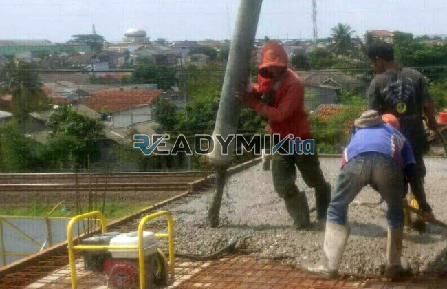

**Jasa Cor Readymix di Bukit Duri Jakarta Murah** - Hai Mitra Readymix Kita! Sedang merencanakan pembangunan di Bukit Duri Jakarta? Jangan biarkan kualitas fondasi jadi masalah! Kami dari Readymix Kita hadir sebagai solusi pengecoran readymix yang handal, efisien, dan yang pasti, terjangkau. Yuk, wujudkan proyek impian Anda dengan beton berkualitas terbaik!



## Mengapa Memilih Pengecoran dengan Readymix?

Mungkin Anda bertanya-tanya, apa sih kelebihan beton readymix dibandingkan mencampur sendiri di lokasi? Nah, beton Cor Readymix ini diproduksi di pabrik dengan kontrol kualitas ketat, menggunakan campuran bahan baku premium. Kemudian, campuran ini diangkut langsung ke proyek Anda menggunakan truk mixer khusus. Apa saja keuntungannya? Berikut ini beberapa alasannya:

1. **Hemat Waktu & Biaya Tenaga**

   Proses pencampuran di lokasi memakan waktu dan tenaga kerja yang signifikan. Dengan menggunakan readymix, Anda menghemat keduanya karena proses pencampuran sudah dilakukan secara efisien di pabrik.

2. **Kualitas Terjamin Konsisten**

   Beton readymix diproduksi dengan takaran dan teknologi modern yang presisi. Hal ini menjamin kualitas beton yang konsisten, sehingga mengurangi risiko kesalahan dan potensi kegagalan struktur.

3. **Fleksibilitas Kapasitas Produksi**

   Butuh beton dalam jumlah besar atau kecil? Readymix mampu memenuhi kebutuhan proyek Anda, skala apapun, dengan cepat dan tepat.

4. **Dampak Lingkungan yang Lebih Rendah**

   Proses produksi readymix yang terkontrol juga membantu mengurangi limbah material dan meminimalkan dampak negatif terhadap lingkungan.

## Kenapa Harus ReadymixKita di Bukit Duri Jakarta?

Banyak penyedia jasa readymix di luar sana, tapi kenapa harus memilih **ReadymixKita** untuk proyek Anda di Bukit Duri Jakarta? Ini dia alasannya:

1. **Pengalaman dan Reputasi Terpercaya**

   Selama bertahun-tahun, kami telah menjadi bagian dari berbagai proyek konstruksi, mulai dari rumah tinggal, gedung komersial, hingga infrastruktur. Pengalaman ini menjadikan kami paham betul kebutuhan setiap proyek.

2. **Pilihan Mutu Beton yang Lengkap**

   Kami menyediakan beragam mutu beton, seperti K-225 hingga K-500, memastikan Anda mendapatkan material yang sesuai dengan spesifikasi proyek Anda.

3. **Didukung Peralatan Modern**

   Kami berinvestasi pada peralatan pengecoran modern, termasuk concrete pump, untuk memastikan proses pengecoran berjalan cepat, merata, dan efisien.

4. **Tim Ahli yang Siap Membantu**

   Tim kami terdiri dari para profesional berpengalaman yang siap memberikan panduan dan solusi terbaik untuk proyek Anda, mulai dari perencanaan hingga eksekusi.

## Layanan Kami yang Dirancang untuk Bukit Duri Jakarta

Kami memahami betul karakteristik wilayah Bukit Duri Jakarta. Kondisi medan yang bervariasi, dari area padat penduduk hingga area perbukitan, membutuhkan solusi pengecoran yang tepat. **ReadymixKita** memberikan layanan khusus untuk memenuhi tantangan ini:

1. **Pengiriman Tepat Waktu**

   Lokasi pabrik kami yang strategis memungkinkan kami menjamin pengiriman beton tepat waktu ke lokasi proyek Anda di Bukit Duri Jakarta dan sekitarnya.

2. **Konsultasi Teknis Gratis**

   Bingung memilih jenis beton yang tepat? Tim kami siap memberikan konsultasi gratis untuk membantu Anda menentukan solusi terbaik.

3. **Penawaran Spesial untuk Proyek Lokal**

   Kami memberikan penawaran khusus, termasuk harga spesial dan diskon, untuk proyek-proyek konstruksi di wilayah Bukit Duri Jakarta.

## Harga Kompetitif dan Promo Menarik di Bukit Duri Jakarta

Kami percaya bahwa kualitas tidak harus mahal. Oleh karena itu, **ReadymixKita** berkomitmen untuk menawarkan:

1. **Harga yang Bersaing**

   Kami menawarkan harga yang kompetitif tanpa mengorbankan kualitas beton readymix kami. Kami juga transparan dalam memberikan informasi harga, termasuk biaya pengiriman dan penggunaan concrete pump.

2. **Promo dan Diskon Spesial**

   Dapatkan berbagai promo menarik, seperti diskon untuk pemesanan dalam jumlah besar atau proyek jangka panjang.

3. **Jaminan Kepuasan Pelanggan**

   Kami berkomitmen untuk memberikan layanan terbaik. Jika Anda mengalami masalah selama proses pengecoran, tim kami siap membantu sampai tuntas.

## Info Harga Jasa Cor Readymix di Bukit Duri Jakarta



Jangan biarkan kualitas beton jadi penghalang kesuksesan proyek Anda! Percayakan pengecoran Anda pada ahlinya. Hubungi kami sekarang untuk penawaran terbaik di Bukit Duri Jakarta!

Kami juga menyediakan layanan survei lokasi gratis untuk membantu Anda menentukan kebutuhan beton yang tepat. Segera pesan beton readymix dari ReadymixKita dan nikmati hasil konstruksi yang kuat, tahan lama, dan memuaskan. [Jasa Cor Readymix di Bali Mester Jakarta Murah](/readymix/jasa-cor-readymix-di-bali-mester-jakarta-murah/) — semoga juga bisa menjadi referensi tambahan untuk perbandingan. Bersama ReadymixKita, wujudkan bangunan impian Anda dengan fondasi yang kokoh!